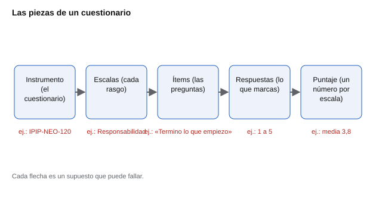

# 001 — Qué significa medir lo que no se ve


<!-- NAV -->
← (inicio del programa) · [📚 Parte 00](../README.md) · [🗺️ Índice 001–200](../../../PROGRAMA.md) · [002 — Del constructo al ítem: cómo nace una pregunta →](../002-del-constructo-al-item/README.md)
<!-- /NAV -->

**Parte 00 — Fundamentos de la medición psicológica** · Nivel fundamentos · 4 h · Estado `escrita`
**Pensada para:** quien construye un instrumento, quien lo interpreta y quien es evaluado.
**Prerrequisitos:** ninguno.

## ¿Para qué te sirve esto?

Alguien te entrega un informe que dice «responsabilidad: 84 puntos». ¿Es mucho? ¿Quién lo midió y con qué? ¿Qué cambiaría si respondieras de nuevo mañana? Estas preguntas valen igual para quien diseña la prueba, para quien la interpreta en un colegio o una empresa y para quien la contesta. Esta clase explica **qué se afirma realmente** cuando se dice que un cuestionario «mide» algo que nadie puede ver, y por qué esa afirmación necesita pruebas.

## Al terminar esta clase podrás

- Distinguir un constructo (la idea) de su indicador (lo que se observa).
- Explicar por qué un puntaje aislado no significa nada sin una referencia.
- Reconocer los dos modos en que falla la medición psicológica: ruido y desvío.
- Explicar por qué un test usa muchos ítems y no uno solo.

## La idea en palabras simples

Una cinta métrica toca el objeto que mide. Un cuestionario no toca la responsabilidad de nadie. Cuando una persona responde «Siempre estoy preparado» con un 4 de 5, lo único observado es **una marca en un formulario**. Todo lo demás es inferencia: de la marca a la conducta, de la conducta al rasgo.

Piensa en un médico que no puede ver la fiebre, pero ve el termómetro, la piel enrojecida y el cansancio. Ninguna señal es la fiebre; juntas la hacen creíble. La psicometría hace lo mismo con rasgos como la ansiedad o el interés vocacional: **reúne varias señales y examina si apuntan a una misma causa**.


*Figura 1.* La cadena completa. Cada flecha es un supuesto que puede fallar; la psicometría se ocupa de ponerlos a prueba.

## Las palabras que vas a ver en todo el programa

Antes de seguir conviene fijar el vocabulario, porque casi todo lo que viene se apoya en estas palabras. Un cuestionario se organiza así:



*Figura 2.* De izquierda a derecha, lo que contiene un cuestionario y lo que produce.

- **Instrumento** (también «test» o «cuestionario»): el conjunto completo de preguntas más las reglas para calcular resultados. Ejemplo: el IPIP-NEO-120, que tiene 120 preguntas.
- **Ítem:** una sola pregunta o afirmación del instrumento. Ejemplo: «Termino lo que empiezo».
- **Escala:** un grupo de ítems que apuntan al mismo rasgo. De cada escala sale un puntaje. Ejemplo: la escala «Responsabilidad».
- **Constructo:** la idea abstracta que cada escala intenta captar (la responsabilidad en sí, que no se ve).
- **Puntaje:** el número que resume las respuestas de una escala.

**Dos aclaraciones que evitan confusiones.**

1. **«Dominio público» no es el «dominio» de un constructo.** «Dominio público» es un estado legal: significa que nadie tiene los derechos de esas preguntas y cualquiera puede usarlas. Es lo que se dice, por ejemplo, de los ítems del IPIP-NEO-120. Que unas preguntas sean de dominio público **no prueba que midan bien**; solo prueba que se pueden usar libremente. El «dominio» de un constructo (clase 002) es otra cosa: el conjunto de contenidos que el rasgo abarca.
2. **Instrumento disponible no es lo mismo que instrumento validado.** Un instrumento puede estar disponible (se puede usar) y no estar validado (no hay estudios que muestren que mide lo que dice). Este programa te enseña a distinguir ambas cosas, y los instrumentos que incluye declaran su estado. Hay un glosario completo en la [guía de conceptos](../../../docs/GUIA_DE_CONCEPTOS.md).

## Un ejemplo completo, de principio a fin

Una orientadora de un colegio quiere saber cuán **perseverante** es Ana, de 15 años. No puede «ver» la perseverancia, así que usa una escala de cuatro ítems, con respuestas de 1 («nada de acuerdo») a 5 («totalmente de acuerdo»):

| Ítem | Tipo | Respuesta de Ana |
|---|---|---:|
| «Termino lo que empiezo.» | directo | 4 |
| «Me rindo con facilidad.» | invertido | 2 |
| «Sigo intentándolo aunque me cueste.» | directo | 5 |
| «Dejo las tareas a medias.» | invertido | 1 |

**Paso 1: reflejar los ítems invertidos.** En «Me rindo con facilidad» una respuesta alta significa *poca* perseverancia, así que se refleja: 6 − 2 = 4. Igual con el último: 6 − 1 = 5.
**Paso 2: promediar.** (4 + 4 + 5 + 5) / 4 = **4,5**.
**Paso 3: interpretar.** ¿4,5 es mucho? *No se puede saber todavía.* Faltan tres cosas: (a) con quién se compara Ana (un baremo, parte 06), (b) cuánto error tiene el puntaje (parte 02) y (c) si esas cuatro preguntas realmente captan perseverancia y no, por ejemplo, ganas de quedar bien (parte 03).

**Moraleja.** Entre la hoja de respuestas y la frase «Ana es muy perseverante» hay varios pasos que se pueden hacer bien o mal. Todo este programa trata de cómo hacerlos bien.

## Cómo funciona, paso a paso

**1. Constructo.** Es una abstracción que se postula para explicar regularidades. Nadie ha visto la extraversión; se postula porque quien va a muchas fiestas también tiende a hablar con desconocidos, y esas conductas covarían.

**2. Indicador.** Es algo observable que se supone relacionado con el constructo. El ítem «Hago amigos con facilidad» es un indicador de cordialidad. El error más común es tratar el indicador como si fuera el constructo: un puntaje alto en un test de ansiedad *no es* ansiedad, es un puntaje del que se infiere ansiedad, con un margen de error.

**3. El supuesto central.** Si varios indicadores distintos covarían, es razonable postular una causa común. Por eso un test tiene muchos ítems: un ítem aislado mezcla el rasgo con su circunstancia (quien responde «Siempre estoy preparado» puede estar pensando en el examen de ayer). Al promediar muchos ítems, las circunstancias particulares tienden a cancelarse y lo compartido, el rasgo, se acumula.

**4. Cómo puede fallar.** De dos maneras, y cada una tiene su parte en este programa:

- Los indicadores covarían **por otra cosa** (el estilo de respuesta, la deseabilidad social, el vocabulario): problema de **validez** (parte 03).
- Los indicadores covarían tan poco que no sostienen una causa común: problema de **fiabilidad** (parte 02).

**5. Medir un rasgo no es medir una longitud.**

| | Longitud | Rasgo psicológico |
|---|---|---|
| Unidad | Definida y constante (el metro) | No existe unidad natural |
| Cero | Absoluto y significativo | Arbitrario: no hay «cero responsabilidad» |
| Acceso | Directo | Solo por indicadores |
| Comparación | Universal | Requiere una muestra de referencia |

De la tabla se sigue la consecuencia más importante: **un puntaje psicológico aislado no significa nada**. Sacar 84 no es alto ni bajo hasta saber cuántos ítems tiene la escala, en qué rango se mueve y con quién se compara (parte 06).

## Si construyes el instrumento

- Define primero el constructo con palabras, antes de escribir un solo ítem (clase 002).
- Escribe varios indicadores por constructo; un ítem aislado casi nunca basta.
- Declara cuántos ítems tiene cada puntaje y cómo se calcula. Este repositorio nunca informa un puntaje bruto sin su media por ítem y su número de ítems respondidos.
- Anticipa las dos fallas: planifica cómo estimar la fiabilidad y cómo reunir evidencia de validez.

## Si eres evaluado

- Tu puntaje es una **inferencia**, no una medida directa. Es razonable preguntar con qué grupo te comparan y cuántos ítems respaldan cada resultado.
- Un solo número no resume quién eres. Pide siempre el contexto: para qué se usará y qué otra información existe.
- Si una persona sin formación te «lee» tu perfil como una verdad, desconfía: el perfil es una hipótesis que hay que contrastar.

## Qué muestra el laboratorio

`lab.py` simula un rasgo latente en 500 personas, genera respuestas a ítems que lo reflejan con ruido y calcula cuánto se parece el puntaje observado al rasgo verdadero a medida que se agregan ítems.


| Ítems | Correlación con el rasgo | r² |
|---:|---:|---:|
| 1 | 0,677 | 0,458 |
| 4 | 0,881 | 0,777 |
| 16 | 0,967 | 0,935 |
| 120 | 0,995 | 0,990 |

**Análisis.** (1) Con un solo ítem, el puntaje comparte menos de la mitad de su varianza con el rasgo (r² = 0,46): más de la mitad es ruido. (2) Cada duplicación de ítems ayuda menos que la anterior (rendimientos decrecientes): de 1 a 4 ítems se gana 0,20; de 16 a 120, solo 0,03. (3) Por eso el IPIP-NEO-120 tiene 120 ítems, pero también por eso no tiene 1.000: el costo es el tiempo y el cansancio de la persona (clase 014). (4) Es una simulación con ruido independiente; en la vida real, ítems mal redactados pueden compartir un error que no se cancela por más que se agreguen.

## Preguntas que suelen surgir

**¿Por qué no preguntar directamente «¿qué tan responsable eres?».** Se puede, pero esa única pregunta mezcla lo que la persona cree de sí misma, lo que quiere mostrar y lo que entendió por «responsable». Varias preguntas concretas, cada una con una pequeña desviación distinta, se compensan entre sí.

**¿Medir una persona no es reducirla a un número?** El número no es la persona: es una estimación de una característica en un momento, con un margen de error. Usado con cuidado, ayuda a decidir apoyos o a conocerse mejor; usado sin cuidado, etiqueta. Por eso el programa dedica una parte entera al uso responsable (parte 07).

**¿Sirve cualquier cuestionario que encuentre en internet?** No. Un cuestionario publicado en una revista o en una web puede estar bien o mal construido; para saberlo hay que mirar de dónde sale, quién lo estudió y para qué se probó. Esa revisión es la que se aprende aquí.

**Soy docente, psicóloga o gestor de personas: ¿esto me sirve si no hago estadística?** Sí. Las ideas centrales de esta clase (inferencia, ruido, referencia) se entienden sin fórmulas y te permiten leer con criterio cualquier informe que recibas o produzcas.

**Si me van a evaluar, ¿qué cambia saber todo esto?** Te permite hacer preguntas útiles: ¿para qué se usará el resultado?, ¿con quién me comparan?, ¿qué margen de error tiene?, ¿puedo ver mi informe completo?

## Errores frecuentes

- Confundir el indicador con el constructo.
- Creer que un número tiene sentido sin su referencia.
- Pensar que más ítems arreglan cualquier problema: no corrigen un desvío sistemático.
- Tratar la medición psicológica como «menos científica» por no ser directa: lo que exige es declarar y probar los supuestos.

## Lo mínimo que debes llevarte

1. Lo observado es una respuesta; el rasgo se infiere.
2. Varios indicadores que covarían sostienen mejor una causa común que uno solo.
3. La medición puede fallar por ruido (fiabilidad) o por desvío (validez).
4. Un puntaje sin referencia no significa nada.

## Ejercicios

- **Inicial.** Nombra un constructo y dos indicadores observables. *Ej.: «curiosidad»: preguntas que hace en clase; libros que pide prestados.*
- **Intermedio.** Un test de una sola pregunta («¿Eres feliz?») puede servir en algún caso. ¿En cuál? *Respuesta guía: cuando se busca un cribado rápido y se acepta un margen de error grande, y el constructo es simple y comprensible por todos.*
- **Avanzado.** Cambia el ruido de `lab.py` a 2,0 y estima cuántos ítems necesitas para alcanzar r = 0,95.
- **Aplicación.** Revisa un informe de evaluación real (anonimizado) y marca qué afirmaciones son observaciones y cuáles son inferencias.

## Glosario

- **Constructo:** idea abstracta que se postula para explicar conductas.
- **Indicador:** algo observable que se supone relacionado con el constructo.
- **Variable latente:** variable que no se observa y se infiere de indicadores.
- **Operacionalización:** decidir cómo se observará un constructo.
- **Inferencia:** conclusión que va más allá de lo directamente observado.

## Laboratorio

```bash
python classes/part-00-fundamentos-de-la-medicion/001-que-significa-medir-lo-que-no-se-ve/lab.py
python classes/part-00-fundamentos-de-la-medicion/001-que-significa-medir-lo-que-no-se-ve/figuras.py
```

## Autoevaluación y criterios

1. La estatura tiene un cero absoluto; la extraversión no. ¿Qué operaciones aritméticas deja de autorizar esa diferencia? 2. Si dos personas obtienen el mismo puntaje, ¿son iguales en el rasgo? ¿Qué necesitarías saber? 3. ¿Por qué un test usa muchos ítems?
Se logra la clase si puedes explicar la cadena de inferencia a alguien sin formación y dar un ejemplo de cada modo de falla.

## Fuentes

**Libros y artículos**
- Borsboom, D. (2005). *Measuring the Mind: Conceptual Issues in Contemporary Psychometrics*. Cambridge University Press. 🔎 sin verificar automáticamente (libro).
- Michell, J. (1999). *Measurement in Psychology*. Cambridge University Press. ✅ [DOI](https://doi.org/10.1017/cbo9780511490040)
- AERA, APA, & NCME (2014). *Standards for Educational and Psychological Testing*. 🔎 sin verificar automáticamente (norma).

Leyenda: ✅ existe en Crossref con título y año coincidentes; ⚠️ año o edición distinta; 🔎 pendiente de comprobar a mano. Confirmar la existencia de una fuente no prueba que respalde cada afirmación de la clase. Estado general en [`docs/VERIFICACION_BIBLIOGRAFIA.md`](../../../docs/VERIFICACION_BIBLIOGRAFIA.md).

---

<!-- NAV -->
← (inicio del programa)  
[📚 Parte 00](../README.md) · [🗺️ Índice 001–200](../../../PROGRAMA.md)  
[002 — Del constructo al ítem: cómo nace una pregunta →](../002-del-constructo-al-item/README.md)
<!-- /NAV -->
