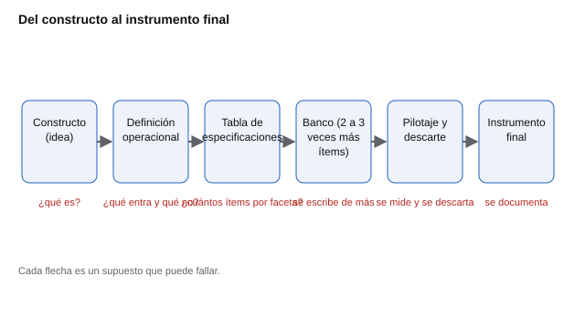
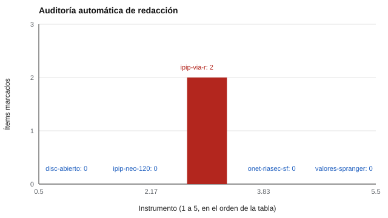

# 002 — Del constructo al ítem: cómo nace una pregunta


<!-- NAV -->
[← 001 — Qué significa medir lo que no se ve](../001-que-significa-medir-lo-que-no-se-ve/README.md) · [📚 Parte 00](../README.md) · [🗺️ Índice 001–200](../../../PROGRAMA.md) · [003 — Escalas de medida y qué operaciones permiten →](../003-escalas-de-medida-y-sus-operaciones/README.md)
<!-- /NAV -->

**Parte 00 — Fundamentos de la medición psicológica** · Nivel fundamentos · 4 h · Estado `escrita`
**Pensada para:** quien construye un instrumento, quien lo revisa o adapta y quien es evaluado.
**Prerrequisitos:** clase 001.

## ¿Para qué te sirve esto?

Muchos cuestionarios fallan antes de que alguien conteste el primero: se empezó a escribir preguntas sin saber con precisión qué se quería medir. Si construyes instrumentos, esta clase te ahorra el error más caro del oficio. Si los revisas, te da una lista de lo que hay que mirar. Y si eres evaluado, te explica por qué algunas preguntas te resultan confusas o «trampa»: probablemente nacieron de una definición vaga.

## Al terminar esta clase podrás

- Redactar una definición operacional que diga qué entra y qué queda fuera del constructo.
- Explicar con un ejemplo la deficiencia y la contaminación de un instrumento.
- Reconocer los cuatro defectos clásicos de redacción de ítems.
- Justificar por qué un banco de ítems se escribe con más ítems de los que se usarán.

## La idea en palabras simples

Imagina que alguien te pide «un cuestionario de responsabilidad». ¿Responsable con el dinero, con los horarios, con las personas? Sin precisar eso, cada redactor escribiría preguntas distintas. La solución es un camino en pasos, de lo abstracto a lo concreto: primero se define, luego se reparte el contenido, después se escribe y finalmente se prueba y se descarta.



*Figura 1.* La clase recorre este camino de izquierda a derecha. El error más frecuente es saltarse las etapas 2 y 3 e ir directo a escribir ítems.

## Cómo funciona, paso a paso

### Paso 1. Primero la definición, después el ítem

Escribir ítems antes de definir el constructo es el error de origen más caro, porque no se detecta hasta el análisis factorial, cuando ya hay datos. Una definición útil delimita **qué entra y qué no**. Compara:

- **Vaga:** «Responsabilidad es ser responsable en el trabajo.» (Se define con la misma palabra.)
- **Operativa:** «Grado en que una persona organiza su actividad, persiste ante la dificultad y controla sus impulsos para alcanzar metas.»

La segunda sugiere sus propias facetas: orden, perseverancia, autocontrol. No es casualidad que el IPIP-NEO-120 mida Responsabilidad con seis facetas (autoeficacia, orden, sentido del deber, orientación al logro, autodisciplina y cautela): esa estructura salió de una definición.

### Paso 2. Los dos modos de fallar el dominio

| Fallo | Qué ocurre | Ejemplo |
|---|---|---|
| **Deficiencia** | El instrumento no cubre parte del constructo | Medir responsabilidad solo con ítems de orden, sin perseverancia |
| **Contaminación** | El instrumento captura algo ajeno al constructo | Ítems con vocabulario difícil que miden, de paso, nivel educativo |

La **tabla de especificaciones** previene ambos: una matriz de facetas por número de ítems, decidida *antes* de escribir (se desarrolla en la clase 016).

### Paso 3. Cuatro defectos de redacción

1. **Doble cañón:** dos afirmaciones en un ítem. «Soy ordenado y puntual»: no se puede responder si se es una cosa y no la otra.
2. **Ambigüedad de frecuencia:** «A veces me enojo». Todos a veces se enojan; el ítem no discrimina.
3. **Deseabilidad social:** «¿Es usted una persona honesta?». Mide la disposición a admitir, no el rasgo.
4. **Doble negación:** «No es raro que no termine lo que empiezo». El error de comprensión se confunde con el rasgo.

*Ojo:* el ítem real del IPIP-VIA-R «No abandono una tarea antes de terminarla» es una negación simple y directa, no doble: se entiende en una lectura.

### Paso 4. Sobreproducir para poder descartar

Un banco parte con dos o tres veces los ítems que sobrevivirán. El pilotaje (clase 015) descarta los que no correlacionan con su escala, los que correlacionan con la escala equivocada y los que casi nadie responde. Descartar es parte del método, no un fracaso; lo que sí es un fracaso es no tener de dónde descartar.

## Si construyes el instrumento

- Escribe la definición en una o dos frases y pídele a otra persona que diga qué quedaría fuera. Si no puede, es demasiado vaga.
- Decide el número de ítems por faceta antes de redactar, y deja registro de por qué.
- Pide a alguien de la población objetivo que explique cada ítem con sus palabras: si lo entiende distinto de lo previsto, reescríbelo (clase 019).
- Guarda las versiones: cambiar una palabra cambia el instrumento (clase 020).

## Si eres evaluado

- Si una pregunta te obliga a responder dos cosas a la vez, no es culpa tuya: es un defecto del ítem. Puedes señalarlo a quien aplica la prueba.
- Las preguntas que parecen «buscar lo que quieres que digan» (¿es usted honesto?) suelen medir tu disposición a quedar bien, no tu rasgo. Responder con sinceridad es lo correcto, pero conviene saber que el resultado debe leerse con cautela.
- Pregunta cómo se definió lo que se mide: una buena respuesta es parte de la calidad del instrumento.

## Qué muestra el laboratorio

`lab.py` audita los cinco instrumentos del catálogo contra defectos detectables por regla: longitud excesiva, conjunciones sospechosas de doble cañón y negaciones acumuladas.



| Instrumento | Ítems | Marcados |
|---|---:|---:|
| disc-abierto | 32 | 0 |
| ipip-neo-120 | 120 | 0 |
| ipip-via-r | 96 | 2 |
| onet-riasec-sf | 60 | 0 |
| valores-spranger | 36 | 0 |

**Análisis.** (1) Solo 2 de 344 ítems (0,6 %) quedaron marcados, ambos por «negaciones acumuladas» («No leo libros de no ficción por gusto», «No creo en un poder universal ni en un Dios»). (2) Eso **no** significa que los otros 342 estén perfectos: la auditoría automática no puede ver la deseabilidad social, la ambigüedad de frecuencia ni la deficiencia del dominio, que exigen juicio experto. (3) Un resultado «limpio» de una herramienta automática es una condición necesaria, no suficiente. (4) Los dos ítems marcados son candidatos a revisión, no errores comprobados: pueden ser aceptables si el pilotaje muestra que se entienden.

## Errores frecuentes

- Escribir ítems sin una definición escrita del constructo.
- Mezclar dos ideas en un ítem para «ahorrar» preguntas.
- Creer que una auditoría automática reemplaza la revisión de expertos y de la población objetivo.
- Copiar ítems de otro contexto cultural sin revisarlos: «Suelo votar por candidatos políticos progresistas» mide Liberalismo en el IPIP original, pero fuera de Estados Unidos puede significar otra cosa.

## Lo mínimo que debes llevarte

1. Define antes de escribir: qué entra y qué no.
2. Deficiencia (falta contenido) y contaminación (sobra algo ajeno) son los dos fallos del dominio.
3. Un ítem, una idea; sin ambigüedad ni doble negación.
4. Se escribe de más para poder descartar.

## Ejercicios

- **Inicial.** Corrige el ítem «Soy ordenado y puntual». *Solución: separar en dos ítems («Soy ordenado», «Llego puntual a mis compromisos»).*
- **Intermedio.** Define «curiosidad intelectual» en una frase que deje claro qué entra y qué no, y propón tres facetas.
- **Avanzado.** Toma la definición de Apertura a la experiencia del catálogo y propón una faceta que el IPIP-NEO-120 no cubra: ¿es deficiencia o queda fuera del constructo?
- **Aplicación.** Revisa diez ítems de un cuestionario real de tu trabajo o estudio y clasifica cada defecto con los cuatro tipos de esta clase.

## Glosario

- **Definición operacional:** descripción de cómo se observa un constructo.
- **Dominio:** conjunto de contenidos que el constructo abarca.
- **Deficiencia:** parte del dominio que el instrumento no cubre.
- **Contaminación:** contenido ajeno que el instrumento recoge.
- **Tabla de especificaciones:** plan que fija cuántos ítems corresponden a cada faceta.

## Laboratorio

```bash
python classes/part-00-fundamentos-de-la-medicion/002-del-constructo-al-item/lab.py
python classes/part-00-fundamentos-de-la-medicion/002-del-constructo-al-item/figuras.py
```

## Autoevaluación y criterios

1. ¿Por qué «¿es usted honesto?» mide algo distinto de la honestidad? 2. ¿Qué diferencia hay entre deficiencia y contaminación? 3. ¿Por qué no basta con que la auditoría automática no marque ningún ítem?
Se logra la clase si puedes escribir una definición operacional, una tabla de facetas y corregir ítems defectuosos justificando cada cambio.

## Fuentes

- DeVellis, R. F. (2017). *Scale Development: Theory and Applications* (4.ª ed.). SAGE. 🔎 libro: comprobar a mano (la 4.ª edición es de 2017; el DOI que un buscador automático asocia a «1992» corresponde a otra obra y no se enlaza).
- Clark, L. A., & Watson, D. (1995). Constructing validity: Basic issues in objective scale development. *Psychological Assessment*, 7(3), 309-319. 🔎 comprobar el DOI en la fuente.
- AERA, APA, & NCME (2014). *Standards for Educational and Psychological Testing*. 🔎 norma: comprobar a mano.

Leyenda: ✅ verificada con DOI; ⚠️ año o edición distinta; 🔎 pendiente de comprobar a mano. Ver [`docs/VERIFICACION_BIBLIOGRAFIA.md`](../../../docs/VERIFICACION_BIBLIOGRAFIA.md).

---

<!-- NAV -->
[← 001 — Qué significa medir lo que no se ve](../001-que-significa-medir-lo-que-no-se-ve/README.md)  
[📚 Parte 00](../README.md) · [🗺️ Índice 001–200](../../../PROGRAMA.md)  
[003 — Escalas de medida y qué operaciones permiten →](../003-escalas-de-medida-y-sus-operaciones/README.md)
<!-- /NAV -->
