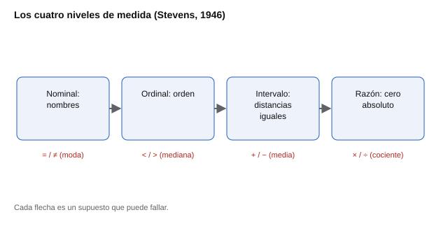

# 003 — Escalas de medida y qué operaciones permiten


<!-- NAV -->
[← 002 — Del constructo al ítem: cómo nace una pregunta](../002-del-constructo-al-item/README.md) · [📚 Parte 00](../README.md) · [🗺️ Índice 001–200](../../../PROGRAMA.md) · [004 — Puntaje bruto, media por ítem y por qué no so… →](../004-puntaje-bruto-y-media-por-item/README.md)
<!-- /NAV -->

**Parte 00 — Fundamentos de la medición psicológica** · Nivel fundamentos · 3 h · Estado `escrita`
**Pensada para:** quien construye instrumentos, quien interpreta puntajes y quien es evaluado.
**Prerrequisitos:** clases 001 y 002.

## ¿Para qué te sirve esto?

Cada vez que alguien calcula un promedio de respuestas («su motivación es 3,8») está haciendo una operación aritmética. ¿Está permitida? Depende de qué tipo de número tiene entre manos: un código, un orden, una distancia o una cantidad. Elegir mal el tipo lleva a conclusiones que parecen precisas y no lo son. Esta clase te enseña a clasificar lo que mides y a saber qué cálculos se pueden hacer con él.

## Al terminar esta clase podrás

- Clasificar una variable como nominal, ordinal, de intervalo o de razón.
- Decir qué estadísticos corresponden a cada nivel.
- Explicar por qué se promedian respuestas tipo Likert aunque sean, estrictamente, ordinales.
- Declarar con honestidad la aproximación que se está haciendo.

## La idea en palabras simples

Piensa en cuatro «reglas» cada vez más exigentes:

- Una **lista de nombres** solo te dice si dos cosas son iguales o distintas (el color de una camiseta).
- Un **podio** te dice quién llegó antes, pero no cuánto antes (primero, segundo, tercero).
- Un **termómetro en grados Celsius** te dice cuánta diferencia hay, pero el cero es una convención: 20 °C no es «el doble de calor» que 10 °C.
- Una **cinta métrica** tiene un cero real: 20 cm sí es el doble de 10 cm.

S. S. Stevens (1946) ordenó estas reglas en cuatro niveles. Cada uno hereda lo del anterior y añade una operación.



*Figura 1.* Cuanto más arriba, más operaciones aritméticas están autorizadas.

## Cómo funciona, paso a paso

| Nivel | Qué permite | Estadístico central | Ejemplo en este programa |
|---|---|---|---|
| **Nominal** | Igualdad | Moda | Código Holland (`IAS`) |
| **Ordinal** | Orden | Mediana | Ranking de valores |
| **Intervalo** | Distancias iguales | Media | Puntaje de CI |
| **Razón** | Cero absoluto | Media geométrica | Tiempo de reacción |

**El problema incómodo.** Una respuesta Likert es, estrictamente, **ordinal**: «Muy exacto» es más que «Moderadamente exacto», pero nada garantiza que la distancia entre esos dos puntos sea igual a la que hay entre «Moderadamente inexacto» y «Ni inexacto ni exacto». Si es ordinal, la media no está autorizada… y sin embargo **todo el campo promedia respuestas Likert**.

**Por qué se hace igual.** Hay tres argumentos:

1. **Robustez empírica.** Con cinco o más puntos y distribuciones no muy asimétricas, tratar el ordinal como intervalo distorsiona poco las conclusiones (Norman, 2010).
2. **Agregación.** Se promedian *escalas* de muchos ítems, no ítems sueltos: la suma de veinte ítems ordinales se comporta bastante como una variable continua.
3. **La alternativa cuesta.** Los métodos «correctos» (correlaciones policóricas, teoría de respuesta al ítem) existen y se estudian en las partes 04 y 05, pero exigen más datos y más supuestos.

> La postura defendible no es «da igual», sino: **se sabe que es una aproximación, se conocen sus condiciones de validez y se declara.**

**Lo que el motor del repositorio hace y no hace.** `motor/puntuacion.py` promedia respuestas Likert, y esa decisión está documentada. Lo que **no** hace es promediar puntajes ipsativos entre personas (clase 013): ahí la aritmética falla por construcción, no por aproximación.

## Si construyes el instrumento

- Decide el nivel de medida que pretendes y justifícalo. Si usas Likert, declara que tratas las respuestas como intervalo y por qué.
- Usa al menos cinco opciones y agrega varios ítems por escala: ayuda a que la aproximación sea razonable.
- Para decisiones delicadas, contrasta con un método que respete el nivel ordinal (clases 050 y 056).
- Nunca sumes ni promedies códigos nominales (un código Holland no se «promedia»).

## Si eres evaluado

- Un puntaje de «3,8» no es una distancia exacta: es una convención útil. Si alguien te dice que «mejoraste 0,2 puntos», pregunta cuánto cambia el puntaje por error de medida (clase 025).
- Un código de tres letras resume seis puntajes continuos y por eso pierde información: pide ver el perfil completo.
- Un ranking solo dice el orden, no cuánto mejor es cada persona que la siguiente.

## Qué muestra el laboratorio

`lab.py` simula 200 personas que responden 10 ítems cuyos umbrales **no** son equidistantes (−1,4; −0,3; 0,2; 1,5). Compara tres tratamientos: media (intervalo), mediana (ordinal) y rango normalizado, y mide cuánto cambia el orden de las personas.

**Resultado:** la concordancia media entre tratamientos (tau de Kendall) fue 0,822.

**Análisis.** (1) Aunque la escala no es de intervalo (umbrales desiguales), el orden de las personas apenas cambia al tratarla como si lo fuera: esa robustez es lo que justifica la práctica. (2) La concordancia no es 1: existe una pérdida real, pequeña pero no nula. (3) Si bajas `N_ITEMS` a 1 y repites, la concordancia cae, porque sin agregación no hay quien suavice las irregularidades. (4) Es una simulación con un patrón de umbrales concreto: con distribuciones muy asimétricas o pocas opciones, la aproximación se deteriora.

## Errores frecuentes

- Decir «la media está prohibida con Likert»: la práctica es aceptable *si se declara y se cumplen condiciones*.
- Decir «da igual»: sí importa, sobre todo con pocos ítems, pocas opciones o respuestas muy sesgadas.
- Promediar códigos nominales o rangos ipsativos.
- Comparar razones («el doble») en escalas de intervalo, donde el cero es arbitrario.

## Lo mínimo que debes llevarte

1. Cuatro niveles: nominal, ordinal, intervalo y razón; cada uno permite más operaciones.
2. Likert es ordinal en rigor, pero se promedia con condiciones: ≥ 5 opciones, varios ítems por escala y sin asimetría extrema.
3. Se declara la aproximación; no se oculta.
4. Los códigos y los rankings no se promedian.

## Ejercicios

- **Inicial.** Clasifica: número de camiseta, ranking de un torneo, temperatura en °C, edad en años. *Solución: nominal, ordinal, intervalo, razón.*
- **Intermedio.** Si las distancias Likert no son iguales, ¿por qué la agregación las vuelve *más* parecidas a una escala de intervalo? *Guía: al sumar muchos ítems, las irregularidades particulares se compensan.*
- **Avanzado.** Cambia en `lab.py` los umbrales para que sean muy desiguales y mide la concordancia. ¿Qué tendría que ocurrir para que la aproximación falle?
- **Aplicación.** El código Holland `IAS` es nominal. ¿Qué se pierde al reducir seis puntajes continuos a tres letras? Redacta un párrafo para quien recibe el informe.

## Glosario

- **Nivel de medida:** tipo de información que contiene un número (nombre, orden, distancia, cantidad).
- **Equidistancia:** que las diferencias entre puntos consecutivos sean iguales.
- **Ordinal:** escala donde solo importa el orden.
- **Aproximación declarada:** simplificación reconocida abiertamente, con sus condiciones de validez.

## Laboratorio

```bash
python classes/part-00-fundamentos-de-la-medicion/003-escalas-de-medida-y-sus-operaciones/lab.py
python classes/part-00-fundamentos-de-la-medicion/003-escalas-de-medida-y-sus-operaciones/figuras.py
```

## Autoevaluación y criterios

1. ¿Por qué un Likert es ordinal en sentido estricto? 2. Da dos razones para promediarlo igual. 3. ¿Qué condiciones debe cumplir la aproximación?
Se logra la clase si puedes clasificar variables, justificar el uso de la media en escalas Likert y declarar sus límites.

## Fuentes

- Stevens, S. S. (1946). On the theory of scales of measurement. *Science*, 103(2684), 677-680. ✅ [DOI](https://doi.org/10.1126/science.103.2684.677)
- Norman, G. (2010). Likert scales, levels of measurement and the «laws» of statistics. *Advances in Health Sciences Education*, 15(5), 625-632. ✅ [DOI](https://doi.org/10.1007/s10459-010-9222-y)

Leyenda: ✅ verificada con DOI; ⚠️ año o edición distinta; 🔎 pendiente de comprobar a mano. Ver [`docs/VERIFICACION_BIBLIOGRAFIA.md`](../../../docs/VERIFICACION_BIBLIOGRAFIA.md).

---

<!-- NAV -->
[← 002 — Del constructo al ítem: cómo nace una pregunta](../002-del-constructo-al-item/README.md)  
[📚 Parte 00](../README.md) · [🗺️ Índice 001–200](../../../PROGRAMA.md)  
[004 — Puntaje bruto, media por ítem y por qué no so… →](../004-puntaje-bruto-y-media-por-item/README.md)
<!-- /NAV -->
