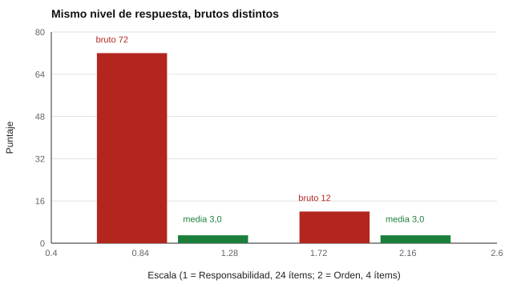
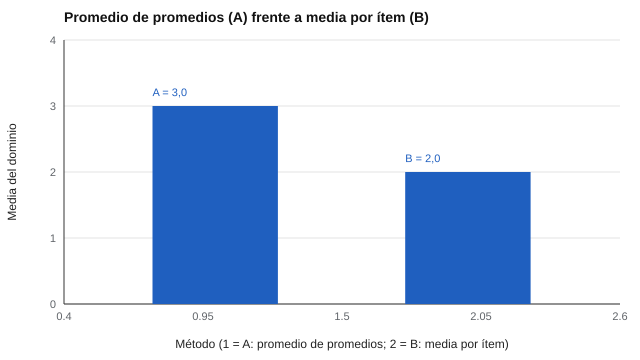

# 004 — Puntaje bruto, media por ítem y por qué no son lo mismo


<!-- NAV -->
[← 003 — Escalas de medida y qué operaciones permiten](../003-escalas-de-medida-y-sus-operaciones/README.md) · [📚 Parte 00](../README.md) · [🗺️ Índice 001–200](../../../PROGRAMA.md) · [005 — Ítems invertidos y sesgo de aquiescencia →](../005-items-invertidos-y-aquiescencia/README.md)
<!-- /NAV -->

**Parte 00 — Fundamentos de la medición psicológica** · Nivel fundamentos · 3 h · Estado `escrita`
**Pensada para:** quien construye y puntúa instrumentos, quien interpreta informes y quien es evaluado.
**Prerrequisitos:** clases 001 a 003.

## ¿Para qué te sirve esto?

Un informe dice «Responsabilidad: 72; Orden: 12». ¿Significa que la persona es seis veces más responsable que ordenada? No: significa que una escala tiene muchos más ítems que la otra. Esta clase te enseña a leer un puntaje sin dejarte engañar por la longitud de la escala, y a calcular un dominio a partir de sus facetas sin introducir pesos ocultos.

## Al terminar esta clase podrás

- Calcular el puntaje bruto y la media por ítem y decir cuándo usar cada uno.
- Detectar el error de comparar brutos entre escalas de distinta longitud.
- Explicar por qué promediar promedios puede dar un resultado distinto y engañoso.
- Reconocer que ninguna de las dos cifras es interpretable sin una referencia (baremo).

## La idea en palabras simples

Si sumas los kilómetros de un viaje de 3 días y los de uno de 30 días, la suma depende de la duración, no de lo rápido que viajaste. Para comparar velocidades divides por el tiempo. Con los puntajes pasa lo mismo: el **bruto** es una suma y depende de cuántos ítems tiene la escala; la **media por ítem** divide por el número de ítems y queda en la misma unidad que las respuestas.



*Figura 1.* Con respuestas iguales (todas «3»), los brutos difieren por el largo de la escala; las medias, no.

## Cómo funciona, paso a paso

**1. El bruto depende del número de ítems.** En el IPIP-NEO-120, Responsabilidad tiene 24 ítems y la faceta Orden tiene 4. Con respuestas en el punto medio (3): Responsabilidad = 72 y Orden = 12.

**2. La media por ítem.**

```
media_item = suma de respuestas efectivas / número de ítems respondidos
```

En el ejemplo, ambas dan **3,00**: ahora sí son comparables, y además quedan en la misma unidad que la escala de respuesta (un 4,2 significa «en promedio, algo más que *moderadamente exacto*»). Por eso el motor expone ambas cifras, pero todo lo que compara (el código Holland, las fortalezas, el orden de facetas) usa la media por ítem.

**3. El error del promedio de promedios.** Al calcular un dominio desde sus facetas hay dos formas y **no dan lo mismo**:

```
A: media de las medias de las facetas
B: media de todos los ítems de todas las facetas
```

Coinciden solo si todas las facetas tienen el mismo número de ítems. Si no, A decide en silencio que una faceta de 2 ítems pesa tanto como una de 10. Este motor usa **B**, y `tests/test_puntuacion.py` lo fija con un caso donde difieren (2,0 contra 1,8).



*Figura 2.* En un instrumento sintético con facetas de 2 y 6 ítems, A = 3,0 y B = 2,0: un punto entero de diferencia.

> En el catálogo real A y B coinciden siempre, porque todas las escalas hoja (las 30 facetas del IPIP-NEO-120 y las 24 fortalezas del IPIP-VIA-R) tienen exactamente 4 ítems. Que una virtud del VIA agrupe 3 fortalezas y otra 5 es irrelevante: lo que importa es cuántos ítems tiene cada hija.

**4. Lo que ninguna cifra dice.** Una media de 4,2 en Responsabilidad **no** significa «alto»: significa que respondió, en promedio, algo más que «moderadamente exacto». Si la población de referencia promedia 4,4, esa persona está por debajo. Convertir una media en percentil exige una muestra normativa (parte 06); por eso el motor trae los campos `percentil`, `z` y `baremo` aún vacíos: la estructura existe, los datos no.

## Si construyes el instrumento

- Informa siempre media por ítem y número de ítems respondidos, no solo el bruto.
- Si calculas dominios desde facetas, decide y declara si ponderas por ítem (B) o por faceta (A), y por qué.
- Guarda `items_respondidos` e `items_totales`: una media sobre 7 de 10 ítems no se compara sin cuidado con una sobre 10 de 10.
- No fabriques percentiles sin muestra normativa.

## Si eres evaluado

- Un número grande no es «más»: pregunta de cuántos ítems sale y cuál es el máximo posible.
- Pide siempre la referencia: «¿con quién me comparan?».
- Si omitiste ítems, pregunta cómo se trató eso en el cálculo.

## Qué muestra el laboratorio

`lab.py` puntúa el mismo protocolo de las dos formas (A y B) sobre todo el catálogo y sobre un instrumento sintético de facetas desiguales.

| Escala (IPIP-NEO-120) | Facetas | Tamaño de cada una | A | B | A − B |
|---|---:|---|---:|---:|---:|
| N | 6 | 4 | 2,917 | 2,917 | 0 |
| E | 6 | 4 | 2,750 | 2,750 | 0 |
| A | 6 | 4 | 2,500 | 2,500 | 0 |

| Sintético | Facetas | Tamaños | A | B | A − B |
|---|---:|---|---:|---:|---:|
| TOT | 2 | 2 y 6 | 3,0 | 2,0 | 1,0 |

**Análisis.** (1) En todo el catálogo real los métodos coinciden porque cada escala hoja tiene 4 ítems. (2) En el sintético divergen un punto entero: A da el mismo peso a la faceta de 2 ítems que a la de 6. (3) No es que un método esté mal siempre: A decide en silencio que todas las facetas pesan igual; si esa es la intención, hay que declararla, y si no, usar B. (4) El motor usa B. (5) El hecho de que hoy coincidan es una propiedad de estos datos, no una garantía para futuros instrumentos: por eso el caso está cubierto por una prueba.

## Errores frecuentes

- Comparar brutos entre escalas de distinta longitud.
- Calcular un dominio promediando promedios sin declararlo.
- Interpretar una media como «alta» sin referencia.
- Perder el número de ítems respondidos.

## Lo mínimo que debes llevarte

1. El bruto depende del largo; la media por ítem, no.
2. Promedia por ítem (B) salvo que quieras, y declares, pesos iguales por faceta.
3. Informa cuántos ítems respondió la persona.
4. Ni el bruto ni la media dicen «alto» o «bajo» sin un baremo.

## Ejercicios

- **Inicial.** Una escala de 8 ítems (1 a 5) tiene bruto 28. ¿Cuál es la media por ítem? *Solución: 3,5.*
- **Intermedio.** Una faceta de 2 ítems tiene media 4 y otra de 6 ítems tiene media 2. Calcula A y B. *Solución: A = 3,0; B = (8 + 12) / 8 = 2,5.*
- **Avanzado.** Modifica el instrumento sintético de `lab.py` con facetas de 3 y 9 ítems y calcula la diferencia A − B.
- **Aplicación.** Revisa un informe real (anonimizado) y marca qué cifras son brutos, cuáles medias y cuáles no tienen referencia.

## Glosario

- **Puntaje bruto:** suma de las respuestas efectivas.
- **Media por ítem:** bruto dividido por el número de ítems respondidos.
- **Agregación ponderada:** forma de combinar subescalas según su número de ítems.
- **Baremo:** tabla que convierte un puntaje en una posición dentro de un grupo de referencia.

## Laboratorio

```bash
python classes/part-00-fundamentos-de-la-medicion/004-puntaje-bruto-y-media-por-item/lab.py
python classes/part-00-fundamentos-de-la-medicion/004-puntaje-bruto-y-media-por-item/figuras.py
```

## Autoevaluación y criterios

1. ¿En qué caso el bruto sí es la cifra correcta de informar? 2. Si una escala tiene 3 de 10 ítems omitidos, ¿la media por ítem sigue siendo comparable? 3. ¿Por qué se guardan `items_respondidos` e `items_totales`?
Se logra la clase si puedes calcular bruto y media, detectar un promedio de promedios engañoso y explicar por qué falta un baremo.

## Fuentes

- AERA, APA, & NCME (2014). *Standards for Educational and Psychological Testing*. Capítulo 5, «Scores, Scales, Norms». 🔎 norma: comprobar a mano.
- Johnson, J. A. (2014). Measuring thirty facets of the Five Factor Model with a 120-item public domain inventory: Development of the IPIP-NEO-120. *Journal of Research in Personality*, 51, 78-89. 🔎 pendiente de comprobar a mano (la referencia anterior del repositorio estaba incompleta).

Leyenda: ✅ verificada con DOI; ⚠️ año o edición distinta; 🔎 pendiente de comprobar a mano. Ver [`docs/VERIFICACION_BIBLIOGRAFIA.md`](../../../docs/VERIFICACION_BIBLIOGRAFIA.md).

---

<!-- NAV -->
[← 003 — Escalas de medida y qué operaciones permiten](../003-escalas-de-medida-y-sus-operaciones/README.md)  
[📚 Parte 00](../README.md) · [🗺️ Índice 001–200](../../../PROGRAMA.md)  
[005 — Ítems invertidos y sesgo de aquiescencia →](../005-items-invertidos-y-aquiescencia/README.md)
<!-- /NAV -->
