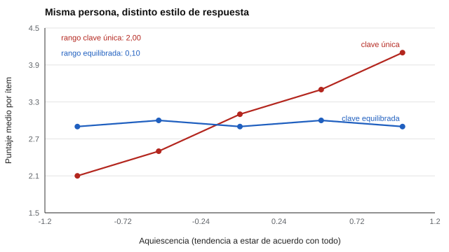

# 005 — Ítems invertidos y sesgo de aquiescencia


<!-- NAV -->
[← 004 — Puntaje bruto, media por ítem y por qué no so…](../004-puntaje-bruto-y-media-por-item/README.md) · [📚 Parte 00](../README.md) · [🗺️ Índice 001–200](../../../PROGRAMA.md) · [006 — Historia de la psicometría: de Galton a la me… →](../006-historia-de-la-psicometria-de-galton-a/README.md)
<!-- /NAV -->

**Parte 00 — Fundamentos de la medición psicológica** · Nivel fundamentos · 4 h · Estado `escrita`
**Pensada para:** quien redacta y puntúa instrumentos, quien interpreta perfiles y quien es evaluado.
**Prerrequisitos:** clases 001 a 004.

## ¿Para qué te sirve esto?

Hay personas que tienden a decir «sí, de acuerdo» a casi todo, sea cual sea la pregunta; otras tienden a discrepar. Si un cuestionario tiene todos sus ítems redactados en la misma dirección, esa tendencia se confunde con el rasgo: quien asiente a todo parece «muy responsable, muy extrovertido y muy amable» al mismo tiempo. Esta clase explica cómo se corrige ese problema con los ítems invertidos, cómo se puntúan sin equivocarse y cuánto cuesta usarlos.

## Al terminar esta clase podrás

- Definir aquiescencia y describir cómo distorsiona un perfil.
- Reflejar correctamente un ítem invertido y justificar el orden de las operaciones.
- Explicar el costo psicométrico de usar ítems invertidos.
- Medir el equilibrio de claves de un instrumento.

## La idea en palabras simples

Imagina una balanza que siempre marca 2 kilos de más. Si pesas solo objetos, todos salen inflados. Pero si en cada pesada pones un objeto y luego su «contrapeso» (algo que en la balanza resta), el error se cancela. Con los ítems invertidos ocurre algo parecido: se escribe la mitad de las preguntas en dirección contraria; quien asiente a todo suma en unas y resta en otras, y el sesgo se anula.

| Clave | Ítem | Responder 5 significa |
|---|---|---|
| Directo (+) | «No abandono una tarea antes de terminarla» | mucha perseverancia |
| Invertido (−) | «Me rindo con facilidad» | poca perseverancia |

Quien asiente a todo marca 5 y 5; tras reflejar el segundo ítem queda 5 y 1: media 3, el punto medio. **El sesgo se cancela.**



*Figura 1.* Cinco personas con el mismo rasgo y distinto estilo de respuesta. Con clave única su puntaje se mueve dos puntos; con clave equilibrada, apenas 0,1.

## Cómo funciona, paso a paso

**1. Definir la aquiescencia.** Es la tendencia a estar de acuerdo con lo que se afirme, con independencia del contenido. Existe en todas las poblaciones y varía entre personas y entre culturas.

**2. Reflejar el ítem invertido.** La fórmula es:

```
valor_reflejado = mínimo + máximo − valor_observado
```

En una escala de 1 a 5: 1↔5, 2↔4, 3↔3.

**3. El orden importa.** La regla no negociable es que **el reflejo va antes de la suma**. Reflejar después de agregar da un número distinto y equivocado. El motor lo hace en el primer paso de la puntuación y `test_item_invertido_se_refleja_antes_de_sumar` lo fija.

**4. El precio.** Los ítems invertidos no son gratis:

1. **Cuestan comprensión.** Quien lee rápido o no domina el idioma se equivoca más en ellos; ese error entra como ruido.
2. **Producen un factor artificial.** En análisis factorial, los invertidos suelen agruparse entre sí en un factor que no corresponde a ningún constructo: es un artefacto del método (parte 04).
3. **Redactarlos bien es difícil.** El negativo de un rasgo no siempre es su ausencia: lo contrario de «confío en los demás» no es «desconfío»; puede ser «no me planteo la cuestión».

**5. El equilibrio en el catálogo.**

| Instrumento | Ítems | Invertidos | Proporción |
|---|---:|---:|---:|
| IPIP-NEO-120 | 120 | 55 | 46 % |
| IPIP-VIA-R | 96 | 48 | 50 % |
| DISC Abierto | 32 | 16 | 50 % |
| Valores de Spranger | 36 | 12 | 33 % |
| O*NET RIASEC SF | 60 | 0 | 0 % |

El RIASEC no tiene ninguno, y con razón: pregunta si una actividad gusta o no; su contrario («me disgustaría reparar cerraduras») no aporta información nueva y confundiría más de lo que corrige. **La técnica se aplica donde resuelve un problema, no por costumbre.**

## Si construyes el instrumento

- Equilibra las claves por escala, no solo en el total: una escala con todos los ítems en una dirección sigue expuesta al sesgo.
- Redacta el invertido como un enunciado natural, no como una negación forzada del original.
- Verifica en el piloto que los invertidos se comprenden (clase 019) y revisa si forman un factor aparte.
- Registra la clave de cada ítem en el archivo del instrumento y comprueba el equilibrio con una prueba automática.

## Si eres evaluado

- Si notas que algunas frases parecen decir lo contrario de otras, no es un descuido: es una forma de comprobar que lees y de neutralizar la tendencia a asentir.
- Lee con atención cada ítem antes de responder: confundir un invertido te cuesta más que equivocarte en uno directo.
- Si un informe te describe con rasgos extremos en todas las dimensiones a la vez, pregunta si el instrumento controla la aquiescencia.

## Qué muestra el laboratorio

`lab.py` simula cinco personas con **el mismo rasgo (0,0)** y aquiescencia creciente, y compara su perfil con clave única y con clave equilibrada.

| Aquiescencia | Clave única | Equilibrada |
|---:|---:|---:|
| −1,0 | 2,10 | 2,90 |
| −0,5 | 2,50 | 3,00 |
| 0,0 | 3,10 | 2,90 |
| 0,5 | 3,50 | 3,00 |
| 1,0 | 4,10 | 2,90 |
| **Rango** | **2,00** | **0,10** |

**Análisis.** (1) Las cinco personas tienen exactamente el mismo rasgo; con clave única, su puntaje se mueve dos puntos solo por estilo de respuesta: el test mide aquiescencia y la llama rasgo. (2) Con clave equilibrada el rango se comprime a 0,10 porque el sesgo empujaba hacia arriba en ambas direcciones y se cancela al reflejar. (3) La simulación supone un sesgo aditivo y constante; en la vida real la aquiescencia interactúa con el contenido y con la cultura, por lo que la cancelación es parcial. (4) El experimento no dice que los invertidos «arreglen» todo: dice cuánto sesgo elimina una clave equilibrada en este modelo.

## Errores frecuentes

- Reflejar después de sumar.
- Creer que más invertidos son siempre mejores.
- Escribir invertidos con doble negación («no me resulta difícil no…»).
- Ignorar que los invertidos pueden crear un factor de método.

## Lo mínimo que debes llevarte

1. La aquiescencia mueve los puntajes sin que cambie el rasgo.
2. Una clave equilibrada cancela gran parte del sesgo.
3. El reflejo se hace antes de la suma: `mín + máx − valor`.
4. Los invertidos cuestan comprensión y pueden crear factores artificiales.

## Ejercicios

- **Inicial.** En una escala 1-5, ¿cuál es el valor reflejado de 2? *Solución: 4.*
- **Intermedio.** ¿Por qué el RIASEC puede prescindir de invertidos sin quedar expuesto? *Guía: sus ítems preguntan por actividades concretas y su contrario no aporta información.*
- **Avanzado.** Escribe el invertido de «Sé cómo sacar las cosas adelante». ¿Qué mide exactamente el que escribiste?
- **Aplicación.** Calcula la proporción de ítems invertidos en un cuestionario que uses en tu trabajo y comenta el equilibrio por escala.

## Glosario

- **Aquiescencia:** tendencia a estar de acuerdo con cualquier afirmación.
- **Ítem invertido:** ítem redactado en dirección contraria al constructo.
- **Reflejo:** operación que convierte la respuesta a una dirección común.
- **Clave equilibrada:** mitad de ítems directos y mitad invertidos.
- **Estilo de respuesta:** forma sistemática de responder independiente del contenido.

## Laboratorio

```bash
python classes/part-00-fundamentos-de-la-medicion/005-items-invertidos-y-aquiescencia/lab.py
python classes/part-00-fundamentos-de-la-medicion/005-items-invertidos-y-aquiescencia/figuras.py
```

## Autoevaluación y criterios

1. ¿Por qué el reflejo debe ir antes de la suma? 2. ¿Qué precio se paga por usar invertidos? 3. ¿Cómo comprobarías el equilibrio de claves de un instrumento?
Se logra la clase si puedes reflejar y puntuar ítems invertidos sin errores y explicar cuándo conviene usarlos.

## Fuentes

- Weijters, B., Baumgartner, H., & Schillewaert, N. (2013). Reversed item bias: An integrative model. *Psychological Methods*, 18(3), 320-334. ✅ [DOI](https://doi.org/10.1037/a0032121)
- Bluemke, M., et al. (2021). Referencia sobre escalas cortas del IPIP-VIA-R: 🔎 **sin verificar**; la cita original del repositorio no pudo comprobarse y debe revisarse antes de usarla.

Leyenda: ✅ verificada con DOI; ⚠️ año o edición distinta; 🔎 pendiente de comprobar a mano. Ver [`docs/VERIFICACION_BIBLIOGRAFIA.md`](../../../docs/VERIFICACION_BIBLIOGRAFIA.md).

---

<!-- NAV -->
[← 004 — Puntaje bruto, media por ítem y por qué no so…](../004-puntaje-bruto-y-media-por-item/README.md)  
[📚 Parte 00](../README.md) · [🗺️ Índice 001–200](../../../PROGRAMA.md)  
[006 — Historia de la psicometría: de Galton a la me… →](../006-historia-de-la-psicometria-de-galton-a/README.md)
<!-- /NAV -->
