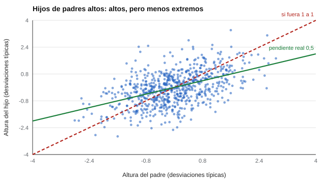

# 006 — Historia de la psicometría: de Galton a la medición moderna


<!-- NAV -->
[← 005 — Ítems invertidos y sesgo de aquiescencia](../005-items-invertidos-y-aquiescencia/README.md) · [📚 Parte 00](../README.md) · [🗺️ Índice 001–200](../../../PROGRAMA.md) · [007 — Constructos, variables latentes y definicione… →](../007-constructos-variables-latentes-y-definiciones-operacionales/README.md)
<!-- /NAV -->

**Parte 00 — Fundamentos de la medición psicológica** · Nivel fundamentos · 4 h · Estado `escrita`
**Pensada para:** cualquier persona que use o responda pruebas y quiera entender de dónde vienen sus ideas.
**Prerrequisitos:** clase 001.

## ¿Para qué te sirve esto?

Casi todo lo que hoy se hace con un test (correlacionar, hablar de «inteligencia general», usar percentiles) tiene un origen histórico con aciertos y errores. Conocerlo te permite entender por qué existen ciertas convenciones y por qué algunas deben mirarse con cautela. Además, un fenómeno estadístico descubierto hace más de un siglo, la **regresión a la media**, explica por qué muchos «resultados sorprendentes» no lo son.

## Al terminar esta clase podrás

- Explicar con tus palabras qué es la regresión a la media y por qué ocurre.
- Distinguir entre pendiente de regresión y correlación.
- Ubicar a Galton, Spearman y a Binet y Simon dentro de la tradición de la medición.
- Reconocer el fenómeno cuando alguien lo confunda con un «efecto» de un programa.

## La idea en palabras simples

Imagina que cien estudiantes rinden una prueba muy difícil y tú tomas solo a los diez mejores. Si los haces rendir otra prueba equivalente, la mayoría sacará un poco menos. No «se echaron a perder»: en la primera prueba tuvieron buena habilidad **y además buena suerte**; la suerte no se repite igual. Lo mismo vale al revés para los peores. Eso es la **regresión a la media**.

Francis Galton la describió en 1886 al comparar las estaturas de padres e hijos: los hijos de padres muy altos eran altos, pero en promedio **menos altos que sus padres**; los hijos de padres bajos eran bajos, pero menos que ellos. Galton la llamó «regresión hacia la mediocridad» (hoy diríamos «hacia la media»).



*Figura 1.* Cada punto es un padre y su hijo (datos simulados). Si los hijos fueran iguales a los padres, los puntos caerían en la línea roja punteada. La recta verde, la real, es más plana: pendiente 0,5.

## Cómo funciona, paso a paso

**1. Una relación imperfecta.** Padre e hijo se parecen, pero no del todo (correlación r ≈ 0,5). Hay otros factores: la madre, la nutrición, el azar.

**2. La pendiente es r.** Cuando ambas variables se miden en desviaciones típicas, la pendiente de la recta que predice al hijo desde el padre **es igual a la correlación**. Si r = 0,5, el hijo de un padre que está 2 desviaciones sobre la media se espera 1 desviación sobre la media.

**3. Qué NO significa.** La regresión a la media **no** dice que la población se vuelva más homogénea: la dispersión de los hijos es igual a la de los padres. Cada generación tiene tantos altos como la anterior; solo que los hijos de los más altos no son, en promedio, tan altos como ellos.

**4. Una línea histórica.**

| Año | Hecho | Idea que dejó |
|---|---|---|
| 1886 | Galton, estaturas de padres e hijos | Regresión a la media; precursor de la correlación |
| 1895–1896 | Pearson formaliza la correlación | Coeficiente r |
| 1904 | Spearman propone un factor general | Análisis factorial, «g» |
| 1905 | Binet y Simon, primera escala práctica de inteligencia | El test como herramienta de decisión escolar |

(Las fechas provienen de manuales de historia de la psicología; conviene contrastarlas con las fuentes primarias, ver al final.)

## Si construyes el instrumento

- Cuando compares a un grupo «extremo» (los de puntaje más bajo) antes y después de una intervención, espera una mejora **aunque no haga nada**: parte del extremo inicial era azar. Necesitas un grupo de comparación.
- Una mayor fiabilidad reduce la regresión: con puntajes más fiables, el fenómeno es menor (clase 021).
- Declara siempre el criterio de selección del grupo al reportar «mejoras».

## Si eres evaluado

- Si obtuviste un resultado excepcionalmente alto o bajo, en una segunda medición es esperable que sea menos extremo. No lo interpretes como fracaso ni como milagro.
- Si te asignan a un programa de apoyo por un puntaje bajo, parte de la mejora posterior puede deberse a esto. Pregunta si existe un grupo de comparación.
- Una medición única no es una sentencia: pide una segunda observación antes de decisiones importantes.

## Qué muestra el laboratorio

`lab.py` simula 5.000 pares padre-hijo con correlación 0,5 y calcula:

| Medida | Resultado |
|---|---:|
| Correlación padre-hijo | 0,51 |
| Pendiente de regresar hijo sobre padre | 0,52 |
| 10 % de padres más altos: media del padre | 1,75 DE |
| Media de sus hijos | 0,93 DE |
| Dispersión de padres / hijos | 0,99 / 1,01 |

**Análisis.** (1) La pendiente (0,52) coincide con la correlación (0,51), como predice la teoría. (2) Los hijos de los padres más altos están 0,93 DE sobre la media, más o menos la mitad de 1,75: menos extremos. (3) Las dispersiones son prácticamente iguales: no hay homogeneización. (4) Es una simulación con distribución normal e igual varianza; con datos reales, otras variables (la madre, el ambiente) cambian cifras, no el fenómeno.

## Errores frecuentes

- Interpretar la regresión como una fuerza biológica «hacia lo normal».
- Creer que la población se vuelve más pareja con cada generación.
- Atribuir a un programa la mejora de un grupo seleccionado por puntajes extremos.
- Confundir pendiente y correlación cuando las variables tienen dispersiones distintas.

## Lo mínimo que debes llevarte

1. Los puntajes extremos tienden a ser menos extremos en la siguiente medición.
2. La pendiente estandarizada es igual a la correlación.
3. No hay homogeneización: la dispersión se mantiene.
4. Para evaluar un efecto, hace falta un grupo de comparación.

## Ejercicios

- **Inicial.** Con r = 0,5, ¿qué estatura (en DE) se espera de un hijo cuyo padre está 3 DE sobre la media? *Solución: 1,5 DE.*
- **Intermedio.** Simula r = 0,8 en `lab.py` y compara la media de los hijos de los padres del 10 % más alto.
- **Avanzado.** Explica cómo la regresión a la media puede inflar el efecto de un programa dirigido a «los 20 estudiantes con peor puntaje».
- **Aplicación.** Un colegio selecciona a los estudiantes con menor puntaje para un taller y los mide de nuevo. Diseña cómo evaluarías el taller sin caer en este error.

## Glosario

- **Regresión a la media:** tendencia de los valores extremos a ser menos extremos en una nueva medición.
- **Correlación (r):** número entre −1 y 1 que resume cuán relacionadas están dos variables.
- **Pendiente:** cambio esperado en una variable por cada unidad de cambio en la otra.
- **Desviación típica (DE):** medida de cuánto se dispersan los valores.

## Laboratorio

```bash
python classes/part-00-fundamentos-de-la-medicion/006-historia-de-la-psicometria-de-galton-a/lab.py
python classes/part-00-fundamentos-de-la-medicion/figuras.py
```

## Autoevaluación y criterios

1. ¿Por qué los hijos de padres muy altos son en promedio menos altos? 2. ¿Por qué esto no hace que la población sea más homogénea? 3. ¿Qué te advertiría sobre un programa evaluado solo con los estudiantes de peor puntaje?
Se logra la clase si puedes explicar el fenómeno sin fórmulas y detectar una situación donde se confunda con un efecto real.

## Bibliografía

- Galton, F. (1886). Regression towards mediocrity in hereditary stature. *Journal of the Anthropological Institute*, 15, 246-263. ✅ [DOI](https://doi.org/10.2307/2841583)
- Spearman, C. (1904). «General intelligence» objectively determined and measured. *American Journal of Psychology*, 15(2), 201-292. ✅ [DOI](https://doi.org/10.2307/1412107)

Leyenda: ✅ existe en Crossref con título y año coincidentes (enlace al DOI); ⚠️ hay una obra de título parecido con otro año (no se enlaza: comprobar la edición); 🔎 no verificada automáticamente (libros sin DOI, normas y sitios web). Crossref confirma la existencia de la fuente, no que respalde cada afirmación de la clase. Ver [`docs/VERIFICACION_BIBLIOGRAFIA.md`](../../../docs/VERIFICACION_BIBLIOGRAFIA.md).

---

<!-- NAV -->
[← 005 — Ítems invertidos y sesgo de aquiescencia](../005-items-invertidos-y-aquiescencia/README.md)  
[📚 Parte 00](../README.md) · [🗺️ Índice 001–200](../../../PROGRAMA.md)  
[007 — Constructos, variables latentes y definicione… →](../007-constructos-variables-latentes-y-definiciones-operacionales/README.md)
<!-- /NAV -->
