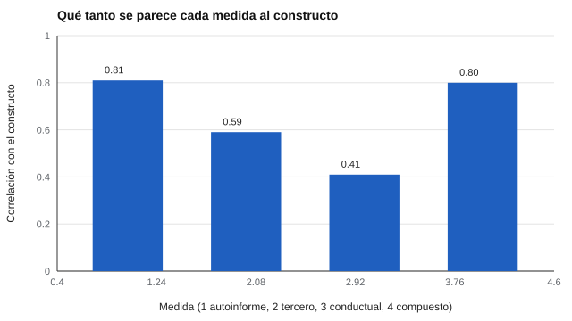

# 007 — Constructos, variables latentes y definiciones operacionales


<!-- NAV -->
[← 006 — Historia de la psicometría: de Galton a la me…](../006-historia-de-la-psicometria-de-galton-a/README.md) · [📚 Parte 00](../README.md) · [🗺️ Índice 001–200](../../../PROGRAMA.md) · [008 — Tipos de test: rendimiento máximo frente a de… →](../008-tipos-de-test-rendimiento-maximo-frente-a/README.md)
<!-- /NAV -->

**Parte 00 — Fundamentos de la medición psicológica** · Nivel fundamentos · 4 h · Estado `escrita`
**Pensada para:** quien diseña o elige instrumentos, quien interpreta resultados y quien es evaluado.
**Prerrequisitos:** clase 001.

## ¿Para qué te sirve esto?

Cuando alguien dice «medimos el estrés», la pregunta correcta es: **¿cómo?** Con una escala que responde la persona, con la opinión de su jefe, con la frecuencia cardíaca… cada elección da una respuesta algo distinta y **identifica a personas distintas** como «muy estresadas». Esta clase te da el lenguaje para hablar de esa diferencia y para exigir, al construir o elegir una prueba, que se declare qué definición operacional se usó.

## Al terminar esta clase podrás

- Distinguir constructo, variable latente y definición operacional.
- Explicar por qué distintas formas de medir el mismo constructo no coinciden del todo.
- Interpretar una matriz de correlaciones entre medidas del mismo rasgo.
- Reconocer los límites de sumar medidas distintas sin ponderar.

## La idea en palabras simples

- **Constructo:** una idea abstracta que se usa para explicar conductas (el «estrés», la «motivación de logro»).
- **Variable latente:** la cantidad hipotética que hay detrás de lo que observamos; «latente» significa que no se ve. En la práctica, es el constructo expresado como variable.
- **Definición operacional:** la receta concreta para observarlo («el puntaje en esta escala de diez preguntas»).

Es como el «talento» de un futbolista: nadie lo ve; se observa con goles, pases, opinión del entrenador, pruebas físicas. Cada una es una **operacionalización** distinta, y ninguna es el talento.

## Cómo funciona, paso a paso

**1. Tres maneras de medir el mismo constructo.** En el laboratorio, un mismo estrés latente se mide con: autoinforme (carga 0,80), valoración de un tercero (0,60) e indicador conductual (0,40). «Carga» indica cuánto del indicador depende del constructo; el resto es error y otras influencias.

**2. Qué se espera de sus correlaciones.** Entre dos indicadores de un mismo constructo, la correlación esperada es el producto de sus cargas: autoinforme-tercero, 0,80 × 0,60 = 0,48.

**3. Los indicadores ordenan distinto.** Aun midiendo lo mismo, no identifican a las mismas personas como «las más altas».



*Figura 1.* Qué tanto se parece cada medida al constructo (solo se sabe porque es una simulación). Sumar las tres sin ponderar (0,80) no supera a la mejor de ellas (0,81).

**4. El compuesto.** Sumar medidas distintas parece mejor, pero si una es mucho más débil, aporta más ruido que información. Hay que ponderar (por sus cargas) o descartar las débiles.

## Si construyes el instrumento

- Escribe la definición operacional antes de elegir los ítems, y también cómo se obtendrá cada indicador.
- Mide con más de un método cuando el constructo importe mucho (autoinforme y observación), y espera que coincidan solo en parte.
- Si combinas medidas, pondera según su calidad y justifica la regla.
- No confundas el nombre de la escala con el constructo: una escala llamada «liderazgo» mide lo que sus ítems preguntan.

## Si eres evaluado

- El nombre de lo que te miden («estrés», «liderazgo») puede ocultar cómo se midió. Pregunta cuál es la definición operacional.
- Si te evalúan con métodos distintos (tu opinión y la de tu jefe) y no coinciden, **no es contradicción**: miden aspectos distintos del mismo fenómeno.
- Una medida conductual (por ejemplo, un registro de tareas) y un autoinforme no tienen por qué dar el mismo resultado.

## Qué muestra el laboratorio

`lab.py` simula 3.000 personas con un estrés latente conocido y tres operacionalizaciones.

| Par de medidas | r observada | r teórica |
|---|---:|---:|
| autoinforme – tercero | 0,48 | 0,48 |
| autoinforme – conductual | 0,33 | 0,32 |
| tercero – conductual | 0,22 | 0,24 |

| Medida | Correlación con el constructo |
|---|---:|
| autoinforme | 0,81 |
| tercero | 0,59 |
| conductual | 0,41 |
| compuesto sin ponderar | 0,80 |

Coincidencia del 20 % superior: autoinforme–tercero 42 %; autoinforme–conductual 36 %.

**Análisis.** (1) Las correlaciones observadas coinciden con las teóricas: el modelo funciona. (2) De cada diez personas que el autoinforme coloca en el 20 % más alto, solo cuatro están también en el 20 % más alto según la otra medida: la definición operacional decide **a quién** se identifica. (3) El compuesto sin ponderar (0,80) no supera a la mejor medida (0,81): sumar medidas desiguales no mejora por sí solo. (4) Solo se conoce la verdad por ser simulación; en la vida real el constructo nunca se observa.

## Errores frecuentes

- Tratar el constructo como si fuera el instrumento.
- Creer que sumar medidas siempre mejora.
- Suponer que si dos medidas no coinciden, una de ellas está «mal».
- No declarar cómo se operacionalizó lo que se mide.

## Lo mínimo que debes llevarte

1. Constructo = idea; definición operacional = receta para observarla.
2. Distintas recetas identifican a personas distintas.
3. Combinar medidas exige ponderar según su calidad.
4. Pregunta siempre cómo se midió.

## Ejercicios

- **Inicial.** Nombra un constructo y dos definiciones operacionales posibles. *Ej.: «motivación»: asistencia a clases; puntaje de una escala.*
- **Intermedio.** Si dos indicadores tienen cargas 0,7 y 0,5, ¿qué correlación se espera entre ellos? *Solución: 0,35.*
- **Avanzado.** Pondera el compuesto de `lab.py` por las cargas y compara su correlación con el constructo.
- **Aplicación.** Propón tres operacionalizaciones de «motivación de logro» y describe una limitación de cada una.

## Glosario

- **Constructo:** idea abstracta que explica conductas.
- **Variable latente:** variable no observada que se infiere de indicadores.
- **Definición operacional:** receta concreta para medir un constructo.
- **Carga:** relación entre un indicador y el constructo.
- **Triangulación:** usar varios métodos para el mismo constructo.

## Laboratorio

```bash
python classes/part-00-fundamentos-de-la-medicion/007-constructos-variables-latentes-y-definiciones-operacionales/lab.py
python classes/part-00-fundamentos-de-la-medicion/figuras.py
```

## Autoevaluación y criterios

1. ¿Qué diferencia hay entre constructo y definición operacional? 2. ¿Por qué dos medidas del mismo constructo no coinciden del todo? 3. ¿Por qué sumar medidas no siempre mejora?
Se logra la clase si puedes explicar, con un ejemplo propio, cómo la elección de la definición operacional cambia a quién se identifica.

## Bibliografía

- Campbell, D. T., & Fiske, D. W. (1959). Convergent and discriminant validation by the multitrait-multimethod matrix. *Psychological Bulletin*, 56(2), 81-105.
- Cronbach, L. J., & Meehl, P. E. (1955). Construct validity in psychological tests. *Psychological Bulletin*, 52(4), 281-302.

---

<!-- NAV -->
[← 006 — Historia de la psicometría: de Galton a la me…](../006-historia-de-la-psicometria-de-galton-a/README.md)  
[📚 Parte 00](../README.md) · [🗺️ Índice 001–200](../../../PROGRAMA.md)  
[008 — Tipos de test: rendimiento máximo frente a de… →](../008-tipos-de-test-rendimiento-maximo-frente-a/README.md)
<!-- /NAV -->
