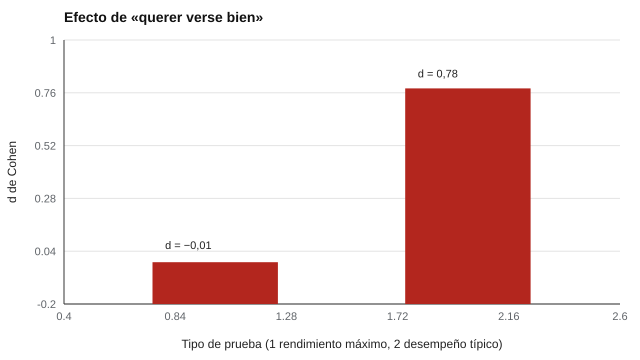

# 008 — Tipos de test: rendimiento máximo frente a desempeño típico


<!-- NAV -->
[← 007 — Constructos, variables latentes y definicione…](../007-constructos-variables-latentes-y-definiciones-operacionales/README.md) · [📚 Parte 00](../README.md) · [🗺️ Índice 001–200](../../../PROGRAMA.md) · [009 — Pruebas de velocidad, de potencia y tareas cr… →](../009-pruebas-de-velocidad-de-potencia-y-tareas/README.md)
<!-- /NAV -->

**Parte 00 — Fundamentos de la medición psicológica** · Nivel fundamentos · 4 h · Estado `escrita`
**Pensada para:** quien elige o diseña pruebas, quien interpreta resultados y quien es evaluado.
**Prerrequisitos:** clase 007.

## ¿Para qué te sirve esto?

No todos los tests preguntan lo mismo. Unos piden **lo mejor que puedes hacer** (una prueba de matemática); otros preguntan **cómo sueles ser** (un cuestionario de personalidad). Esa diferencia cambia cómo se construyen, cómo se puntúan y, sobre todo, **qué tan fácil es «verse mejor de lo que eres»**. Si usas o respondes pruebas en selección de personal o en admisión, esta distinción te protege de interpretaciones ingenuas.

## Al terminar esta clase podrás

- Distinguir rendimiento máximo y desempeño típico y dar ejemplos de cada uno.
- Explicar por qué querer «verse bien» afecta a un tipo de prueba y casi no al otro.
- Cuantificar un cambio con el d de Cohen.
- Elegir con criterio qué tipo de prueba corresponde a cada pregunta de evaluación.

## La idea en palabras simples

- **Rendimiento máximo:** «haz lo mejor que puedas». Hay respuestas correctas e incorrectas (matemática, razonamiento, vocabulario). Se mide *capacidad*.
- **Desempeño típico:** «cuéntame cómo eres o qué sueles hacer». No hay respuesta correcta (personalidad, intereses, valores). Se mide *tendencia*.

Si te piden resolver una suma y quieres impresionar, no puedes saber más de lo que sabes (a lo sumo adivinas). Si te preguntan «¿eres ordenado?» y quieres impresionar, puedes responder «sí» sin que nadie lo compruebe.

## Cómo funciona, paso a paso

| | Rendimiento máximo | Desempeño típico |
|---|---|---|
| Pregunta | ¿Qué eres capaz de hacer? | ¿Cómo sueles actuar o sentir? |
| Respuestas | Correctas / incorrectas | No hay correctas |
| Ejemplos | Razonamiento, comprensión lectora | Personalidad, intereses, valores |
| Cómo «verse bien» | Solo adivinando | Eligiendo la respuesta deseable |
| Riesgo | Ansiedad, falta de motivación | Deseabilidad social, falseamiento |



*Figura 1.* Cambio en el puntaje al pedir causar buena impresión: casi nulo en un caso, grande en el otro.

**Cómo se mide el cambio.** El **d de Cohen** expresa la diferencia entre dos promedios en unidades de desviación típica. Como regla orientativa, 0,2 es pequeño, 0,5 mediano y 0,8 grande (Cohen, 1988).

## Si construyes el instrumento

- Si evalúas capacidad, usa tareas con respuesta correcta y controla la ansiedad y la motivación.
- Si preguntas por tendencias, incorpora escalas de deseabilidad social, ítems de formato forzado y avisos de uso (clase 040).
- No uses un autoinforme como único criterio en una decisión de alto impacto.
- Declara qué consigna se dio al evaluado («conteste con sinceridad» no basta si hay consecuencias).

## Si eres evaluado

- Pregunta si el instrumento mide lo que puedes hacer o lo que sueles hacer.
- En una prueba de personalidad en una selección, la tentación de «verse bien» es natural; saber que existe un sesgo conocido ayuda a quien interpreta a leer con cautela.
- En una prueba de capacidad, el cansancio, el ruido o la ansiedad pueden bajar tu resultado: coméntalo a quien la aplica.

## Qué muestra el laboratorio

`lab.py` simula 2.000 personas que responden una prueba de opción múltiple de 30 ítems y un autoinforme de 30 ítems, primero con consigna honesta y luego con consigna de causar buena impresión.

| Tipo | Media honesta | Media «impresión» | d de Cohen |
|---|---:|---:|---:|
| Rendimiento máximo (opción múltiple) | 18,9 | 18,8 | −0,01 |
| Desempeño típico (Likert) | 90,4 | 109,4 | 0,78 |

**Análisis.** (1) En la prueba de capacidad, querer impresionar no cambia el puntaje (d ≈ 0): no se puede saber más de lo que se sabe. (2) En el autoinforme, el desplazamiento es grande (d = 0,78, casi «grande» según la regla de Cohen): quien quiere quedar bien sube su puntaje. (3) Por eso las pruebas de personalidad en selección requieren cautela y los resultados de ambos tipos no se interpretan igual. (4) Los tamaños dependen de los parámetros simulados (aquí, un desplazamiento fijo de 0,7 en la escala de respuesta); en la realidad varían según el contexto y la persona.

## Errores frecuentes

- Interpretar un autoinforme con la misma confianza que una prueba de capacidad.
- Creer que el rendimiento máximo es inmune a todo sesgo (hay ansiedad, motivación, adivinación).
- Tratar «sinceridad» como si bastara pedirla.
- Usar un único autoinforme para decidir sobre una persona.

## Lo mínimo que debes llevarte

1. Máximo = lo que puedes hacer; típico = lo que sueles hacer.
2. «Verse bien» casi no afecta a las pruebas de capacidad, pero sí a los autoinformes.
3. La consigna y las consecuencias del resultado cambian cómo responden las personas.
4. Un autoinforme requiere más cautela en contextos de selección.

## Ejercicios

- **Inicial.** Clasifica: prueba de comprensión lectora; cuestionario de intereses vocacionales; inventario de personalidad. *Solución: máximo, típico, típico.*
- **Intermedio.** Cambia el desplazamiento a 0,3 en `lab.py` y observa cómo cambia d.
- **Avanzado.** Diseña una estrategia para reducir el sesgo de deseabilidad en un autoinforme de selección.
- **Aplicación.** Revisa un proceso de selección real (anonimizado) y señala qué pruebas son de máximo y cuáles de típico.

## Glosario

- **Rendimiento máximo:** prueba que mide lo mejor que una persona puede hacer.
- **Desempeño típico:** cuestionario que describe lo que la persona suele hacer o sentir.
- **Deseabilidad social:** tendencia a responder de forma socialmente aceptable.
- **d de Cohen:** diferencia entre promedios en unidades de desviación típica.

## Laboratorio

```bash
python classes/part-00-fundamentos-de-la-medicion/008-tipos-de-test-rendimiento-maximo-frente-a/lab.py
python classes/part-00-fundamentos-de-la-medicion/figuras.py
```

## Autoevaluación y criterios

1. ¿Por qué «verse bien» casi no afecta a una prueba de razonamiento? 2. ¿Qué cautelas exige un autoinforme en una selección? 3. ¿Cómo interpretarías un d de 0,8?
Se logra la clase si puedes clasificar pruebas y explicar con un ejemplo por qué requieren lecturas distintas.

## Bibliografía

- Cronbach, L. J. (1949). *Essentials of Psychological Testing*. Harper. 🔎 sin verificar (libro, norma o sitio no hallado en Crossref: comprobar a mano)
- AERA, APA, & NCME (2014). *Standards for Educational and Psychological Testing*. 🔎 sin verificar (libro, norma o sitio no hallado en Crossref: comprobar a mano)

Leyenda: ✅ existe en Crossref con título y año coincidentes (enlace al DOI); ⚠️ hay una obra de título parecido con otro año (no se enlaza: comprobar la edición); 🔎 no verificada automáticamente (libros sin DOI, normas y sitios web). Crossref confirma la existencia de la fuente, no que respalde cada afirmación de la clase. Ver [`docs/VERIFICACION_BIBLIOGRAFIA.md`](../../../docs/VERIFICACION_BIBLIOGRAFIA.md).

---

<!-- NAV -->
[← 007 — Constructos, variables latentes y definicione…](../007-constructos-variables-latentes-y-definiciones-operacionales/README.md)  
[📚 Parte 00](../README.md) · [🗺️ Índice 001–200](../../../PROGRAMA.md)  
[009 — Pruebas de velocidad, de potencia y tareas cr… →](../009-pruebas-de-velocidad-de-potencia-y-tareas/README.md)
<!-- /NAV -->
