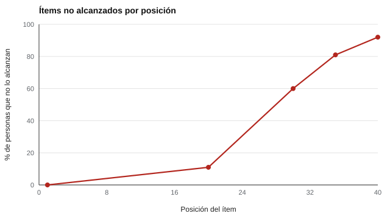

# 009 — Pruebas de velocidad, de potencia y tareas cronometradas


<!-- NAV -->
[← 008 — Tipos de test: rendimiento máximo frente a de…](../008-tipos-de-test-rendimiento-maximo-frente-a/README.md) · [📚 Parte 00](../README.md) · [🗺️ Índice 001–200](../../../PROGRAMA.md) · [010 — Introducción a la estadística descriptiva par… →](../010-introduccion-a-la-estadistica-descriptiva-para-evaluacion/README.md)
<!-- /NAV -->

**Parte 00 — Fundamentos de la medición psicológica** · Nivel fundamentos · 4 h · Estado `escrita`
**Pensada para:** quien diseña pruebas con tiempo, quien interpreta sus resultados y quien las rinde.
**Prerrequisitos:** clase 008.

## ¿Para qué te sirve esto?

Muchas pruebas tienen un límite de tiempo. ¿Qué se mide entonces: lo que sabes o lo rápido que trabajas? Depende de cómo se diseñó. Si no se aclara, el puntaje mezcla ambas cosas y puede penalizar a quien piensa con calma, tiene discapacidad o rinde en un segundo idioma. Esta clase te enseña a distinguir los tipos de prueba y a detectar cuando el tiempo contamina el resultado.

## Al terminar esta clase podrás

- Distinguir prueba de potencia, de velocidad y mixta.
- Calcular y leer el porcentaje de ítems no alcanzados por posición.
- Explicar por qué el alfa no delata la contaminación por velocidad.
- Decidir cuánto tiempo conviene dar según lo que se quiere medir.

## La idea en palabras simples

- **Prueba de potencia:** hay tiempo de sobra; lo que importa es hasta dónde llegas (ítems cada vez más difíciles).
- **Prueba de velocidad:** los ítems son fáciles y lo que importa es cuántos haces en poco tiempo (tachar letras, sumar rápido).
- **Mixta (la más común):** ítems exigentes **y** poco tiempo. Aquí es donde aparece el problema.

Es como una carrera de obstáculos con cronómetro: si hay mucho tiempo, gana quien salta mejor; si hay poco, gana quien corre más rápido, aunque salte peor.

## Cómo funciona, paso a paso

**1. El tiempo recorta el final.** Cuando el tiempo no alcanza, las personas lentas no llegan a los últimos ítems. Esos ítems se contabilizan como incorrectos aunque la persona hubiera podido resolverlos.

**2. Se mide con «ítems no alcanzados».** Para cada posición se calcula qué porcentaje no llegó a responderla.



*Figura 1.* En un test de 40 ítems con tiempo ajustado, casi nadie llega al final.

**3. Efecto sobre el puntaje.** El puntaje correlaciona más con la rapidez y menos con la habilidad.

**4. Una trampa estadística.** El coeficiente alfa (clase 022) apenas cambia, de modo que **no revela el problema**: una fiabilidad alta no prueba que se mida habilidad.

## Si construyes el instrumento

- Declara si la prueba es de potencia o de velocidad. Si quieres medir habilidad, da tiempo holgado (una regla práctica es que la gran mayoría complete el 90 % de los ítems).
- Registra los ítems omitidos y los no alcanzados por separado.
- Ofrece tiempo adicional cuando haya razones documentadas (clase 069).
- Si el tiempo es parte del constructo (por ejemplo, fluidez lectora), mídelo explícitamente.

## Si eres evaluado

- Pregunta cuánto tiempo hay y si el puntaje considera la velocidad.
- Si sabes que trabajas lento por razones legítimas (idioma, discapacidad, ansiedad), pide acomodaciones antes de la prueba.
- En una prueba con tiempo ajustado, no es una buena estrategia detenerse demasiado en un ítem difícil: avanzar y volver puede dar más puntaje.

## Qué muestra el laboratorio

`lab.py` simula 1.500 personas en una prueba de 40 ítems, con y sin límite de tiempo, donde habilidad y velocidad están algo relacionadas.

| Prueba | r con habilidad | r con velocidad | Alfa |
|---|---:|---:|---:|
| De potencia (sin límite) | 0,95 | 0,26 | 0,90 |
| Con límite de tiempo | 0,88 | 0,56 | 0,89 |

Ítems no alcanzados: 0 % (ítem 1), 11 % (ítem 20), 60 % (ítem 30), 81 % (ítem 35) y 92 % (ítem 40).

**Análisis.** (1) Con límite de tiempo, la correlación con la habilidad baja de 0,95 a 0,88 y la correlación con la velocidad sube de 0,26 a 0,56: el puntaje ahora mezcla ambas cosas. (2) El alfa casi no cambia (0,90 → 0,89): una fiabilidad alta no dice si se mide habilidad. (3) Los últimos ítems dejan de ser «difíciles» para ser «no alcanzados». (4) El resultado depende del límite elegido (28 minutos en la simulación): con otro tiempo, los números cambian.

## Errores frecuentes

- Dar tiempo ajustado sin declararlo.
- Tratar los no alcanzados como errores sin análisis.
- Confiar en el alfa como prueba de que se mide habilidad.
- No distinguir omitido (se saltó) de no alcanzado (no llegó).

## Lo mínimo que debes llevarte

1. Potencia mide hasta dónde llegas; velocidad mide cuán rápido.
2. Un tiempo ajustado mezcla ambas cosas.
3. El alfa no detecta la mezcla.
4. Declara el tiempo y registra los no alcanzados.

## Ejercicios

- **Inicial.** ¿Qué es un ítem «no alcanzado»? *Solución: uno que la persona no llegó a ver o responder por falta de tiempo.*
- **Intermedio.** Duplica el límite de tiempo en `lab.py` y observa las correlaciones.
- **Avanzado.** Propón cómo distinguir omitidos de no alcanzados en un registro de respuestas.
- **Aplicación.** Revisa una prueba cronometrada que conozcas y estima qué porcentaje no llega al final.

## Glosario

- **Prueba de potencia:** tiempo suficiente; mide capacidad.
- **Prueba de velocidad:** ítems fáciles y poco tiempo; mide rapidez.
- **Ítem no alcanzado:** ítem no respondido por falta de tiempo.
- **Contaminación:** influencia de algo ajeno al constructo en el puntaje.

## Laboratorio

```bash
python classes/part-00-fundamentos-de-la-medicion/009-pruebas-de-velocidad-de-potencia-y-tareas/lab.py
python classes/part-00-fundamentos-de-la-medicion/figuras.py
```

## Autoevaluación y criterios

1. ¿Por qué un límite de tiempo puede contaminar la medición de habilidad? 2. ¿Por qué el alfa no detecta el problema? 3. ¿Qué información pedirías antes de rendir una prueba cronometrada?
Se logra la clase si puedes distinguir los tipos de prueba y justificar el tiempo de una prueba concreta.

## Bibliografía

- Lord, F. M., & Novick, M. R. (1968). *Statistical Theories of Mental Test Scores*. Addison-Wesley.
- AERA, APA, & NCME (2014). *Standards for Educational and Psychological Testing*.

---

<!-- NAV -->
[← 008 — Tipos de test: rendimiento máximo frente a de…](../008-tipos-de-test-rendimiento-maximo-frente-a/README.md)  
[📚 Parte 00](../README.md) · [🗺️ Índice 001–200](../../../PROGRAMA.md)  
[010 — Introducción a la estadística descriptiva par… →](../010-introduccion-a-la-estadistica-descriptiva-para-evaluacion/README.md)
<!-- /NAV -->
