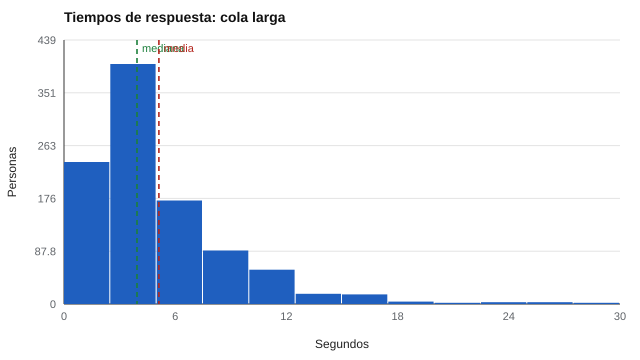

# 010 — Introducción a la estadística descriptiva para evaluación


<!-- NAV -->
[← 009 — Pruebas de velocidad, de potencia y tareas cr…](../009-pruebas-de-velocidad-de-potencia-y-tareas/README.md) · [📚 Parte 00](../README.md) · [🗺️ Índice 001–200](../../../PROGRAMA.md) · [011 — Redacción de ítems: las reglas y por qué exis… →](../../part-01-construccion-de-instrumentos/011-redaccion-de-items/README.md)
<!-- /NAV -->

**Parte 00 — Fundamentos de la medición psicológica** · Nivel fundamentos · 4 h · Estado `escrita`
**Pensada para:** cualquier persona que lea o produzca informes con puntajes.
**Prerrequisitos:** clase 004.

## ¿Para qué te sirve esto?

Un informe te dice «el promedio del curso fue 55». ¿Es un buen resumen? Depende de cómo se reparten los puntajes. Con datos simétricos, la media sirve; con datos asimétricos, o con un error de digitación, puede engañar. Esta clase te enseña a **mirar antes de resumir**, a elegir el resumen adecuado y a reconocer cuándo un solo dato cambia todo.

## Al terminar esta clase podrás

- Calcular e interpretar media, mediana, desviación típica y rango intercuartil.
- Leer un histograma y reconocer una distribución asimétrica.
- Elegir el resumen según la forma de los datos.
- Comprobar la robustez de un resumen ante un valor erróneo.

## La idea en palabras simples

Imagina que en una calle viven nueve personas que ganan 500 mil pesos y una que gana 50 millones. El **promedio** (media) es de unos 5 millones: ¡ninguna de las nueve gana algo parecido! La **mediana** (el valor del medio al ordenar) es 500 mil y describe mejor a «la persona típica». La lección: **elige el resumen según la forma de los datos**.

- **Media:** el «punto de equilibrio». Sensible a valores extremos.
- **Mediana:** el valor central. Robusta.
- **Desviación típica (DE):** cuánto se alejan, en promedio, los valores de la media.
- **Rango intercuartil (RIC):** la amplitud del 50 % central de los datos. Robusto.
- **Asimetría:** si hay una cola larga hacia un lado.

## Cómo funciona, paso a paso

**1. Primero graficar.** Un histograma muestra la forma: simétrica (campana) o con cola.



*Figura 1.* En datos con cola larga, la media queda por encima de la mediana.

**2. Elegir el resumen.** Simétricos: media y DE. Asimétricos: mediana y RIC (y a veces percentiles).

**3. Probar la robustez.** Si agregas un valor erróneo, ¿cambia mucho el resumen? La mediana y el RIC casi no cambian; la media y la DE, sí.

**4. Los extremos se investigan, no se borran.** Un valor raro puede ser un error de digitación (se corrige) o un caso real (se conserva y se explica). Siempre queda registro.

## Si construyes el instrumento

- Calcula siempre media, mediana, DE y asimetría de cada escala en el piloto.
- Revisa efectos de suelo y techo (muchos puntajes mínimos o máximos).
- Documenta la regla para tratar valores extremos.
- Si los tiempos de respuesta son un dato, usa la mediana, no la media.

## Si eres evaluado

- Cuando te informen «el promedio fue X», pregunta por la mediana o por la dispersión: un promedio solo puede esconder mucho.
- Tu puntaje sobre o bajo el promedio no dice mucho si la dispersión es pequeña (todos están cerca) o grande.
- Un puntaje extremo tuyo puede ser real o un error de registro: pide revisarlo.

## Qué muestra el laboratorio

`lab.py` compara puntajes simétricos con tiempos de cola larga y luego agrega un único valor erróneo (9.999 s).

| Conjunto | Media | Mediana | DE | RIC | Asimetría |
|---|---:|---:|---:|---:|---:|
| Puntajes (simétricos) | 55,0 | 54,5 | 11,7 | 15,6 | 0,03 |
| Tiempos (cola larga) | 5,3 | 4,1 | 4,0 | 4,2 | 2,18 |
| Tiempos + 1 valor erróneo | 15,3 | 4,1 | 315,9 | 4,2 | 31,58 |

**Análisis.** (1) Con datos simétricos, media y mediana casi coinciden. (2) Con cola larga, la media (5,3) queda sobre la mediana (4,1). (3) **Un solo** valor erróneo sube la media a 15,3 y la DE a 315,9, mientras que la mediana (4,1) y el RIC (4,2) no cambian: la mediana habría delatado que algo no cuadraba. (4) Son datos simulados; la forma exacta depende del proceso que genere los tiempos.

## Errores frecuentes

- Resumir sin graficar.
- Reportar solo la media con datos asimétricos.
- Borrar valores extremos sin registro.
- Interpretar la DE como «error» (no lo es: es dispersión).

## Lo mínimo que debes llevarte

1. Grafica antes de resumir.
2. Simétrico: media y DE; asimétrico: mediana y RIC.
3. La mediana resiste valores extremos; la media no.
4. Investiga los extremos; no los borres sin registro.

## Ejercicios

- **Inicial.** Calcula la mediana de 3, 5, 7, 9, 100. *Solución: 7.*
- **Intermedio.** Calcula la media recortada al 5 % de los tiempos de `lab.py` y compárala.
- **Avanzado.** Escribe una regla para tratar valores extremos en tiempos de respuesta y justifícala.
- **Aplicación.** Toma las notas de un curso (anonimizadas), grafícalas y decide qué resumen informarías.

## Glosario

- **Media:** suma de los valores dividida por el número de valores.
- **Mediana:** valor central al ordenar los datos.
- **Desviación típica:** medida de dispersión alrededor de la media.
- **Rango intercuartil:** distancia entre el percentil 25 y el 75.
- **Asimetría:** grado en que una distribución tiene una cola hacia un lado.

## Laboratorio

```bash
python classes/part-00-fundamentos-de-la-medicion/010-introduccion-a-la-estadistica-descriptiva-para-evaluacion/lab.py
python classes/part-00-fundamentos-de-la-medicion/figuras.py
```

## Autoevaluación y criterios

1. ¿Por qué la mediana resiste un valor extremo y la media no? 2. ¿Cuándo preferirías mediana y RIC? 3. ¿Qué harías al encontrar un valor sospechoso?
Se logra la clase si puedes elegir y justificar un resumen estadístico para un conjunto de datos y explicar su robustez.

## Bibliografía

- Tukey, J. W. (1977). *Exploratory Data Analysis*. Addison-Wesley. 🔎 sin verificar (libro, norma o sitio no hallado en Crossref: comprobar a mano)
- Wilcox, R. R. (2012). *Introduction to Robust Estimation and Hypothesis Testing* (3.ª ed.). Academic Press. 🔎 sin verificar (libro, norma o sitio no hallado en Crossref: comprobar a mano)

Leyenda: ✅ existe en Crossref con título y año coincidentes (enlace al DOI); ⚠️ hay una obra de título parecido con otro año (no se enlaza: comprobar la edición); 🔎 no verificada automáticamente (libros sin DOI, normas y sitios web). Crossref confirma la existencia de la fuente, no que respalde cada afirmación de la clase. Ver [`docs/VERIFICACION_BIBLIOGRAFIA.md`](../../../docs/VERIFICACION_BIBLIOGRAFIA.md).

---

<!-- NAV -->
[← 009 — Pruebas de velocidad, de potencia y tareas cr…](../009-pruebas-de-velocidad-de-potencia-y-tareas/README.md)  
[📚 Parte 00](../README.md) · [🗺️ Índice 001–200](../../../PROGRAMA.md)  
[011 — Redacción de ítems: las reglas y por qué exis… →](../../part-01-construccion-de-instrumentos/011-redaccion-de-items/README.md)
<!-- /NAV -->
