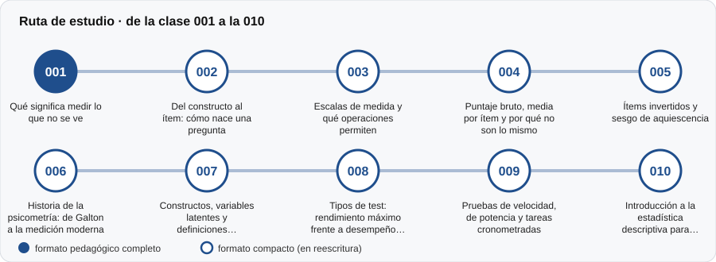

# 📏 Parte 00 — Fundamentos de la medición psicológica

**Nivel:** fundamentos · **Duración estimada:** 2-3 semanas · **Clases:** 10

## De qué trata

Qué significa medir algo que no se ve (la inteligencia, la motivación, el estrés) y qué compromisos asume cualquiera que lo intente. Se parte de la idea de constructo, se revisan los tipos de escala y de test, y se aprenden las herramientas estadísticas mínimas para leer un puntaje.

## Por qué importa

Todo el resto del programa se apoya en estas ideas. Quien no distingue un constructo de su definición operacional, o una escala ordinal de una de intervalo, termina interpretando números que no significan lo que parecen.

## Según tu papel

- **Si construyes o aplicas instrumentos:** Aprenderás a partir de una definición clara del atributo, a decidir qué tipo de prueba corresponde (rendimiento máximo o desempeño típico) y a resumir datos sin engañarte.
- **Si eres evaluado o recibes resultados:** Entenderás qué significa realmente un puntaje, por qué no es una medida exacta como la de una regla y qué preguntas puedes hacer antes de aceptar un resultado.

## Al terminar esta parte podrás

- Explicar con tus palabras qué es un constructo y cómo se vuelve observable.
- Distinguir los cuatro niveles de medida y las operaciones que permite cada uno.
- Calcular e interpretar un puntaje bruto, una media por ítem y un ítem invertido.
- Reconocer cuándo una prueba mide velocidad y cuándo potencia.

## Cómo estudiarla

Léela completa y en orden. No exige conocimientos previos de estadística. Ejecuta cada laboratorio y lee la sección «Qué muestra el laboratorio» antes de pasar a la clase siguiente.

## Ruta de estudio

## Clases en orden de estudio

Las clases están numeradas de forma consecutiva (001 a 200) en el orden de estudio: sigue el número.

| Orden | ID | Clase | Qué aprenderás | Formato | Horas |
|---:|---|---|---|---|---:|
| 1 | 001 | [Qué significa medir lo que no se ve](001-que-significa-medir-lo-que-no-se-ve/README.md) | Distinguir un constructo (la idea) de su indicador (lo que se observa). | ✅ pedagógico | 4 |
| 2 | 002 | [Del constructo al ítem: cómo nace una pregunta](002-del-constructo-al-item/README.md) | Definir un constructo con la precisión suficiente para que sea medible. | 🟡 compacto | 4 |
| 3 | 003 | [Escalas de medida y qué operaciones permiten](003-escalas-de-medida-y-sus-operaciones/README.md) | Clasificar una variable en nominal, ordinal, de intervalo o de razón. | 🟡 compacto | 3 |
| 4 | 004 | [Puntaje bruto, media por ítem y por qué no son lo mismo](004-puntaje-bruto-y-media-por-item/README.md) | Calcular bruto y media por ítem, y decir cuándo usar cada uno. | 🟡 compacto | 3 |
| 5 | 005 | [Ítems invertidos y sesgo de aquiescencia](005-items-invertidos-y-aquiescencia/README.md) | Definir aquiescencia y describir cómo distorsiona un perfil. | 🟡 compacto | 4 |
| 6 | 006 | [Historia de la psicometría: de Galton a la medición moderna](006-historia-de-la-psicometria-de-galton-a/README.md) | Explicar la regresión a la media a partir de Galton. | 🟡 compacto | 4 |
| 7 | 007 | [Constructos, variables latentes y definiciones operacionales](007-constructos-variables-latentes-y-definiciones-operacionales/README.md) | Distinguir constructo y definición operacional. | 🟡 compacto | 4 |
| 8 | 008 | [Tipos de test: rendimiento máximo frente a desempeño típico](008-tipos-de-test-rendimiento-maximo-frente-a/README.md) | Distinguir rendimiento máximo y desempeño típico. | 🟡 compacto | 4 |
| 9 | 009 | [Pruebas de velocidad, de potencia y tareas cronometradas](009-pruebas-de-velocidad-de-potencia-y-tareas/README.md) | Distinguir velocidad y potencia. | 🟡 compacto | 4 |
| 10 | 010 | [Introducción a la estadística descriptiva para evaluación](010-introduccion-a-la-estadistica-descriptiva-para-evaluacion/README.md) | Elegir el resumen según la forma de la distribución. | 🟡 compacto | 4 |

[← Volver al índice del programa](../../README.md) · [Índice numérico de las 200 clases](../../PROGRAMA.md)
