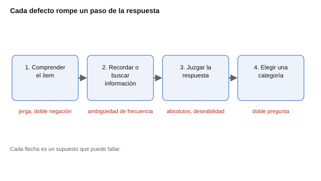

# 011 — Redacción de ítems: las reglas y por qué existen


<!-- NAV -->
[← 010 — Introducción a la estadística descriptiva par…](../../part-00-fundamentos-de-la-medicion/010-introduccion-a-la-estadistica-descriptiva-para-evaluacion/README.md) · [📚 Parte 01](../README.md) · [🗺️ Índice 001–200](../../../PROGRAMA.md) · [012 — Formatos de respuesta: Likert, dicotómico, co… →](../012-formatos-de-respuesta/README.md)
<!-- /NAV -->

**Parte 01 — Construcción de instrumentos** · Nivel fundamentos · 4 h · Estado `escrita`
**Pensada para:** quien escribe o revisa preguntas, y quien responde cuestionarios y quiere entender por qué algunas confunden.
**Prerrequisitos:** clases 001 a 005.

## ¿Para qué te sirve esto?

Un ítem es la unidad mínima de un cuestionario: si está mal escrito, ninguna técnica posterior lo repara. Si escribes preguntas, esta clase te da reglas con su razón. Si revisas cuestionarios, te da una lista de verificación. Si los respondes, te explica por qué ciertas preguntas te dejan dudando: no es que tú «no entiendas», es que el ítem está mal hecho.

## Al terminar esta clase podrás

- Identificar y corregir doble pregunta, absolutos, doble negación y exceso de longitud.
- Explicar qué error de medida introduce cada defecto.
- Distinguir un defecto de **forma** (se detecta con reglas) de uno de **sentido** (requiere personas).
- Revisar un banco de ítems con una lista de verificación reproducible.

## La idea en palabras simples

Responder un ítem es un proceso de varios pasos, aunque ocurra en segundos: **comprender** la frase, **buscar** en la memoria, **juzgar** y **elegir** una opción. Cada defecto de redacción rompe uno de esos pasos. Lo grave es que, cuando el paso se rompe, la persona **responde igual**: no deja el ítem en blanco, da una respuesta cualquiera. El resultado no es un dato faltante, es un **dato contaminado**, y nadie lo nota.



*Figura 1.* Cada defecto de redacción rompe un paso; la persona responde de todos modos, y el dato queda contaminado.

## Cómo funciona, paso a paso

### Las reglas y su mecanismo

| Defecto | Ejemplo | Qué se rompe |
|---|---|---|
| Doble pregunta | «Planifico mi semana y reviso mi avance cada día» | Quien hace lo uno y no lo otro no tiene respuesta válida; elige al azar. |
| Absoluto | «Siempre termino lo que empiezo» | Casi nadie asiente; el ítem pierde varianza y discrimina poco. |
| Doble negación | «Me cuesta no distraerme cuando no hay nadie que me supervise» | El acuerdo significa lo contrario de lo que parece; sube el error de lectura. |
| Exceso de longitud | más de unas 20 palabras | Cae la comprensión, sobre todo en lectores menos fluidos o en segunda lengua. |
| Jerga o ambigüedad | «Soy proactivo» | Cada persona le da un significado; se mide vocabulario, no rasgo. |
| Deseabilidad evidente | «Soy una persona honesta» | Todos asienten; se mide imagen, no conducta. |

**Las reglas no son leyes.** Son hipótesis sobre cómo se rompe la respuesta. Un absoluto puede ser defendible si el constructo es genuinamente extremo (por ejemplo, un indicador de riesgo en un cribado), y **por eso se documenta la excepción**.

### Ejemplo resuelto

Ítem original: *«Siempre planifico mi trabajo y nunca me distraigo»*.

1. Tiene **dos ideas** (planificar y distraerse): se separa en dos ítems.
2. «Siempre» y «nunca» son **absolutos**: se suavizan con una frecuencia («Planifico mi trabajo antes de comenzar»).
3. «Nunca me distraigo» es negación más absoluto: se reformula en positivo («Mantengo la atención en lo que hago»).
4. Longitud final: 6 y 7 palabras.

## Si construyes el instrumento

- Escribe un ítem por idea; pide a un colega que intente responder dos versiones distintas del mismo ítem y vea si duda.
- Usa afirmaciones positivas y concretas; deja los invertidos para la redacción del polo opuesto del rasgo, no para añadir «no» (clase 005).
- Mantén una lista de verificación y regístrala junto al banco.
- Ninguna revisión de forma sustituye pedirle a personas de la población objetivo que expliquen el ítem con sus palabras (clase 019).

## Si eres evaluado

- Si un ítem te obliga a responder dos cosas a la vez, elige lo más cercano y avisa a quien aplica la prueba: es un defecto del ítem, no tuyo.
- Los «siempre» y «nunca» casi nunca describen a nadie: si dudas, responde según tu tendencia general.
- Si la frase está llena de negaciones, relee con calma antes de marcar: es fácil responder al revés por un descuido.

## Qué muestra el laboratorio

`lab.py` es un **linter** heurístico: un revisor automático por reglas que detecta cuatro defectos de forma. Se prueba con seis ítems etiquetados a mano.

| Ítem | Esperado | Detectado |
|---|---|---|
| «Me cuesta no distraerme cuando no hay nadie que me supervise.» | mala | doble negación |
| «Siempre termino lo que empiezo.» | mala | absoluto |
| «Planifico mi semana y reviso mi avance cada día con mis compañeros de equipo.» | mala | posible doble pregunta |
| «Termino las tareas que empiezo.» | buena | — |
| «Organizo mi trabajo antes de comenzar.» | buena | — |
| «Cuando algo sale mal, busco qué cambiar.» | buena | — |

**Análisis.** (1) El linter coincide con la etiqueta humana en 6 de 6 ítems, que es un resultado favorable pero con una muestra muy pequeña. (2) Revisa la **forma**, no el **sentido**: un ítem breve y afirmativo puede seguir siendo ambiguo y pasar la revisión. (3) Por eso es una ayuda para ordenar la revisión, no un sustituto de personas reales. (4) Las reglas del linter son heurísticas (por ejemplo, la «doble pregunta» se detecta por la conjunción «y» en un ítem largo) y pueden producir falsos positivos.

## Errores frecuentes

- Corregir la forma y olvidar el sentido.
- Invertir un ítem añadiendo «no» en lugar de redactar el polo opuesto.
- Dar por válido un ítem porque «se entiende bien» a quien lo escribió.
- Aplicar las reglas como leyes sin documentar las excepciones.

## Lo mínimo que debes llevarte

1. Un ítem, una idea.
2. Los defectos no dejan un hueco: producen respuestas contaminadas.
3. Las reglas son hipótesis; las excepciones se documentan.
4. El linter revisa forma; solo las personas revelan el sentido.

## Ejercicios

- **Inicial.** ¿Cuál tiene doble pregunta: a) «Disfruto aprender y enseñar»; b) «Disfruto aprender»? *Solución: a).*
- **Intermedio.** Reescribe «Nunca dejo de ser amable con quien no me cae bien» sin negaciones ni absolutos. *Ej.: «Trato con amabilidad a personas que me caen mal».*
- **Avanzado.** Toma diez ítems de un instrumento del catálogo (`psychometrics ficha <código>`), pásalos por el linter y discute dos casos que el linter marque pero que tú aceptes.
- **Aplicación.** Revisa un cuestionario de tu entorno (anonimizado) y clasifica cada defecto.

## Glosario

- **Ítem:** pregunta o afirmación de un instrumento.
- **Doble pregunta:** ítem que pide valorar dos ideas a la vez.
- **Absoluto:** palabra como «siempre» o «nunca».
- **Linter:** herramienta que revisa reglas de forma de manera automática.
- **Dato contaminado:** respuesta que no refleja lo que se pretendía medir.

## Laboratorio

```bash
python classes/part-01-construccion-de-instrumentos/011-redaccion-de-items/lab.py
python classes/part-01-construccion-de-instrumentos/figuras.py
```

## Autoevaluación y criterios

1. ¿Por qué un absoluto reduce la discriminación? 2. ¿Qué paso del proceso rompe una doble negación? 3. Da un caso en que un absoluto sea legítimo y cómo lo documentarías.
Se logra la clase si puedes corregir ítems defectuosos justificando cada cambio y explicar los límites de una revisión automática.

## Bibliografía

- Haladyna, T. M., & Downing, S. M. (1989). A taxonomy of multiple-choice item-writing rules. *Applied Measurement in Education*, 2(1), 37-50. ✅ [DOI](https://doi.org/10.1207/s15324818ame0201_3)
- Tourangeau, R., Rips, L. J., & Rasinski, K. (2000). *The Psychology of Survey Response*. Cambridge University Press. ✅ [DOI](https://doi.org/10.1017/cbo9780511819322)

Leyenda: ✅ existe en Crossref con título y año coincidentes (enlace al DOI); ⚠️ hay una obra de título parecido con otro año (no se enlaza: comprobar la edición); 🔎 no verificada automáticamente (libros sin DOI, normas y sitios web). Crossref confirma la existencia de la fuente, no que respalde cada afirmación de la clase. Ver [`docs/VERIFICACION_BIBLIOGRAFIA.md`](../../../docs/VERIFICACION_BIBLIOGRAFIA.md).

---

<!-- NAV -->
[← 010 — Introducción a la estadística descriptiva par…](../../part-00-fundamentos-de-la-medicion/010-introduccion-a-la-estadistica-descriptiva-para-evaluacion/README.md)  
[📚 Parte 01](../README.md) · [🗺️ Índice 001–200](../../../PROGRAMA.md)  
[012 — Formatos de respuesta: Likert, dicotómico, co… →](../012-formatos-de-respuesta/README.md)
<!-- /NAV -->
