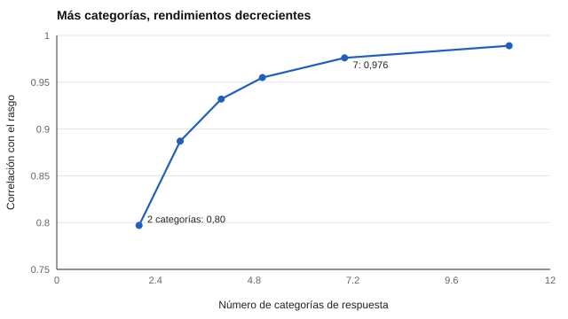

# 012 — Formatos de respuesta: Likert, dicotómico, continuo


<!-- NAV -->
[← 011 — Redacción de ítems: las reglas y por qué exis…](../011-redaccion-de-items/README.md) · [📚 Parte 01](../README.md) · [🗺️ Índice 001–200](../../../PROGRAMA.md) · [013 — Ipsativo frente a normativo: la trampa de la… →](../013-ipsativo-vs-normativo/README.md)
<!-- /NAV -->

**Parte 01 — Construcción de instrumentos** · Nivel fundamentos · 3 h · Estado `escrita`
**Pensada para:** quien diseña cuestionarios, quien los interpreta y quien los contesta.
**Prerrequisitos:** clases 003 y 011.

## ¿Para qué te sirve esto?

¿Cinco opciones o siete? ¿Con punto medio o sin él? ¿Una línea para marcar? Elegir el formato de respuesta parece un detalle de diseño, pero decide **cuánta información del rasgo llega al puntaje** y qué errores se facilitan. Si diseñas, evitas decisiones por costumbre; si interpretas, sabes qué precisión es razonable esperar; si contestas, entiendes por qué a veces te «obligan» a elegir.

## Al terminar esta clase podrás

- Comparar los formatos dicotómico, Likert y continuo.
- Cuantificar la información que se pierde con pocas categorías.
- Justificar el número de categorías según población y propósito.
- Reconocer el efecto del punto medio y de las etiquetas.

## La idea en palabras simples

Piensa en medir la altura de alguien con una cinta marcada solo cada 50 centímetros («menos de 1,50» o «más de 1,50»): sabrás poco. Con marcas cada 10 cm sabrás más; cada 1 cm, casi todo. Con los rasgos pasa igual: **cuantas más categorías, menos información se pierde**, pero hay un punto a partir del cual las personas ya no distinguen entre categorías vecinas y las extra solo agregan ruido y cansancio.

| Formato | Ejemplo | Ventaja | Costo |
|---|---|---|---|
| Dicotómico | Sí / No | Rápido y claro | Mucha información perdida |
| Politómico (Likert) | 1 a 5 de acuerdo | Equilibrio habitual | Estilos de respuesta (aquiescencia, extremos) |
| Continuo (escala visual análoga) | Marca en una línea | Aparente granularidad | Más lento; la precisión real suele ser menor que la aparente |

## Cómo funciona, paso a paso

**1. Discretizar es perder información.** Si el rasgo es continuo y se registra en *k* categorías, la correlación entre la categoría y el rasgo es un **techo** para cualquier fiabilidad posterior.



*Figura 1.* De 2 a 5 categorías se gana mucho; de 7 a 11, casi nada.

**2. Decisiones prácticas.**

- **Punto medio sí o no.** Con número impar existe «ni de acuerdo ni en desacuerdo»: sirve de refugio a quien no entiende el ítem. Con número par se fuerza una inclinación. No hay regla universal: depende del constructo.
- **Etiquetas.** Etiquetar todas las categorías ayuda a que signifiquen lo mismo para todos; solo los extremos las deja abiertas a interpretación.
- **Población.** Con niños pequeños o segunda lengua, menos categorías y apoyo con pictogramas.

**3. Ejemplo resuelto.** Se quiere medir perseverancia en estudiantes de 8.º básico. Una escala de 7 categorías añade 0,02 de fidelidad sobre una de 5, pero eleva la carga cognitiva. Decisión: 4 categorías etiquetadas con caritas y palabras, sin punto medio, para evitar la respuesta neutra por falta de comprensión.

## Si construyes el instrumento

- Elige el número de categorías según quién responde, no por tradición.
- Mantén el mismo formato en todos los ítems de una escala.
- Etiqueta todas las categorías con palabras claras y evita etiquetas ambiguas («a veces»).
- No trates una escala de 5 puntos como si fuera de razón (clase 003).

## Si eres evaluado

- Si dudas entre dos categorías vecinas, la diferencia importa poco: no te angusties.
- Si no hay punto medio y sientes que «ninguna opción te representa», puedes decírselo a quien aplica la prueba: es información útil sobre el ítem.
- Una línea continua no significa que tu respuesta se mida con precisión milimétrica.

## Qué muestra el laboratorio

`lab.py` simula un rasgo normal registrado en distinto número de categorías equiespaciadas y calcula su correlación con el rasgo.

| Categorías | r con el rasgo | Ganancia |
|---:|---:|---:|
| 2 | 0,797 (teórico √(2/π) = 0,798) | — |
| 3 | 0,887 | +0,090 |
| 4 | 0,932 | +0,046 |
| 5 | 0,955 | +0,023 |
| 7 | 0,976 | +0,021 |
| 11 | 0,989 | +0,013 |

**Análisis.** (1) El valor con 2 categorías coincide con el teórico: la simulación es correcta. (2) De 2 a 5 categorías se gana 0,16; de 7 a 11, 0,013 en total. (3) Además, las personas no discriminan tantas categorías: más no es mejor. (4) Se supuso un rasgo normal y umbrales equiespaciados; con rasgos asimétricos o umbrales óptimos las cifras cambian. Es una ilustración, no una norma.

## Errores frecuentes

- Tratar una escala de 5 puntos como si fuera de razón.
- Cambiar el número de categorías entre ítems de una misma escala.
- Creer que la escala visual análoga «es más precisa» por ser continua.
- Añadir categorías «para tener más precisión» sin comprobar que la gente las distingue.

## Lo mínimo que debes llevarte

1. Menos categorías, más pérdida de información, con rendimientos decrecientes.
2. Entre 4 y 7 categorías suele ser un buen equilibrio, según la población.
3. El punto medio es una decisión de diseño con ventajas y costos.
4. Etiqueta todas las categorías.

## Ejercicios

- **Inicial.** ¿Qué formato elegirías para un cribado de 3 minutos en una sala de espera? Justifica. *Guía: pocas categorías, claras, rápidas.*
- **Intermedio.** Calcula cuánto mejora la fidelidad de 3 a 5 categorías. *Solución: 0,955 − 0,887 = 0,068.*
- **Avanzado.** Modifica `lab.py` para usar un rasgo asimétrico (por ejemplo exponencial) y reporta qué pasa con las 2 categorías.
- **Aplicación.** Revisa el formato de un cuestionario real y propón una mejora justificada para su población.

## Glosario

- **Dicotómico:** con dos respuestas posibles.
- **Politómico:** con más de dos categorías ordenadas.
- **Likert:** escala de acuerdo con categorías etiquetadas.
- **Punto medio:** categoría central («ni de acuerdo ni en desacuerdo»).
- **Discretización:** convertir un rasgo continuo en categorías.

## Laboratorio

```bash
python classes/part-01-construccion-de-instrumentos/012-formatos-de-respuesta/lab.py
python classes/part-01-construccion-de-instrumentos/figuras.py
```

## Autoevaluación y criterios

1. ¿Por qué la fidelidad de la discretización limita la fiabilidad? 2. ¿Cuándo preferirías un número par de categorías? 3. ¿Qué pasa si añades categorías que la gente no distingue?
Se logra la clase si puedes justificar el formato de respuesta para una población concreta usando la evidencia del laboratorio.

## Bibliografía

- Likert, R. (1932). A technique for the measurement of attitudes. *Archives of Psychology*, 22(140), 1-55. 🔎 sin verificar (libro, norma o sitio no hallado en Crossref: comprobar a mano)
- Preston, C. C., & Colman, A. M. (2000). Optimal number of response categories in rating scales. *Acta Psychologica*, 104(1), 1-15. ✅ [DOI](https://doi.org/10.1016/s0001-6918(99)00050-5)

Leyenda: ✅ existe en Crossref con título y año coincidentes (enlace al DOI); ⚠️ hay una obra de título parecido con otro año (no se enlaza: comprobar la edición); 🔎 no verificada automáticamente (libros sin DOI, normas y sitios web). Crossref confirma la existencia de la fuente, no que respalde cada afirmación de la clase. Ver [`docs/VERIFICACION_BIBLIOGRAFIA.md`](../../../docs/VERIFICACION_BIBLIOGRAFIA.md).

---

<!-- NAV -->
[← 011 — Redacción de ítems: las reglas y por qué exis…](../011-redaccion-de-items/README.md)  
[📚 Parte 01](../README.md) · [🗺️ Índice 001–200](../../../PROGRAMA.md)  
[013 — Ipsativo frente a normativo: la trampa de la… →](../013-ipsativo-vs-normativo/README.md)
<!-- /NAV -->
