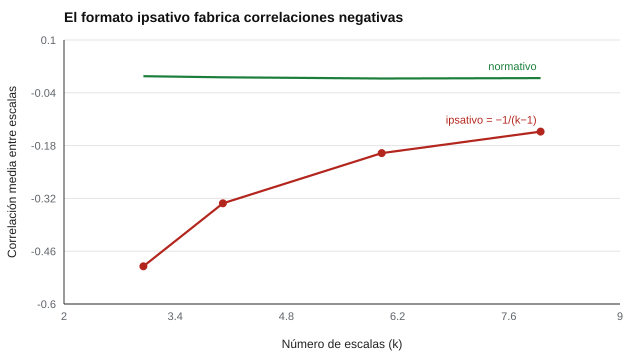

# 013 — Ipsativo frente a normativo: la trampa de la elección forzada


<!-- NAV -->
[← 012 — Formatos de respuesta: Likert, dicotómico, co…](../012-formatos-de-respuesta/README.md) · [📚 Parte 01](../README.md) · [🗺️ Índice 001–200](../../../PROGRAMA.md) · [014 — Longitud del test: el intercambio entre preci… →](../014-longitud-y-costo-de-medida/README.md)
<!-- /NAV -->

**Parte 01 — Construcción de instrumentos** · Nivel fundamentos · 4 h · Estado `escrita`
**Pensada para:** quien diseña o elige cuestionarios, quien interpreta perfiles y quien es evaluado.
**Prerrequisitos:** clases 003, 005 y 012.

## ¿Para qué te sirve esto?

Algunos cuestionarios te piden **elegir entre opciones**: «¿cuál te describe más: A, B, C o D?» o «ordena estas cuatro frases de la más a la menos propia». Parecen más difíciles de «falsear», y por eso se usan en selección de personal. Pero tienen un costo matemático que invalida ciertas comparaciones, entre ellas **comparar a dos personas entre sí**. Esta clase te enseña a reconocer el formato y a usarlo solo para lo que sirve.

## Al terminar esta clase podrás

- Distinguir medida ipsativa y normativa.
- Explicar por qué las escalas ipsativas suman una constante.
- Predecir la correlación negativa que se fabrica: −1/(k−1).
- Decidir cuándo usar elección forzada y cuándo no.

## La idea en palabras simples

Imagina que repartes 100 monedas entre cuatro cajas. Si pones más en una, **necesariamente** pones menos en otra. Aunque a ti te gusten las cuatro cajas por igual, el reparto te obliga a priorizar. Un cuestionario ipsativo hace lo mismo con tus rasgos: tus puntajes describen **cómo se ordenan tus preferencias dentro de ti**, no cuánto de cada rasgo tienes comparado con otros.

- **Normativo:** cada escala se puntúa con independencia; alguien puede puntuar alto en todas.
- **Ipsativo:** el puntaje se reparte; si una escala sube, otra baja.

## Cómo funciona, paso a paso

**1. La suma es constante.** En un formato ipsativo, las *k* escalas suman lo mismo para todas las personas: la varianza de la suma es cero.

**2. Eso fabrica correlaciones negativas.** Si la suma es fija, cuando una escala sube las demás bajan, **aunque los rasgos reales sean independientes**. La correlación media esperada es −1/(k−1) (Hicks, 1970).



*Figura 1.* La línea verde (normativo) está en 0; la roja (ipsativo) sigue la fórmula.

**3. Comparar personas es ambiguo.** Dos personas pueden tener el mismo perfil ordenado siendo una alta en todo y otra baja en todo.

**4. Se distorsionan los análisis.** El análisis factorial y las correlaciones con criterios externos pierden sentido.

**5. Cuándo sirve.** Para **orientar una conversación individual** («¿qué prefieres tú?») o cuando todas las opciones son igual de deseables y se quiere reducir el falseamiento. No sirve para ordenar personas ni para estimar el nivel absoluto de un rasgo, salvo con modelos especiales de elección forzada (Brown & Maydeu-Olivares, 2011), que exigen diseños y calibración específicos.

## Si construyes el instrumento

- Si necesitas comparar personas, usa formato normativo (Likert) y controla el falseamiento por otras vías.
- Si usas elección forzada, usa modelos que recuperen puntajes normativos y declara el diseño.
- No interpretes correlaciones negativas entre escalas ipsativas como «rasgos opuestos».
- Verifica en el archivo del instrumento si es ipsativo: en este repositorio, `ipsativo: false` en los cinco YAML; el DISC abierto y Valores de Spranger usan Likert a propósito.

## Si eres evaluado

- En un formato de elección forzada, no hay respuestas «correctas»: tu perfil describe tu jerarquía interna. Responde según lo que realmente prefieres.
- Un perfil ipsativo no dice que seas «poco» algo en términos absolutos: dice que lo prefieres menos que otras cosas.
- Si te rankean o comparan con otros usando este formato, puedes preguntar si el instrumento está diseñado para eso.

## Qué muestra el laboratorio

`lab.py` simula rasgos independientes y calcula la correlación media entre escalas en formato normativo y ipsativo.

| k escalas | Normativo | Ipsativo | −1/(k−1) | Suma por persona |
|---:|---:|---:|---:|---:|
| 3 | 0,004 | −0,500 | −0,500 | 8,9e−16 |
| 4 | 0,001 | −0,333 | −0,333 | 6,7e−16 |
| 6 | −0,002 | −0,200 | −0,200 | 1,3e−15 |
| 8 | −0,001 | −0,143 | −0,143 | 1,1e−15 |

**Análisis.** (1) Con rasgos independientes, el formato normativo da correlaciones ≈ 0; el ipsativo, exactamente −1/(k−1). (2) La suma por persona es del orden de 10⁻¹⁵: es cero numérico, la propiedad de suma constante. (3) El formato fabrica relaciones que no existen en los rasgos. (4) El resultado supone escalas independientes y de varianza similar; con rasgos correlacionados las cifras cambian, pero el sesgo negativo estructural permanece.

## Errores frecuentes

- Interpretar una correlación negativa entre escalas ipsativas como «rasgos opuestos».
- Comparar el puntaje ipsativo de dos personas como si fuera normativo.
- Llamar «ipsativo» a cualquier ranking sin revisar si hay suma fija.
- Decidir una selección ordenando personas por un puntaje ipsativo.

## Lo mínimo que debes llevarte

1. Ipsativo: las escalas suman una constante.
2. Eso fabrica correlaciones negativas: −1/(k−1).
3. Sirve para ordenar preferencias dentro de una persona, no para comparar personas.
4. Para comparar, usa formatos normativos o modelos especiales.

## Ejercicios

- **Inicial.** ¿Es ipsativa una escala Likert de 1 a 5? ¿Y repartir 100 puntos entre 5 áreas? *Solución: no; sí.*
- **Intermedio.** Predice la correlación media con 6 escalas ipsativas independientes. *Solución: −0,20.*
- **Avanzado.** Modifica `lab.py` para correlacionar dos rasgos reales con r = 0,5 antes de ipsatizar y compara con la predicción.
- **Aplicación.** ¿Qué decisión de personal sería indefendible con puntajes ipsativos? Redacta un párrafo.

## Glosario

- **Ipsativo:** puntaje que se reparte entre escalas y suma una constante.
- **Normativo:** puntaje independiente por escala, comparable entre personas.
- **Elección forzada:** formato en que se elige o se ordena entre opciones.
- **Falseamiento:** responder de modo que se produzca una imagen deseada.

## Laboratorio

```bash
python classes/part-01-construccion-de-instrumentos/013-ipsativo-vs-normativo/lab.py
python classes/part-01-construccion-de-instrumentos/figuras.py
```

## Autoevaluación y criterios

1. ¿Por qué la suma constante implica correlaciones negativas? 2. ¿Qué decisión de personal sería indefendible con puntajes ipsativos? 3. ¿Qué ventaja real conserva la elección forzada?
Se logra la clase si puedes derivar la propiedad de suma constante, predecir la correlación y rechazar usos de comparación entre personas con datos ipsativos.

## Bibliografía

- Hicks, L. E. (1970). Some properties of ipsative, normative, and forced-choice normative measures. *Psychological Bulletin*, 74(3), 167-184.
- Brown, A., & Maydeu-Olivares, A. (2011). Item response modeling of forced-choice questionnaires. *Educational and Psychological Measurement*, 71(3), 460-502.

---

<!-- NAV -->
[← 012 — Formatos de respuesta: Likert, dicotómico, co…](../012-formatos-de-respuesta/README.md)  
[📚 Parte 01](../README.md) · [🗺️ Índice 001–200](../../../PROGRAMA.md)  
[014 — Longitud del test: el intercambio entre preci… →](../014-longitud-y-costo-de-medida/README.md)
<!-- /NAV -->
