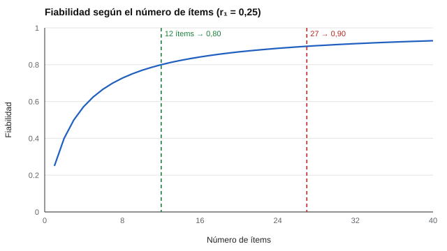

# 014 — Longitud del test: el intercambio entre precisión y abandono


<!-- NAV -->
[← 013 — Ipsativo frente a normativo: la trampa de la…](../013-ipsativo-vs-normativo/README.md) · [📚 Parte 01](../README.md) · [🗺️ Índice 001–200](../../../PROGRAMA.md) · [015 — Pilotaje y análisis clásico de ítems →](../015-pilotaje-y-analisis-de-items/README.md)
<!-- /NAV -->

**Parte 01 — Construcción de instrumentos** · Nivel fundamentos · 3 h · Estado `escrita`
**Pensada para:** quien decide cuántas preguntas incluir, quien interpreta resultados y quien responde.
**Prerrequisitos:** clases 004 y 012.

## ¿Para qué te sirve esto?

¿Cuántas preguntas hacen falta? Con pocas, el puntaje es ruidoso; con muchas, la gente se cansa, responde sin leer o abandona. Esta clase te da una **fórmula** para decidir con datos y no con intuición, y te enseña a ver cuándo agregar ítems ya casi no ayuda. Es útil si diseñas cuestionarios, si te piden «acortar» uno o si te preguntas por qué un test es tan largo.

## Al terminar esta clase podrás

- Aplicar la fórmula de Spearman-Brown (directa e inversa).
- Explicar por qué agregar ítems rinde cada vez menos.
- Decidir una longitud considerando precisión y carga para quien responde.
- Reconocer el supuesto que la fórmula necesita (ítems paralelos).

## La idea en palabras simples

Piensa en pedir opinión sobre una película. Con una persona, el resultado es muy variable; con diez, ya se estabiliza; con cien, apenas cambia respecto de los diez. Cada ítem adicional es «una opinión más» sobre el rasgo: al principio ayuda mucho, después cada vez menos. Mientras tanto, cada pregunta extra cuesta tiempo y paciencia a quien responde.

## Cómo funciona, paso a paso

**1. Si cada ítem tiene fiabilidad r₁** (correlación con un ítem paralelo), la fiabilidad de una escala de *k* ítems paralelos es:

```
rₖ = k · r₁ / (1 + (k − 1) · r₁)        (Spearman, 1910; Brown, 1910)
```

**2. Y el número de ítems para una fiabilidad objetivo ρ:**

```
k = ρ · (1 − r₁) / ( r₁ · (1 − ρ) )
```



*Figura 1.* Con r₁ = 0,25, alcanzar 0,80 requiere 12 ítems y 0,90 requiere 27; después de unos 30, cada ítem suma muy poco.

**3. Ejemplo resuelto.** Un cribado de 6 ítems con r₁ = 0,30 da r₆ = 6 · 0,30 / (1 + 5 · 0,30) = 1,8 / 2,5 = **0,72**. Para llegar a 0,80 harían falta k = 0,80 · 0,70 / (0,30 · 0,20) = 9,3, es decir, **10 ítems**.

**4. El otro lado: el costo.** Cada ítem extra aumenta cansancio, respuestas apresuradas y abandono. Y la fórmula asume ítems **paralelos**: ítems poco relacionados con el constructo no suben la fiabilidad como se predice. Por eso las formas cortas se construyen eligiendo los ítems más discriminantes (clase 015), no recortando al azar.

## Si construyes el instrumento

- Define la fiabilidad que necesitas según la decisión: un cribado puede aceptar 0,70; una decisión individual importante exige más (clase 025).
- Calcula k con la fórmula y revisa si el tiempo resultante es razonable para la población.
- Para acortar un test, conserva los ítems más discriminantes y recalcula la fiabilidad en datos nuevos.
- No afirmes que «más ítems, mejor» sin mirar la ganancia marginal.

## Si eres evaluado

- Un cuestionario muy largo puede bajar la calidad de tus respuestas por cansancio: avisa si necesitas una pausa.
- Un test corto (5 ítems) da un resultado más inestable que uno largo; un puntaje de un cribado breve no debería usarse para decisiones importantes sin más información.
- Pregunta cuánto error tiene el puntaje (error típico de medida, clase 025).

## Qué muestra el laboratorio

`lab.py` calcula la fiabilidad predicha y la compara con el alfa de datos simulados, con r₁ = 0,25.

| Ítems | Predicha | Alfa simulado | Ganancia |
|---:|---:|---:|---:|
| 2 | 0,400 | 0,405 | +0,400 |
| 5 | 0,625 | 0,612 | +0,225 |
| 10 | 0,769 | 0,762 | +0,144 |
| 20 | 0,870 | 0,865 | +0,100 |
| 40 | 0,930 | 0,928 | +0,061 |

Ítems necesarios: **12** para fiabilidad 0,80 y **27** para 0,90.

**Análisis.** (1) La fiabilidad simulada sigue a la predicha con diferencias de milésimas: la fórmula describe bien este modelo. (2) Pasar de 20 a 40 ítems suma solo 0,06 y duplica el tiempo de respuesta. (3) Para 0,90 hacen falta más del doble de ítems que para 0,80. (4) Los datos son simulados con errores independientes y normales; en datos reales la fiabilidad depende de la muestra.

## Errores frecuentes

- Afirmar «más ítems, mejor» sin mirar la ganancia marginal.
- Aplicar Spearman-Brown a ítems heterogéneos.
- Confundir fiabilidad alta con validez alta.
- Acortar un test quitando ítems al azar.

## Lo mínimo que debes llevarte

1. La fiabilidad crece con k, pero cada vez menos.
2. Hay una fórmula para decidir cuántos ítems usar.
3. Ítems extra cuestan cansancio y abandono.
4. La fórmula supone ítems paralelos.

## Ejercicios

- **Inicial.** Calcula r₄ con r₁ = 0,40. *Solución: 0,727.*
- **Intermedio.** ¿Cuántos ítems para 0,85 con r₁ = 0,30? *Solución: ≈ 13,2, es decir, 14.*
- **Avanzado.** Cambia `VARIANZA_ERROR` en `lab.py` y encuentra cuándo 40 ítems no alcanzan 0,90.
- **Aplicación.** Evalúa un cuestionario de tu entorno: ¿cuánto podría acortarse sin perder fiabilidad relevante?

## Glosario

- **Spearman-Brown:** fórmula que relaciona fiabilidad y longitud del test.
- **Ítems paralelos:** ítems que miden lo mismo con igual precisión.
- **Fiabilidad:** proporción de la variación del puntaje que corresponde al rasgo (clase 021).
- **Ganancia marginal:** mejora que aporta cada ítem adicional.

## Laboratorio

```bash
python classes/part-01-construccion-de-instrumentos/014-longitud-y-costo-de-medida/lab.py
python classes/part-01-construccion-de-instrumentos/figuras.py
```

## Autoevaluación y criterios

1. ¿Por qué la ganancia de fiabilidad decrece con k? 2. ¿Qué supuesto falla cuando los ítems no son paralelos? 3. ¿Cuándo preferirías una forma corta aunque pierdas fiabilidad?
Se logra la clase si puedes calcular longitudes objetivo y justificar el equilibrio entre fiabilidad y carga.

## Bibliografía

- Spearman, C. (1910). Correlation calculated from faulty data. *British Journal of Psychology*, 3(3), 271-295.
- Brown, W. (1910). Some experimental results in the correlation of mental abilities. *British Journal of Psychology*, 3(3), 296-322.

---

<!-- NAV -->
[← 013 — Ipsativo frente a normativo: la trampa de la…](../013-ipsativo-vs-normativo/README.md)  
[📚 Parte 01](../README.md) · [🗺️ Índice 001–200](../../../PROGRAMA.md)  
[015 — Pilotaje y análisis clásico de ítems →](../015-pilotaje-y-analisis-de-items/README.md)
<!-- /NAV -->
