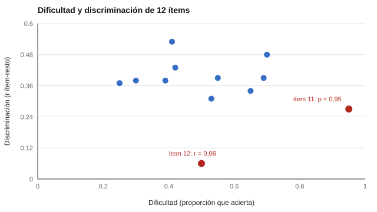

# 015 — Pilotaje y análisis clásico de ítems


<!-- NAV -->
[← 014 — Longitud del test: el intercambio entre preci…](../014-longitud-y-costo-de-medida/README.md) · [📚 Parte 01](../README.md) · [🗺️ Índice 001–200](../../../PROGRAMA.md) · [016 — Especificaciones de test y tablas de contenido →](../016-especificaciones-de-test-y-tablas-de-contenido/README.md)
<!-- /NAV -->

**Parte 01 — Construcción de instrumentos** · Nivel fundamentos · 4 h · Estado `escrita`
**Pensada para:** quien construye instrumentos, quien los revisa y quien participa en un piloto.
**Prerrequisitos:** clases 004, 011 y 014.

## ¿Para qué te sirve esto?

Antes de usar un instrumento con muchas personas, se prueba con un grupo pequeño: es el **piloto**. Ahí se descubre qué ítems no funcionan. Si construyes instrumentos, esta clase te da los dos indicadores básicos para decidir qué conservar. Si participas en un piloto, entenderás para qué sirven tus respuestas y por qué te piden comentarios.

## Al terminar esta clase podrás

- Calcular dificultad (proporción de aciertos) y discriminación (correlación ítem-resto).
- Explicar por qué se excluye el propio ítem del total.
- Detectar ítems defectuosos y justificar qué hacer sin descartar a ciegas.
- Diseñar un piloto y declarar sus límites.

## La idea en palabras simples

En un examen, un ítem **demasiado fácil** (lo aciertan todos) no distingue a nadie; uno **que se contesta al azar** tampoco. Los dos indicadores clásicos son:

- **Dificultad (p):** qué proporción de personas acierta (o está de acuerdo). Cerca de 0 o de 1 aporta poca información.
- **Discriminación (r ítem-resto):** si las personas que lo hacen bien en el ítem también les va bien en el resto de la prueba. Si es baja, el ítem no sigue al resto.

Se llama «ítem-resto» porque se compara con el total **sin ese ítem**; de lo contrario, el ítem se correlaciona consigo mismo y el valor se infla, sobre todo en escalas cortas.

## Cómo funciona, paso a paso

**1. Reunir datos.** Se aplica el instrumento a una muestra piloto parecida a la población final.

**2. Calcular p y r para cada ítem.**

**3. Marcar los ítems problemáticos.** Una regla de lectura habitual es revisar r < 0,20 y p extremos; pero es una alerta, no un veredicto.

**4. Decidir con criterio.** Un ítem con r baja puede medir otra faceta legítima; uno muy fácil puede ser necesario por cobertura del contenido (clase 032). Se revisa su redacción, su clave y su lugar en la tabla de especificaciones antes de eliminarlo.



*Figura 1.* Diez ítems agrupados en la zona sana; el 11 (muy fácil) y el 12 (no discrimina) destacan en rojo.

**5. Diseñar el piloto.**

- **Tamaño:** suficiente para que los índices no oscilen; 300 es una referencia didáctica, no una norma.
- **Población:** similar a la destinataria, o el análisis no se transfiere.
- **Registro:** tiempos, omisiones y comentarios de las personas.
- **Datos personales:** sin identificadores y con consentimiento (parte 07).

## Si construyes el instrumento

- Calcula ambos indicadores para cada ítem y revisa los marcados uno por uno.
- Conserva un registro de decisiones: qué se cambió, por qué y con qué dato.
- No eliminas un ítem por un solo indicador; revisa redacción, clave y contenido.
- Declara que un piloto **no es** una validación.

## Si eres evaluado

- Si participas en un piloto, tus respuestas y comentarios sirven para mejorar el instrumento: sé sincero y señala lo que no entendiste.
- Los resultados de un piloto no se usan para decisiones sobre ti, salvo que se te informe lo contrario.
- Pregunta si tus datos serán anónimos y por cuánto tiempo se guardarán.

## Qué muestra el laboratorio

`lab.py` simula 300 personas y 12 ítems con dos defectos sembrados a propósito.

| Ítem | p | r | Veredicto |
|---:|---:|---:|---|
| 1 | 0,70 | 0,48 | ok |
| 2 | 0,65 | 0,34 | ok |
| 3 | 0,55 | 0,39 | ok |
| 4 | 0,53 | 0,31 | ok |
| 5 | 0,42 | 0,43 | ok |
| 6 | 0,39 | 0,38 | ok |
| 7 | 0,30 | 0,38 | ok |
| 8 | 0,25 | 0,37 | ok |
| 9 | 0,69 | 0,39 | ok |
| 10 | 0,41 | 0,53 | ok |
| **11** | **0,95** | 0,27 | **p extrema: demasiado fácil** |
| **12** | 0,50 | **0,06** | **discrimina poco (azar)** |

**Análisis.** (1) El análisis encuentra los dos ítems defectuosos sembrados y no marca ninguno de los diez sanos. (2) El ítem 11 tiene discriminación aceptable (0,27) pero es tan fácil que aporta poca información. (3) El ítem 12 está bien en dificultad, pero responde como al azar (r = 0,06). (4) Es un caso didáctico con defectos muy marcados; en datos reales los casos son más ambiguos y requieren juicio.

## Errores frecuentes

- Correlacionar el ítem con el total que lo incluye.
- Eliminar ítems por un solo índice.
- Pilotar con personas cercanas al autor y generalizar a toda la población.
- Reportar un piloto como validación.

## Lo mínimo que debes llevarte

1. Dificultad y discriminación son los dos indicadores básicos.
2. La discriminación se calcula sin el propio ítem (ítem-resto).
3. Un indicador marcado es una alerta, no un veredicto.
4. Un piloto no establece validez.

## Ejercicios

- **Inicial.** Un ítem lo acierta el 98 %. ¿Qué información aporta? *Solución: muy poca; casi todos responden igual.*
- **Intermedio.** ¿Por qué r ítem-resto es menor que r ítem-total? *Solución: el total incluye al ítem y esa parte siempre correlaciona consigo misma.*
- **Avanzado.** Añade a `lab.py` un ítem con correlación negativa (clave mal puesta) y explica cómo lo detectas.
- **Aplicación.** Diseña un piloto para un cuestionario de 20 ítems en tu contexto: muestra, registro y criterios de decisión.

## Glosario

- **Piloto:** aplicación preliminar de un instrumento para detectar problemas.
- **Dificultad (p):** proporción de aciertos o de acuerdo.
- **Discriminación (r ítem-resto):** correlación del ítem con el total sin ese ítem.
- **Ítem defectuoso:** ítem que no aporta información útil.

## Laboratorio

```bash
python classes/part-01-construccion-de-instrumentos/015-pilotaje-y-analisis-de-items/lab.py
python classes/part-01-construccion-de-instrumentos/figuras.py
```

## Autoevaluación y criterios

1. ¿Qué dos indicadores usarías primero y por qué? 2. ¿Cuándo conservarías un ítem con r < 0,20? 3. ¿Qué no puedes concluir de un piloto?
Se logra la clase si puedes calcular los indicadores, justificar la decisión sobre cada ítem y declarar los límites del piloto.

## Bibliografía

- Crocker, L., & Algina, J. (1986). *Introduction to Classical and Modern Test Theory*. Holt, Rinehart and Winston.
- DeVellis, R. F. (2017). *Scale Development: Theory and Applications* (4.ª ed.). SAGE.

---

<!-- NAV -->
[← 014 — Longitud del test: el intercambio entre preci…](../014-longitud-y-costo-de-medida/README.md)  
[📚 Parte 01](../README.md) · [🗺️ Índice 001–200](../../../PROGRAMA.md)  
[016 — Especificaciones de test y tablas de contenido →](../016-especificaciones-de-test-y-tablas-de-contenido/README.md)
<!-- /NAV -->
