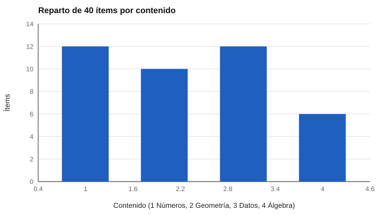

# 016 — Especificaciones de test y tablas de contenido


<!-- NAV -->
[← 015 — Pilotaje y análisis clásico de ítems](../015-pilotaje-y-analisis-de-items/README.md) · [📚 Parte 01](../README.md) · [🗺️ Índice 001–200](../../../PROGRAMA.md) · [017 — Ítems de opción múltiple: distractores y clave →](../017-items-de-opcion-multiple-distractores-y-clave/README.md)
<!-- /NAV -->

**Parte 01 — Construcción de instrumentos** · Nivel fundamentos · 4 h · Estado `escrita`
**Pensada para:** quien diseña pruebas (docentes, evaluadores, psicólogos) y quien las rinde.
**Prerrequisitos:** clases 006 y 011.

## ¿Para qué te sirve esto?

¿Por qué en un examen aparecen unas materias y no otras? ¿Cómo se asegura que dos versiones de una prueba midan lo mismo? La respuesta es la **tabla de especificaciones**: el plano de la prueba. Si diseñas evaluaciones, es la herramienta que garantiza que el contenido evaluado sea representativo. Si rindes una prueba, te da derecho a pedir qué contenidos se evaluarán y en qué proporción.

## Al terminar esta clase podrás

- Construir una tabla de especificaciones contenido × nivel cognitivo.
- Repartir un total de ítems según pesos, sin que la suma falle (resto mayor).
- Verificar que dos formas cumplen la tabla.
- Distinguir «misma tabla» de «formas equivalentes».

## La idea en palabras simples

Un arquitecto no construye una casa sin plano. La tabla de especificaciones es el plano de la prueba: dice **cuántos ítems** corresponden a cada **contenido** (por ejemplo, números, geometría) y a cada **nivel cognitivo** (recordar, aplicar, razonar). Sin plano, el contenido se llena según lo que a cada autor se le ocurre, y la prueba termina midiendo lo que fue fácil de preguntar.

| Contenido | Recordar | Aplicar | Razonar | Total |
|---|---:|---:|---:|---:|
| Números | 3 | 6 | 3 | 12 |
| Geometría | 2 | 5 | 3 | 10 |
| Datos | 2 | 6 | 4 | 12 |
| Álgebra | 1 | 4 | 1 | 6 |
| **Total** | | | | **40** |

## Cómo funciona, paso a paso

**1. Decidir los pesos.** Cada celda recibe un peso según su importancia en el programa. Esa decisión es curricular y debe justificarse con expertos.

**2. Repartir un total entero.** Con 40 ítems, cada celda recibe un número entero. El **método del resto mayor** reparte la parte entera de cada cuota y asigna los ítems que faltan a las celdas con mayor parte decimal, de modo que la suma da exactamente 40.



*Figura 1.* Reparto por contenido de los 40 ítems.

**3. Ensamblar formas.** Se arman dos formas desde un banco, respetando la tabla.

**4. Verificar.** Cada forma debe cumplir la tabla; pero eso **no** garantiza que sean equivalentes en dificultad.

## Si construyes el instrumento

- Fija la tabla **antes** de escribir ítems y guárdala con el banco.
- Justifica los pesos con el programa y con expertos.
- Si necesitas formas equivalentes, además de la tabla controla la dificultad (por ejemplo, con la TRI, parte 05).
- Registra qué ítem ocupa cada celda: es la base para auditar la validez de contenido (clase 032).

## Si eres evaluado

- Pide la tabla de especificaciones: te dice qué se evaluará y con qué peso, y es una guía para estudiar.
- Si una prueba incluye contenidos que no estaban en el programa, es un problema de validez de contenido que puedes plantear.
- Si rindes una de dos formas de la misma prueba, pregunta cómo se asegura que ninguna sea más difícil.

## Qué muestra el laboratorio

`lab.py` reparte 40 ítems en 12 celdas y arma dos formas desde un banco sintético.

| Resultado | Valor |
|---|---:|
| Suma de pesos | 1,00 |
| Suma con redondeo simple | 40 (coincide en este caso) |
| Suma con resto mayor | 40 |
| Forma 1: cumple la tabla | sí (dificultad media −0,57) |
| Forma 2: cumple la tabla | sí (dificultad media −0,20) |

**Análisis.** (1) El reparto final suma 40 y respeta las proporciones. (2) El redondeo simple puede no sumar el total; aquí coincidió, pero no está garantizado, y el resto mayor lo asegura. (3) **Ambas formas cumplen la tabla, pero su dificultad media difiere** (−0,57 contra −0,20): cumplir la tabla no equivale a ser paralelas; hay que equiparar o analizar. (4) El banco es sintético y los pesos son un ejemplo; en la práctica los pesos salen del currículo.

## Errores frecuentes

- Escribir ítems sin tabla y «completar» después.
- Fijar los pesos sin respaldo curricular.
- Creer que dos formas con la misma tabla son equivalentes.
- Redondear sin controlar el total.

## Lo mínimo que debes llevarte

1. La tabla es el plano de la prueba y el puente al dominio.
2. Se define antes de escribir ítems.
3. El resto mayor garantiza el total.
4. Misma tabla no implica misma dificultad.

## Ejercicios

- **Inicial.** ¿Para qué sirve una tabla de especificaciones? *Guía: asegura representatividad del contenido.*
- **Intermedio.** Cambia el total a 50 y reparte los ítems con resto mayor.
- **Avanzado.** Propón una regla para igualar la dificultad de dos formas.
- **Aplicación.** Construye la tabla de una prueba de tu asignatura o tu trabajo y justifica los pesos.

## Glosario

- **Tabla de especificaciones:** plan de una prueba por contenido y nivel cognitivo.
- **Nivel cognitivo:** tipo de proceso que exige el ítem (recordar, aplicar, razonar).
- **Resto mayor:** método para repartir enteros que suman un total.
- **Formas paralelas:** versiones de una prueba con el mismo contenido y dificultad.

## Laboratorio

```bash
python classes/part-01-construccion-de-instrumentos/016-especificaciones-de-test-y-tablas-de-contenido/lab.py
python classes/part-01-construccion-de-instrumentos/figuras.py
```

## Autoevaluación y criterios

1. ¿Por qué se define la tabla antes de escribir ítems? 2. ¿Qué garantiza el resto mayor? 3. ¿Por qué dos formas con la misma tabla pueden diferir en dificultad?
Se logra la clase si puedes construir una tabla, repartir los ítems y justificar los pesos.

## Bibliografía

- AERA, APA, & NCME (2014). *Standards for Educational and Psychological Testing*. 🔎 sin verificar (libro, norma o sitio no hallado en Crossref: comprobar a mano)
- Downing, S. M., & Haladyna, T. M. (Eds.) (2006). *Handbook of Test Development*. Erlbaum. ⚠️ hay una obra de título parecido en Crossref con otro año (2011): comprobar la edición a mano

Leyenda: ✅ existe en Crossref con título y año coincidentes (enlace al DOI); ⚠️ hay una obra de título parecido con otro año (no se enlaza: comprobar la edición); 🔎 no verificada automáticamente (libros sin DOI, normas y sitios web). Crossref confirma la existencia de la fuente, no que respalde cada afirmación de la clase. Ver [`docs/VERIFICACION_BIBLIOGRAFIA.md`](../../../docs/VERIFICACION_BIBLIOGRAFIA.md).

---

<!-- NAV -->
[← 015 — Pilotaje y análisis clásico de ítems](../015-pilotaje-y-analisis-de-items/README.md)  
[📚 Parte 01](../README.md) · [🗺️ Índice 001–200](../../../PROGRAMA.md)  
[017 — Ítems de opción múltiple: distractores y clave →](../017-items-de-opcion-multiple-distractores-y-clave/README.md)
<!-- /NAV -->
