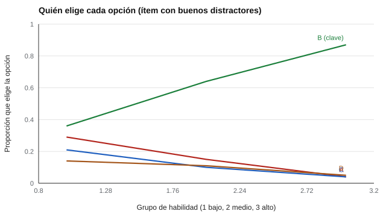

# 017 — Ítems de opción múltiple: distractores y clave


<!-- NAV -->
[← 016 — Especificaciones de test y tablas de contenido](../016-especificaciones-de-test-y-tablas-de-contenido/README.md) · [📚 Parte 01](../README.md) · [🗺️ Índice 001–200](../../../PROGRAMA.md) · [018 — Ítems abiertos, rúbricas y acuerdo entre juec… →](../018-items-abiertos-rubricas-y-acuerdo-entre-jueces/README.md)
<!-- /NAV -->

**Parte 01 — Construcción de instrumentos** · Nivel fundamentos · 4 h · Estado `escrita`
**Pensada para:** docentes y evaluadores que escriben pruebas, y estudiantes que quieren entender cómo se arman.
**Prerrequisitos:** clases 011 y 016.

## ¿Para qué te sirve esto?

Las preguntas de alternativas son las más usadas en educación y selección. Una buena tiene **una clave** (la correcta) y **distractores** (las incorrectas pero tentadoras). Si escribes pruebas, esta clase te enseña a revisar si cada alternativa cumple su función. Si las rindes, te explica por qué un ítem puede ser difícil de contestar aunque sepas el tema, y cómo se detectan los ítems mal construidos.

## Al terminar esta clase podrás

- Analizar qué alternativa elige cada grupo de habilidad.
- Detectar distractores no funcionales.
- Sospechar de claves mal asignadas.
- Decidir si revisar, reescribir o conservar un ítem.

## La idea en palabras simples

Un buen distractor «atrapa» a quien no domina el tema: lo elige más el grupo de rendimiento bajo que el alto. La clave se comporta al revés: la elige más el grupo alto. Si nadie elige un distractor, no cumple función (es relleno). Si un distractor lo elige más el grupo alto, algo anda mal: quizás la clave es discutible o el enunciado es ambiguo.

## Cómo funciona, paso a paso

**1. Dividir a las personas en grupos** de habilidad (bajo, medio, alto), según su puntaje total.

**2. Calcular, por alternativa, qué proporción de cada grupo la elige.**



*Figura 1.* En un ítem bien construido, la clave sube con la habilidad y los distractores bajan.

**3. Aplicar reglas de lectura.**

| Observación | Interpretación |
|---|---|
| Distractor elegido por menos del 5 % | No funcional: reescribir o reemplazar |
| Distractor que atrae más al grupo alto | Revisar clave y enunciado |
| Clave que el grupo alto no elige más que el bajo | La clave puede estar mal |

**4. Decidir.** No se elimina un ítem sin revisar su contenido: el problema puede estar en el enunciado, la clave o un distractor.

## Si construyes el instrumento

- Escribe distractores a partir de errores reales de estudiantes, no de opciones absurdas.
- Evita «ninguna de las anteriores» y claves siempre más largas.
- Revisa los resultados del piloto alternativa por alternativa (clase 015).
- Documenta cada cambio: un distractor cambiado modifica el ítem.

## Si eres evaluado

- Si un ítem parece tener dos respuestas correctas, señálalo al docente: puede ser un error de clave y corresponde corregirlo.
- Saber que los distractores se diseñan para parecer plausibles ayuda a leer con calma y descartar con razones.
- Si el ítem es anulado o corregido tras el análisis, es una práctica normal de control de calidad.

## Qué muestra el laboratorio

`lab.py` simula 1.200 personas respondiendo 6 ítems de 4 opciones, con distinta calidad de distractores.

Ítem q1 (con buenos distractores) — proporción que elige cada opción, por grupo bajo / medio / alto:

| Opción | Bajo | Medio | Alto |
|---|---:|---:|---:|
| A | 0,29 | 0,15 | 0,04 |
| B (clave) | 0,36 | 0,64 | 0,87 |
| C | 0,21 | 0,10 | 0,04 |
| D | 0,14 | 0,11 | 0,05 |

Hallazgos del conjunto: **q2:** el distractor B casi no se elige (1 %, no funcional); **q6:** el distractor D atrae al grupo alto (revisar); los ítems q1, q3, q4 y q5 no muestran hallazgos.

**Análisis.** (1) En q1 la clave sube con la habilidad (0,36 → 0,87) y cada distractor baja: funciona bien. (2) En q2, el distractor B no cumple función: casi nadie lo elige. (3) En q6, un distractor atrae más a los mejores, lo que sugiere revisar la clave o la redacción. (4) Los datos son simulados con distractores diseñados para producir estos casos; en la realidad los patrones son menos nítidos.

## Errores frecuentes

- Eliminar el ítem sin revisar el contenido.
- Mirar solo dificultad y discriminación, sin ver cada alternativa.
- Distractores obviamente absurdos.
- Cambiar una alternativa sin registrar el cambio.

## Lo mínimo que debes llevarte

1. La clave la elige más el grupo alto; los distractores, el bajo.
2. Un distractor casi nunca elegido no funciona.
3. Un distractor que atrae a los mejores señala un problema.
4. Revisa contenido antes de descartar.

## Ejercicios

- **Inicial.** ¿Qué es un distractor no funcional? *Solución: alternativa que casi nadie elige.*
- **Intermedio.** Cambia el umbral a 10 % y observa qué distractores aparecen como no funcionales.
- **Avanzado.** Reescribe el distractor atípico de q6 y vuelve a simular.
- **Aplicación.** Revisa un ítem de opción múltiple de una evaluación real (con resultados anónimos) y haz el análisis por alternativa.

## Glosario

- **Clave:** alternativa correcta.
- **Distractor:** alternativa incorrecta pero plausible.
- **Distractor funcional:** el que atrae a quienes no dominan el contenido.
- **Grupo de habilidad:** agrupación de personas según su puntaje total.

## Laboratorio

```bash
python classes/part-01-construccion-de-instrumentos/017-items-de-opcion-multiple-distractores-y-clave/lab.py
python classes/part-01-construccion-de-instrumentos/figuras.py
```

## Autoevaluación y criterios

1. ¿Cómo se ve un buen distractor en el análisis por grupo? 2. ¿Qué sugiere un distractor que atrae al grupo alto? 3. ¿Qué harías antes de eliminar un ítem?
Se logra la clase si puedes analizar un ítem alternativa por alternativa y decidir qué cambiar, con evidencia.

## Bibliografía

- Haladyna, T. M., & Downing, S. M. (1993). How many options is enough for a multiple-choice test item? *Educational and Psychological Measurement*, 53(4), 999-1010. ✅ [DOI](https://doi.org/10.1177/0013164493053004013)
- AERA, APA, & NCME (2014). *Standards for Educational and Psychological Testing*. 🔎 sin verificar (libro, norma o sitio no hallado en Crossref: comprobar a mano)

Leyenda: ✅ existe en Crossref con título y año coincidentes (enlace al DOI); ⚠️ hay una obra de título parecido con otro año (no se enlaza: comprobar la edición); 🔎 no verificada automáticamente (libros sin DOI, normas y sitios web). Crossref confirma la existencia de la fuente, no que respalde cada afirmación de la clase. Ver [`docs/VERIFICACION_BIBLIOGRAFIA.md`](../../../docs/VERIFICACION_BIBLIOGRAFIA.md).

---

<!-- NAV -->
[← 016 — Especificaciones de test y tablas de contenido](../016-especificaciones-de-test-y-tablas-de-contenido/README.md)  
[📚 Parte 01](../README.md) · [🗺️ Índice 001–200](../../../PROGRAMA.md)  
[018 — Ítems abiertos, rúbricas y acuerdo entre juec… →](../018-items-abiertos-rubricas-y-acuerdo-entre-jueces/README.md)
<!-- /NAV -->
