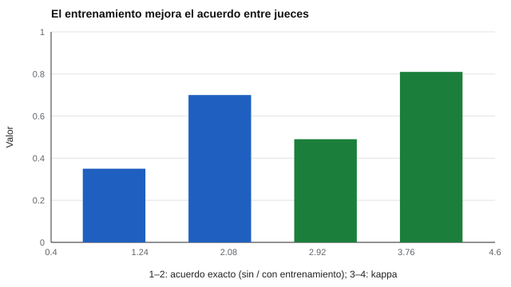

# 018 — Ítems abiertos, rúbricas y acuerdo entre jueces


<!-- NAV -->
[← 017 — Ítems de opción múltiple: distractores y clave](../017-items-de-opcion-multiple-distractores-y-clave/README.md) · [📚 Parte 01](../README.md) · [🗺️ Índice 001–200](../../../PROGRAMA.md) · [019 — Juicio de expertos y revisión cognitiva de ít… →](../019-juicio-de-expertos-y-revision-cognitiva-de/README.md)
<!-- /NAV -->

**Parte 01 — Construcción de instrumentos** · Nivel fundamentos · 4 h · Estado `escrita`
**Pensada para:** docentes y evaluadores que corrigen respuestas abiertas, y estudiantes que quieren entender cómo los califican.
**Prerrequisitos:** clases 016 y 017.

## ¿Para qué te sirve esto?

Cuando una prueba pide redactar, explicar o resolver un problema abierto, alguien debe **calificar**. Y dos correctores razonables pueden dar notas distintas a la misma respuesta. Esta clase te enseña cómo se mide ese desacuerdo, por qué ocurre y cómo se reduce con rúbricas y entrenamiento. Si calificas, te da herramientas; si eres calificado, te explica cómo se intenta que tu nota no dependa de quién te corrija.

## Al terminar esta clase podrás

- Calcular acuerdo exacto, acuerdo adyacente y kappa ponderado.
- Identificar el sesgo de severidad de un juez.
- Evaluar el efecto del entrenamiento de los jueces.
- Explicar por qué se informa más de un indicador de acuerdo.

## La idea en palabras simples

Dos profesores corrigen el mismo ensayo con una escala de 0 a 3. Uno es más estricto. Puede que **coincidan casi siempre en el orden** (el mismo ensayo es el mejor para ambos) pero que **uno ponga sistemáticamente un punto menos**. Un buen sistema de calificación revisa tres cosas: ¿ponen exactamente la misma nota?, ¿se acercan?, ¿uno es siempre más severo? La **rúbrica** (descripción de qué se espera en cada nivel) y el **entrenamiento con ejemplos ancla** hacen que los jueces interpreten los niveles de la misma manera.

## Cómo funciona, paso a paso

**1. Acuerdo exacto:** proporción de respuestas con la misma nota de ambos jueces.

**2. Acuerdo adyacente:** proporción que difiere a lo sumo en un nivel.

**3. Kappa ponderado cuadrático:** acuerdo corregido por azar que penaliza más las diferencias grandes.

**4. Diferencia media entre jueces:** revela si uno es más severo.



*Figura 1.* El entrenamiento duplica el acuerdo exacto.

**5. Reducir el desacuerdo.** Con una rúbrica de descriptores observables, ejemplos ancla, calibración periódica y, si es posible, doble corrección.

## Si construyes el instrumento

- Redacta una rúbrica con descriptores observables para cada nivel, no con adjetivos vagos.
- Entrena a los jueces con respuestas ancla y vuelve a calibrar periódicamente.
- Informa varios indicadores de acuerdo y la diferencia de severidad.
- Considera una segunda corrección en decisiones de alto impacto.

## Si eres evaluado

- Pide la rúbrica antes de responder: te dice qué se valora en cada nivel.
- Si crees que la nota depende de quién corrigió, puedes solicitar una segunda corrección.
- Una buena rúbrica permite entender por qué recibiste esa nota y cómo mejorar.

## Qué muestra el laboratorio

`lab.py` simula 400 respuestas calificadas por dos jueces (rúbrica de 4 niveles), sin y con entrenamiento.

| Condición | Exacto | Adyacente | Kappa pond. | Dif. media J2−J1 |
|---|---:|---:|---:|---:|
| Sin entrenamiento | 0,35 | 0,86 | 0,49 | +0,69 |
| Con entrenamiento | 0,70 | 1,00 | 0,81 | +0,11 |

**Análisis.** (1) Sin entrenamiento, el acuerdo adyacente (0,86) parece bueno, pero el exacto es 0,35 y un juez es 0,69 niveles más severo: las notas dependen de quién corrige. (2) Con entrenamiento, el exacto sube a 0,70 y la diferencia de severidad baja a 0,11. (3) El kappa ponderado no descompone la severidad: por eso se informa también la diferencia media. (4) Los jueces simulados tienen una severidad fija y ruido; los reales varían entre respuestas y con el cansancio.

## Errores frecuentes

- Informar un solo indicador de acuerdo.
- Entrenar a los jueces una sola vez.
- Rúbricas con adjetivos subjetivos («buena», «regular»).
- Ignorar la severidad sistemática de un juez.

## Lo mínimo que debes llevarte

1. Exacto, adyacente y kappa miden aspectos distintos.
2. La severidad sistemática se ve en la diferencia media.
3. Rúbricas observables y entrenamiento reducen el desacuerdo.
4. Una segunda corrección ayuda en decisiones importantes.

## Ejercicios

- **Inicial.** ¿Qué diferencia hay entre acuerdo exacto y adyacente? *Solución: exacto = misma nota; adyacente = difiere a lo sumo en un nivel.*
- **Intermedio.** Añade un tercer juez en `lab.py` y calcula el acuerdo por pares.
- **Avanzado.** Diseña un procedimiento de calibración con respuestas ancla.
- **Aplicación.** Escribe una rúbrica de 4 niveles para evaluar un texto breve y pruébala con un colega.

## Glosario

- **Rúbrica:** descripción de lo que se espera en cada nivel de calidad.
- **Acuerdo adyacente:** coincidencia con diferencia máxima de un nivel.
- **Kappa ponderado:** acuerdo corregido por azar que pondera la distancia entre notas.
- **Severidad:** tendencia de un juez a puntuar más alto o más bajo que otros.
- **Respuesta ancla:** ejemplo con nota consensuada usado para entrenar.

## Laboratorio

```bash
python classes/part-01-construccion-de-instrumentos/018-items-abiertos-rubricas-y-acuerdo-entre-jueces/lab.py
python classes/part-01-construccion-de-instrumentos/figuras.py
```

## Autoevaluación y criterios

1. ¿Por qué se informa más de un indicador de acuerdo? 2. ¿Qué revela la diferencia media entre jueces? 3. ¿Cómo reducirías el desacuerdo?
Se logra la clase si puedes calcular los tres indicadores, interpretarlos y proponer mejoras de rúbrica y entrenamiento.

## Bibliografía

- Fleiss, J. L., & Cohen, J. (1973). The equivalence of weighted kappa and the intraclass correlation coefficient. *Educational and Psychological Measurement*, 33, 613-619. ✅ [DOI](https://doi.org/10.1177/001316447303300309)
- AERA, APA, & NCME (2014). *Standards for Educational and Psychological Testing*. 🔎 sin verificar (libro, norma o sitio no hallado en Crossref: comprobar a mano)

Leyenda: ✅ existe en Crossref con título y año coincidentes (enlace al DOI); ⚠️ hay una obra de título parecido con otro año (no se enlaza: comprobar la edición); 🔎 no verificada automáticamente (libros sin DOI, normas y sitios web). Crossref confirma la existencia de la fuente, no que respalde cada afirmación de la clase. Ver [`docs/VERIFICACION_BIBLIOGRAFIA.md`](../../../docs/VERIFICACION_BIBLIOGRAFIA.md).

---

<!-- NAV -->
[← 017 — Ítems de opción múltiple: distractores y clave](../017-items-de-opcion-multiple-distractores-y-clave/README.md)  
[📚 Parte 01](../README.md) · [🗺️ Índice 001–200](../../../PROGRAMA.md)  
[019 — Juicio de expertos y revisión cognitiva de ít… →](../019-juicio-de-expertos-y-revision-cognitiva-de/README.md)
<!-- /NAV -->
