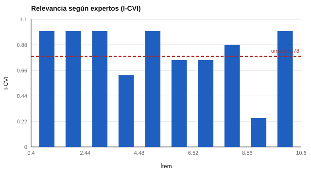

# 019 — Juicio de expertos y revisión cognitiva de ítems


<!-- NAV -->
[← 018 — Ítems abiertos, rúbricas y acuerdo entre juec…](../018-items-abiertos-rubricas-y-acuerdo-entre-jueces/README.md) · [📚 Parte 01](../README.md) · [🗺️ Índice 001–200](../../../PROGRAMA.md) · [020 — Bancos de ítems, versiones y control de cambi… →](../020-bancos-de-items-versiones-y-control-de/README.md)
<!-- /NAV -->

**Parte 01 — Construcción de instrumentos** · Nivel fundamentos · 4 h · Estado `escrita`
**Pensada para:** quien construye o adapta instrumentos, y quien participa como experto o entrevistado.
**Prerrequisitos:** clases 016 y 018.

## ¿Para qué te sirve esto?

Antes de aplicar un cuestionario a cientos de personas conviene preguntarse dos cosas: ¿los ítems son **relevantes** para lo que se quiere medir? (lo dicen los expertos) y ¿la gente **los entiende como se pretende**? (lo dicen las entrevistas cognitivas). Cada fuente detecta problemas distintos. Esta clase te enseña a usar ambas, a cuantificar el acuerdo de los expertos y a decidir qué ítems conservar, revisar o reescribir.

## Al terminar esta clase podrás

- Calcular el I-CVI y el kappa modificado.
- Combinar el juicio de expertos con entrevistas cognitivas.
- Decidir si conservar, revisar o reescribir cada ítem.
- Reconocer los límites de los umbrales.

## La idea en palabras simples

- **Juicio de expertos:** un grupo de especialistas califica, ítem por ítem, qué tan relevante es para el constructo (por ejemplo, de 1 a 4). El **I-CVI** es la proporción de expertos que lo califican 3 o 4. Si pocos están de acuerdo en que es relevante, el ítem está fuera de lugar.
- **Revisión cognitiva:** se pide a personas de la población objetivo que lean cada ítem y expliquen con sus palabras qué entienden («piensa en voz alta»). Si varias lo interpretan distinto, el ítem es ambiguo, aunque sea relevante.

Un ítem puede ser **relevante y ambiguo**, o **claro e irrelevante**: por eso se necesitan las dos miradas.

## Cómo funciona, paso a paso

**1. Reunir expertos** (se recomiendan al menos 6; con pocos, la proporción es muy inestable).

**2. Calcular el I-CVI por ítem.** Con 8 expertos, si 6 califican 3 o 4: I-CVI = 6/8 = 0,75. Una referencia usual (Lynn, 1986) es exigir al menos 0,78 con 6 o más expertos.

**3. Corregir por azar.** El kappa modificado k* = (I-CVI − Pc) / (1 − Pc), con Pc = C(N, A) × 0,5^N, descuenta el acuerdo esperado por azar (Polit et al., 2007).



*Figura 1.* Cuatro ítems quedan bajo el umbral de 0,78.

**4. Hacer entrevistas cognitivas** y marcar un ítem si más de un cuarto de las personas lo interpreta distinto de lo previsto.

**5. Decidir.** Cruzar ambas fuentes: conservar, revisar la relevancia, o reescribir por ambigüedad.

## Si construyes el instrumento

- Elige expertos de distintas perspectivas y dales criterios claros de calificación.
- Registra por escrito las razones de cada decisión.
- Entrevista a personas de la población objetivo, no solo a colegas.
- Los umbrales son convenciones: justifícalos y no los uses de forma mecánica.

## Si eres evaluado

- Si te invitan a una entrevista cognitiva, tu forma de entender cada ítem es información valiosa: no hay respuestas «correctas».
- Si un ítem te resultó ambiguo, es una señal útil para quien construye el instrumento: coméntalo.
- Un instrumento revisado así tiene más probabilidades de ser comprensible para ti.

## Qué muestra el laboratorio

`lab.py` simula 8 expertos y 12 entrevistados para 10 ítems.

| Ítem | Acuerdan | I-CVI | k* | Mal interpretado | Decisión |
|---:|---:|---:|---:|---:|---|
| 1 | 8/8 | 1,00 | 1,00 | 17 % | conservar |
| 2 | 8/8 | 1,00 | 1,00 | 8 % | conservar |
| 3 | 8/8 | 1,00 | 1,00 | 67 % | reescribir (ambiguo) |
| 4 | 5/8 | 0,62 | 0,52 | 42 % | revisar relevancia; reescribir |
| 5 | 8/8 | 1,00 | 1,00 | 0 % | conservar |
| 6 | 6/8 | 0,75 | 0,72 | 58 % | revisar relevancia; reescribir |
| 7 | 6/8 | 0,75 | 0,72 | 8 % | revisar relevancia |
| 8 | 7/8 | 0,88 | 0,87 | 0 % | conservar |
| 9 | 2/8 | 0,25 | 0,16 | 8 % | revisar relevancia |
| 10 | 8/8 | 1,00 | 1,00 | 17 % | conservar |

**Análisis.** (1) El ítem 3 es relevante para todos los expertos (I-CVI 1,00) pero el 67 % lo interpreta distinto: **los expertos solos no habrían detectado el problema**. (2) El ítem 9 es claro (8 % de mala interpretación) pero casi ningún experto lo considera relevante. (3) El k* corrige el I-CVI por el acuerdo esperado al azar. (4) Los umbrales (0,78; 25 %) son convenciones, no verdades; y ninguna de las dos fuentes reemplaza el piloto con datos (clase 015).

## Errores frecuentes

- Usar solo expertos.
- Tratar el umbral 0,78 como regla universal.
- Entrevistar a personas que no representan a la población objetivo.
- No registrar las decisiones tomadas.

## Lo mínimo que debes llevarte

1. Expertos juzgan relevancia; las entrevistas revelan comprensión.
2. Un ítem puede ser relevante y ambiguo, o claro e irrelevante.
3. El k* corrige el I-CVI por azar.
4. Ninguna de las dos fuentes sustituye el piloto.

## Ejercicios

- **Inicial.** ¿Qué mide el I-CVI? *Solución: la proporción de expertos que califican el ítem como relevante.*
- **Intermedio.** Cambia a 6 expertos y observa los umbrales.
- **Avanzado.** Diseña la guía de una entrevista cognitiva con parafraseo para tres ítems.
- **Aplicación.** Aplica el procedimiento a diez ítems de un cuestionario real con tres colegas.

## Glosario

- **I-CVI:** índice de validez de contenido de un ítem.
- **Kappa modificado (k*):** I-CVI corregido por acuerdo aleatorio.
- **Entrevista cognitiva:** técnica en que la persona explica cómo entiende y responde cada ítem.
- **Parafraseo:** decir con palabras propias lo que se entiende de un ítem.

## Laboratorio

```bash
python classes/part-01-construccion-de-instrumentos/019-juicio-de-expertos-y-revision-cognitiva-de/lab.py
python classes/part-01-construccion-de-instrumentos/figuras.py
```

## Autoevaluación y criterios

1. ¿Qué corrige el kappa modificado? 2. ¿Por qué se necesitan ambas fuentes? 3. ¿Qué harías con un ítem relevante pero ambiguo?
Se logra la clase si puedes calcular los índices, cruzar las dos fuentes y justificar la decisión por ítem.

## Bibliografía

- Polit, D. F., Beck, C. T., & Owen, S. V. (2007). Is the CVI an acceptable indicator of content validity? Appraisal and recommendations. *Research in Nursing & Health*, 30(4), 459-467.
- Lynn, M. R. (1986). Determination and quantification of content validity. *Nursing Research*, 35(6), 382-385.
- Willis, G. B. (2005). *Cognitive Interviewing: A Tool for Improving Questionnaire Design*. Sage.

---

<!-- NAV -->
[← 018 — Ítems abiertos, rúbricas y acuerdo entre juec…](../018-items-abiertos-rubricas-y-acuerdo-entre-jueces/README.md)  
[📚 Parte 01](../README.md) · [🗺️ Índice 001–200](../../../PROGRAMA.md)  
[020 — Bancos de ítems, versiones y control de cambi… →](../020-bancos-de-items-versiones-y-control-de/README.md)
<!-- /NAV -->
