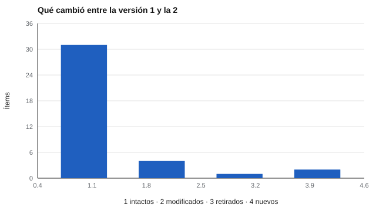

# 020 — Bancos de ítems, versiones y control de cambios


<!-- NAV -->
[← 019 — Juicio de expertos y revisión cognitiva de ít…](../019-juicio-de-expertos-y-revision-cognitiva-de/README.md) · [📚 Parte 01](../README.md) · [🗺️ Índice 001–200](../../../PROGRAMA.md) · [021 — La teoría clásica: puntaje verdadero y error →](../../part-02-fiabilidad/021-teoria-clasica-del-error/README.md)
<!-- /NAV -->

**Parte 01 — Construcción de instrumentos** · Nivel fundamentos · 4 h · Estado `escrita`
**Pensada para:** quien mantiene instrumentos en el tiempo, quien interpreta puntajes de distintas versiones y quien los rinde.
**Prerrequisitos:** clases 016 y 019.

## ¿Para qué te sirve esto?

Un instrumento no se escribe una vez: se corrige, se actualiza, se traduce. Cada cambio, aunque sea de una palabra, **puede alterar lo que significa el puntaje**. Si no hay registro, nadie sabe qué versión respondió cada persona ni si los puntajes de hace dos años se pueden comparar con los de hoy. Esta clase te enseña a llevar un **banco de ítems** con control de cambios, a detectar modificaciones silenciosas y a decidir cuándo dos versiones son comparables.

## Al terminar esta clase podrás

- Calcular una «huella» por ítem para detectar cambios.
- Comparar dos versiones de un banco.
- Aplicar una regla de comparabilidad por ítems ancla.
- Proponer el número de versión según el tipo de cambio.

## La idea en palabras simples

Un **banco de ítems** es el archivo ordenado de todas las preguntas con su historia: quién las escribió, cuándo, qué cambió. La **huella** es un código corto que resume el texto (y la clave) de un ítem: si cambia una sola letra, la huella cambia. Comparar huellas entre dos versiones muestra qué ítems quedaron **intactos**, cuáles se **modificaron**, cuáles se **retiraron** y cuáles son **nuevos**. Los intactos funcionan como **ítems ancla** para comparar puntajes entre versiones.

## Cómo funciona, paso a paso

**1. Identificadores estables.** Cada ítem tiene un id que no cambia aunque cambie el texto.

**2. Huella por ítem.** Se calcula una huella SHA-256 del texto y de la clave (incluir la clave es importante: invertir un ítem es cambiarlo).

**3. Comparar versiones.** Con las huellas se clasifican los ítems.



*Figura 1.* Comparación entre una versión 1 de 36 ítems y una versión 2 simulada.

**4. Regla de comparabilidad.** Si la proporción de ítems ancla (idénticos) es suficiente, los puntajes pueden compararse con cautela; si no, hace falta equiparar (clase 059). En el laboratorio se usa 80 % como regla de ejemplo, no como norma.

**5. Número de versión.** Corregir una errata es un cambio de parche; cambiar el sentido de un ítem o su clave es un cambio menor o mayor y se documenta (clase 182).

## Si construyes el instrumento

- Guarda cada versión con fecha, autor y motivo del cambio.
- Nunca reutilices un id para un ítem distinto.
- Documenta el criterio de comparabilidad y la evidencia de equiparación.
- Un banco que cambia sin registro no permite reproducir ni comparar puntajes.

## Si eres evaluado

- Si repites un test tiempo después, pregunta si es la misma versión: si cambió, la comparación con tu resultado anterior puede no ser válida.
- Si se actualiza un instrumento que se usó para decidir sobre ti, tienes derecho a saber qué cambió.
- Pregunta a quién corresponda cómo se conservan tus respuestas y por cuánto tiempo (parte 07).

## Qué muestra el laboratorio

`lab.py` usa los ítems reales de `valores-spranger` (36 ítems) y simula una versión 2 con 4 ítems reescritos, 1 retirado y 2 nuevos.

| Categoría | Ítems |
|---|---:|
| Intactos | 31 |
| Modificados | 4 (t03, e05, o03, r01) |
| Retirados | 1 (t06) |
| Nuevos | 2 |

Proporción de ítems ancla: **86 %** (umbral de ejemplo 80 %) → comparables con cautela. Versión sugerida: **menor (1.1.0)**: documentar y recalcular.

**Análisis.** (1) La huella detecta cualquier cambio, incluso de un carácter o de la clave. (2) 31 de 36 ítems intactos (86 %) superan el umbral de ejemplo. (3) El umbral del 80 % es una regla de ejemplo: lo importante es documentar el criterio y la evidencia de equiparación. (4) La versión 2 es una simulación; el instrumento real no se modificó.

## Errores frecuentes

- Cambiar ítems sin registro.
- Comparar versiones sin ítems ancla.
- Reutilizar identificadores.
- No incluir la clave en la huella.

## Lo mínimo que debes llevarte

1. Cada cambio queda registrado.
2. La huella detecta modificaciones silenciosas.
3. Los ítems ancla permiten comparar versiones.
4. Reescribir un ítem cambia el estímulo y, por tanto, el instrumento.

## Ejercicios

- **Inicial.** ¿Para qué sirve una huella por ítem? *Solución: detectar si un ítem cambió.*
- **Intermedio.** Cambia el umbral al 90 % y revisa la decisión.
- **Avanzado.** Diseña el formato de un registro de cambios de banco.
- **Aplicación.** Registra las versiones de un cuestionario de tu entorno y evalúa su comparabilidad.

## Glosario

- **Banco de ítems:** colección ordenada de ítems con su historia.
- **Huella (hash):** código que resume un texto; cambia si el texto cambia.
- **Ítem ancla:** ítem idéntico en dos versiones, usado para compararlas.
- **Equiparación:** procedimiento para poner en la misma escala puntajes de formas distintas.

## Laboratorio

```bash
python classes/part-01-construccion-de-instrumentos/020-bancos-de-items-versiones-y-control-de/lab.py
python classes/part-01-construccion-de-instrumentos/figuras.py
```

## Autoevaluación y criterios

1. ¿Qué detecta una huella que no vería una revisión visual? 2. ¿Cuándo son comparables dos versiones? 3. ¿Por qué la clave forma parte de la huella?
Se logra la clase si puedes comparar dos versiones, decidir su comparabilidad y proponer el número de versión.

## Bibliografía

- AERA, APA, & NCME (2014). *Standards for Educational and Psychological Testing*.
- Kolen, M. J., & Brennan, R. L. (2014). *Test Equating, Scaling, and Linking* (3.ª ed.). Springer.

---

<!-- NAV -->
[← 019 — Juicio de expertos y revisión cognitiva de ít…](../019-juicio-de-expertos-y-revision-cognitiva-de/README.md)  
[📚 Parte 01](../README.md) · [🗺️ Índice 001–200](../../../PROGRAMA.md)  
[021 — La teoría clásica: puntaje verdadero y error →](../../part-02-fiabilidad/021-teoria-clasica-del-error/README.md)
<!-- /NAV -->
