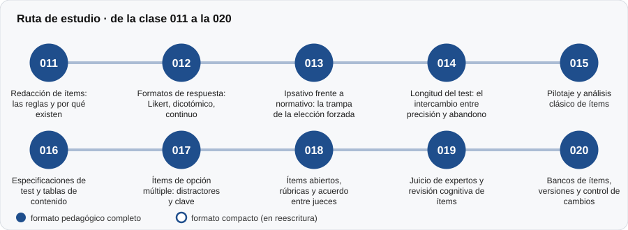

# 📝 Parte 01 — Construcción de instrumentos

**Nivel:** fundamentos · **Duración estimada:** 3-4 semanas · **Clases:** 10

## De qué trata

Cómo se pasa de una idea a un cuestionario o prueba administrable. Redacción de ítems, formatos de respuesta, longitud del test, ítems de opción múltiple y abiertos, juicio de expertos, pilotaje y bancos de ítems.

## Por qué importa

Un instrumento mal construido no se rescata con buena estadística. La mayoría de los problemas de medición nacen en la redacción del ítem y en el formato, mucho antes de calcular nada.

## Según tu papel

- **Si construyes o aplicas instrumentos:** Es la parte más práctica: reglas de redacción, tabla de especificaciones, análisis de distractores, rúbricas y control de versiones.
- **Si eres evaluado o recibes resultados:** Te permite reconocer ítems ambiguos, dobles preguntas o formatos que te fuerzan a responder de una manera, y entender por qué algunos tests parecen «trampas».

## Al terminar esta parte podrás

- Redactar ítems claros y evitar los errores clásicos.
- Elegir un formato de respuesta y justificar la longitud del test.
- Construir una tabla de especificaciones y analizar distractores.
- Planificar un pilotaje y llevar el control de cambios de un banco.

## Cómo estudiarla

Conviene haber visto la parte 00. Haz los ejercicios de redacción con un instrumento propio; el laboratorio sirve para ver el efecto de cada decisión.

## Ruta de estudio

## Clases en orden de estudio

Las clases están numeradas de forma consecutiva (001 a 200) en el orden de estudio: sigue el número.

| Orden | ID | Clase | Qué aprenderás | Formato | Horas |
|---:|---|---|---|---|---:|
| 1 | 011 | [Redacción de ítems: las reglas y por qué existen](011-redaccion-de-items/README.md) | Identificar y corregir doble pregunta, absolutos, doble negación y exceso de longitud. | 🟡 compacto | 4 |
| 2 | 012 | [Formatos de respuesta: Likert, dicotómico, continuo](012-formatos-de-respuesta/README.md) | Comparar formatos dicotómico, politómico (Likert) y continuo. | 🟡 compacto | 3 |
| 3 | 013 | [Ipsativo frente a normativo: la trampa de la elección forzada](013-ipsativo-vs-normativo/README.md) | Definir medida ipsativa y normativa. | 🟡 compacto | 4 |
| 4 | 014 | [Longitud del test: el intercambio entre precisión y abandono](014-longitud-y-costo-de-medida/README.md) | Aplicar la fórmula de Spearman-Brown directa e inversa. | 🟡 compacto | 3 |
| 5 | 015 | [Pilotaje y análisis clásico de ítems](015-pilotaje-y-analisis-de-items/README.md) | Calcular dificultad (proporción de aciertos) y discriminación (correlación ítem-resto). | 🟡 compacto | 5 |
| 6 | 016 | [Especificaciones de test y tablas de contenido](016-especificaciones-de-test-y-tablas-de-contenido/README.md) | Construir una tabla de especificaciones contenido × nivel. | 🟡 compacto | 4 |
| 7 | 017 | [Ítems de opción múltiple: distractores y clave](017-items-de-opcion-multiple-distractores-y-clave/README.md) | Analizar la elección de opciones por grupo de habilidad. | 🟡 compacto | 4 |
| 8 | 018 | [Ítems abiertos, rúbricas y acuerdo entre jueces](018-items-abiertos-rubricas-y-acuerdo-entre-jueces/README.md) | Calcular acuerdo exacto, adyacente y kappa ponderado. | 🟡 compacto | 4 |
| 9 | 019 | [Juicio de expertos y revisión cognitiva de ítems](019-juicio-de-expertos-y-revision-cognitiva-de/README.md) | Calcular I-CVI y kappa modificado. | 🟡 compacto | 4 |
| 10 | 020 | [Bancos de ítems, versiones y control de cambios](020-bancos-de-items-versiones-y-control-de/README.md) | Calcular una huella por ítem. | 🟡 compacto | 4 |

[← Volver al índice del programa](../../README.md) · [Índice numérico de las 200 clases](../../PROGRAMA.md)
