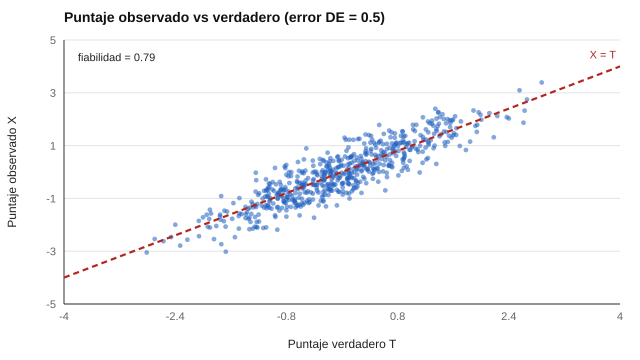
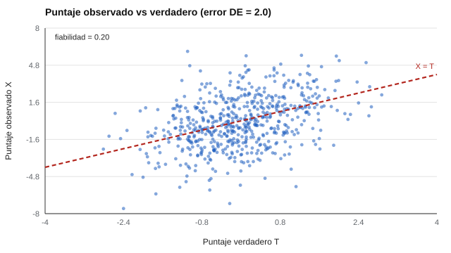
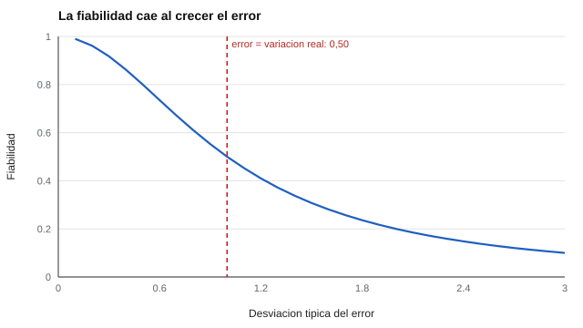

# 021 — La teoría clásica: puntaje verdadero y error


> [Índice de la parte](../README.md) · [Siguiente](../022-consistencia-interna-alfa/README.md)

**Parte 02 — Fiabilidad** · Nivel intermedio · 4 h · Estado `escrita`
**Pensada para:** quien construye un test, quien lo interpreta (psicólogo, docente, selector de personal) y quien es evaluado.
**Prerrequisitos:** clases 004, 014 y 015.

## ¿Para qué te sirve esto?

Imagina que una persona obtiene 62 puntos en una prueba de comprensión lectora y otra obtiene 58. ¿La primera lee mejor? Si repitieras la prueba mañana, ¿saldría igual? Esta clase responde a una pregunta que está debajo de cualquier puntaje: **¿cuánto de lo que veo es la persona y cuánto es ruido?** Sin esa respuesta no se puede decidir si una diferencia de cuatro puntos significa algo o es un accidente del día.

## Al terminar esta clase podrás

- Explicar con tus palabras que todo puntaje es una parte verdadera más una parte de error.
- Calcular la fiabilidad y el error típico de medida a partir de varianzas.
- Decidir si una diferencia pequeña entre dos puntajes es o no concluyente.

## La idea en palabras simples

Piensa en pesar un objeto en una balanza que tiembla un poco. Cada vez que lo pesas, marca un número algo distinto: 500,2 g; 499,6 g; 500,5 g. Nadie diría que el objeto cambió de peso: la balanza tiene **error**. Si pesaras el objeto cien veces y promediaras, obtendrías un valor muy estable. A ese promedio imaginario lo llamamos **puntaje verdadero**.

La teoría clásica de los tests dice lo mismo de las personas: **lo que observas = lo que es estable en la persona + una parte de azar**.

```
Puntaje observado (X) = Puntaje verdadero (T) + Error (E)
```

- **T** es el promedio que obtendría la persona si pudiera contestar infinitas versiones equivalentes del test sin cansarse ni aprender.
- **E** es todo lo que mueve el resultado sin tener que ver con el rasgo: sueño, ruido en la sala, una pregunta que justo se sabía, un clic equivocado.

Dos aclaraciones que evitan malentendidos frecuentes:

1. «Verdadero» no significa «real» ni «correcto». Si el test mide mal el constructo, T es fielmente la medida equivocada. Un termómetro que siempre marca 2 grados de menos es perfectamente estable… y está desviado.
2. El error se supone **aleatorio**: a veces suma, a veces resta y, en promedio, es cero. Si un evaluador siempre es severo, esa severidad no es «error» para el modelo: entra en T y nadie la detecta con esta teoría.

**Así se ve el ruido.** Cada punto es una persona simulada. Si no hubiera error, todos caerían sobre la línea roja (X = T). A la izquierda el error es pequeño y la nube se pega a la línea; a la derecha el error es grande y los puntajes observados casi no permiten ordenar a las personas por su valor verdadero.




## Cómo funciona, paso a paso

**Paso 1. Los puntajes varían entre personas.** Parte de esa variación es real (hay personas que leen mejor) y parte es ruido.

**Paso 2. Si el error es independiente de lo verdadero, las varianzas se suman:**

```
varianza de X = varianza de T + varianza de E
```

**Paso 3. Se define la fiabilidad** como la fracción de la variación observada que corresponde a lo verdadero:

```
fiabilidad = varianza de T / varianza de X
```

Va de 0 (todo es ruido) a 1 (nada es ruido).

**Ejemplo con números.** Una prueba tiene desviación típica observada de 10 puntos, por lo que la varianza de X es 100. Si su fiabilidad es 0,84:

- varianza de T = 0,84 × 100 = 84,
- varianza de E = 100 − 84 = 16, es decir, un error típico de **4 puntos** (la raíz de 16).

Traducido: cuando alguien obtiene 62, su puntaje verdadero probablemente está entre 58 y 66. La diferencia con quien obtuvo 58 **no es concluyente**. Esa es la utilidad práctica de todo este desarrollo (se ve en detalle en la clase 025).

**Por qué se puede estimar algo que no se observa.** Si dos formas del test son paralelas (miden lo mismo con la misma precisión), la correlación entre ambas es igual a la fiabilidad. Por eso la fiabilidad se estima comparando formas, repeticiones o mitades del test (clases 022 a 024).

## Si construyes el instrumento

- La fiabilidad **no es una propiedad fija del test**; es una propiedad de los puntajes en una población y una situación. Un test puede tener 0,90 en una muestra amplia y 0,70 en un grupo muy parejo, porque en un grupo homogéneo hay menos variación real que distinguir.
- Se mejora reduciendo el error: más ítems de buena calidad, instrucciones claras, condiciones de aplicación estandarizadas, corrección objetiva.
- Se informa siempre **con su población y su método de estimación**, no como «el test tiene 0,90».
- El error típico de medida (en puntos del propio test) es más útil para quien interpreta que el coeficiente.

## Si eres evaluado

- Tu puntaje es una **estimación con margen**, no una medida exacta. Tienes derecho a preguntar cuál es el margen de error del instrumento y a que la decisión que se tome contigo lo considere.
- Una diferencia pequeña entre tu puntaje y un corte (por ejemplo, 1 o 2 puntos bajo el mínimo) rara vez es concluyente. Pregunta si hay una segunda fuente de información.
- Si el día de la prueba estabas enfermo, cansado o con problemas de acceso técnico, eso es error que se debería poder considerar; coméntalo.



*Figura 2.* Con varianza verdadera 1, la fiabilidad es 1 / (1 + DE del error²). Cuando el error iguala a la variación real (DE = 1), la mitad de lo que se ve es ruido. Las figuras se regeneran con `python classes/part-02-fiabilidad/021-teoria-clasica-del-error/figuras.py`.

## Qué muestra el laboratorio

El laboratorio simula 20.000 personas con el mismo puntaje verdadero (varianza ≈ 1) y le suma errores de tamaño creciente. Resultado:

| Desviación del error | Varianza de T | Varianza de E | Varianza de X | T/X | Correlación entre dos formas |
|---:|---:|---:|---:|---:|---:|
| 0,5 | 1,003 | 0,254 | 1,246 | 0,805 | 0,799 |
| 1,0 | 1,004 | 1,006 | 2,015 | 0,498 | 0,499 |
| 2,0 | 1,003 | 3,989 | 5,017 | 0,200 | 0,198 |

**Análisis.** (1) La varianza de T no cambia: lo verdadero es lo mismo en las tres filas. (2) Al crecer el error, la fiabilidad baja de 0,80 a 0,50 y a 0,20: con un error de tamaño doble que la variación real, solo el 20 % de lo que se ve es información de las personas. (3) La columna T/X y la correlación entre formas coinciden: es la razón por la que se puede estimar la fiabilidad sin conocer T. (4) Es una simulación: confirma que el algoritmo cumple la teoría, no que un test real tenga ese comportamiento.

## Errores frecuentes

- «Este test tiene fiabilidad 0,90» dicho como constante universal.
- Confundir fiabilidad con validez: un test puede ser muy estable y medir otra cosa (parte 03).
- Suponer que todo el error es aleatorio: los sesgos constantes quedan escondidos dentro de T.
- Creer que el error es igual para todas las personas: en la práctica suele ser mayor en los extremos del rasgo (la teoría de respuesta al ítem, parte 05, lo modela).

## Lo mínimo que debes llevarte

1. Todo puntaje es verdadero + error; la fiabilidad dice qué fracción es verdadera.
2. La fiabilidad depende de la población, no solo del test.
3. El error típico de medida convierte el concepto en puntos utilizables.
4. Fiabilidad alta no prueba validez.

## Ejercicios

- **Inicial.** Varianza de T = 6 y de E = 2. ¿Cuál es la fiabilidad? *Solución: 6/8 = 0,75.*
- **Intermedio.** Con fiabilidad 0,60, ¿qué porcentaje de la variación es error? *Solución: 40 %.*
- **Avanzado.** Modifica `lab.py` para que el error dependa del puntaje verdadero (más error en los extremos) y explica por qué la fiabilidad pasa a depender de a quién se mida.
- **Aplicación.** Un colegio descarta a los alumnos que quedan dos puntos bajo un corte. Con error típico 4, redacta un párrafo (para apoderados) explicando por qué la decisión no debería basarse solo en ese puntaje.

## Glosario

- **Puntaje verdadero (T):** promedio hipotético en infinitas aplicaciones equivalentes.
- **Error de medida (E):** parte del puntaje ajena al rasgo, supuesta aleatoria.
- **Fiabilidad:** proporción de la variación observada que es verdadera.
- **Formas paralelas:** versiones que miden lo mismo con igual precisión.
- **Error típico de medida:** desviación típica del error, en puntos del test.

## Laboratorio

```bash
python classes/part-02-fiabilidad/021-teoria-clasica-del-error/lab.py
```

## Autoevaluación y criterios

1. ¿Por qué T no equivale al nivel «real» de la persona? 2. ¿Qué pasa con la fiabilidad en un grupo muy homogéneo? 3. Da un error sistemático que el modelo confunde con T.
Se logra la clase si puedes explicar la descomposición a alguien sin formación estadística, calcular el error típico y distinguir fiabilidad de validez.

## Bibliografía

Estado de verificación en [`docs/VERIFICACION_BIBLIOGRAFIA.md`](../../../docs/VERIFICACION_BIBLIOGRAFIA.md).

- Spearman, C. (1904). The proof and measurement of association between two things. *American Journal of Psychology*, 15(1), 72-101. ✅ [DOI](https://doi.org/10.2307/1412159)
- Novick, M. R. (1966). The axioms and principal results of classical test theory. *Journal of Mathematical Psychology*, 3(1), 1-18. ✅ [DOI](https://doi.org/10.1016/0022-2496(66)90002-2)
- Lord, F. M., & Novick, M. R. (1968). *Statistical Theories of Mental Test Scores*. Addison-Wesley. 🔎 sin verificar (libro, norma o sitio no hallado en Crossref: comprobar a mano)

Leyenda: ✅ existe en Crossref con título y año coincidentes (enlace al DOI); ⚠️ el título existe pero con otro año (reedición); 🔎 no verificada automáticamente. Crossref confirma la existencia de la fuente, no que respalde cada afirmación de la clase.
