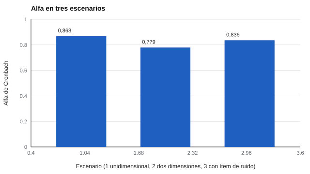

# 022 — Consistencia interna: alfa de Cronbach y sus abusos


<!-- NAV -->
[← 021 — La teoría clásica: puntaje verdadero y error](../021-teoria-clasica-del-error/README.md) · [📚 Parte 02](../README.md) · [🗺️ Índice 001–200](../../../PROGRAMA.md) · [023 — Omega de McDonald y por qué alfa se queda cor… →](../023-omega-y-alternativas-a-alfa/README.md)
<!-- /NAV -->

**Parte 02 — Fiabilidad** · Nivel intermedio · 5 h · Estado `escrita`
**Pensada para:** quien construye escalas, quien lee informes de fiabilidad y quien responde cuestionarios.
**Prerrequisitos:** clases 014 y 021.

## ¿Para qué te sirve esto?

El coeficiente alfa de Cronbach es el número que más aparece en los informes de cuestionarios: «alfa = 0,85». Muchas personas lo leen como «el test es fiable y mide bien». No es tan simple. Esta clase te enseña qué dice realmente alfa, qué **no** dice y cómo evitar los abusos más comunes (por ejemplo, creer que un alfa alto prueba que la escala mide una sola cosa).

## Al terminar esta clase podrás

- Calcular alfa desde las varianzas de los ítems y del total.
- Explicar qué supone alfa y qué no demuestra.
- Usar «alfa si se elimina el ítem» sin tomar decisiones mecánicas.
- Reportar alfa con su contexto: muestra, número de ítems e intervalo.

## La idea en palabras simples

Alfa responde: **¿los ítems de la escala se mueven juntos?** Si las personas que puntúan alto en un ítem tienden a puntuar alto en los demás, hay «consistencia interna». Piensa en un equipo de remo: si todos reman con ritmo parecido, el bote avanza parejo.

Dos cosas hacen subir alfa: que los ítems se relacionen más entre sí **y** que haya más ítems (clase 014). Cronbach (1951) lo presentó como el promedio de todas las formas de partir el test en dos mitades, y es un **límite inferior** de la fiabilidad bajo ciertos supuestos (tau-equivalencia y errores no correlacionados).

## Cómo funciona, paso a paso

**1. La fórmula.**

```
α = k/(k−1) · ( 1 − Σ varianza(ítem i) / varianza(total) )
```

**2. Ejemplo.** Cuatro ítems de varianza 1 y varianza total 7: α = 4/3 · (1 − 4/7) = **0,571**.

**3. Lo que alfa no demuestra.** Un alfa alto no prueba que la escala mida un solo constructo: mide la **covarianza media**, no la estructura (Sijtsma, 2009). La estructura se examina con análisis factorial (parte 04).



*Figura 1.* La escala que mezcla dos constructos independientes (barra del medio) obtiene un alfa que muchos manuales llaman «aceptable».

**4. «Alfa si se elimina el ítem».** Señala qué ítem baja alfa, pero no hay que quitarlo de forma automática: puede cubrir una parte legítima del constructo.

**5. Umbrales.** «0,70» es una convención, no una ley. Un alfa mayor a 0,95 puede indicar ítems redundantes.

## Si construyes el instrumento

- Calcula alfa **por escala**, nunca de todo el instrumento mezclado.
- Refleja los ítems invertidos antes de calcularlo (clase 005): si no, el alfa sale bajo o negativo.
- Informa el alfa con su intervalo de confianza y el tamaño de la muestra.
- Complementa con análisis de estructura (omega, análisis factorial) cuando la escala pueda ser multidimensional.

## Si eres evaluado

- Un «alfa de 0,90» no garantiza que los resultados tuyos sean exactos: el alfa describe al grupo, no a ti.
- Si un instrumento reporta un único alfa para todo el cuestionario, es una señal de que se mezclaron constructos.
- Pregunta qué muestra se usó para calcularlo: un alfa obtenido con otra población puede no aplicarse a ti.

## Qué muestra el laboratorio

`lab.py` calcula alfa en tres escenarios de 12 ítems.

| Escenario | Alfa |
|---|---:|
| A. Unidimensional | 0,868 |
| B. Dos dimensiones independientes (6 + 6) | 0,779 |
| C. Unidimensional con un ítem de ruido | 0,836 |

En C, el «alfa si se elimina cada ítem» da valores de 0,819 a 0,821 para los ítems 1 a 11 y **0,861 para el ítem 12**: eliminarlo sube alfa y delata al ítem de ruido.

**Análisis.** (1) El escenario B mezcla dos constructos sin relación y aun así da 0,779, un valor que muchos manuales llaman «aceptable»: alfa no delata la mezcla. (2) En C, quitar el ítem 12 sube alfa de 0,836 a 0,861 y lo identifica como ruido. (3) Estos casos están fabricados; en datos reales el patrón es menos claro y requiere análisis factorial. (4) Alfa mide consistencia, no unidimensionalidad.

## Errores frecuentes

- Calcular alfa sobre una escala multidimensional y reportarlo como «fiabilidad del test».
- Olvidar reflejar los ítems invertidos.
- Eliminar ítems hasta «maximizar» alfa.
- Creer que alfa cubre la estabilidad en el tiempo (eso es el test-retest, clase 024).

## Lo mínimo que debes llevarte

1. Alfa mide cuán juntos se mueven los ítems.
2. Sube con la correlación entre ítems y con su número.
3. No prueba unidimensionalidad.
4. Se reporta con contexto: muestra, ítems e intervalo.

## Ejercicios

- **Inicial.** ¿Qué pasa con alfa si se duplican ítems paralelos? *Solución: sube (Spearman-Brown, clase 014).*
- **Intermedio.** k = 5, Σvar = 5, var(total) = 15. *Solución: α = 5/4 · (1 − 5/15) = 0,833.*
- **Avanzado.** Agrega a `lab.py` un escenario de tres dimensiones y compáralo con B.
- **Aplicación.** Revisa el informe de un instrumento que uses y señala si el alfa está bien reportado.

## Glosario

- **Consistencia interna:** grado en que los ítems de una escala se relacionan entre sí.
- **Alfa de Cronbach:** coeficiente que resume esa consistencia.
- **Tau-equivalencia:** supuesto de que todos los ítems miden el rasgo con la misma fuerza.
- **Covarianza media:** relación promedio entre pares de ítems.

## Laboratorio

```bash
python classes/part-02-fiabilidad/022-consistencia-interna-alfa/lab.py
python classes/part-02-fiabilidad/figuras.py
```

## Autoevaluación y criterios

1. ¿Por qué un alfa alto no prueba unidimensionalidad? 2. ¿Qué dos factores, además de la calidad, hacen subir alfa? 3. ¿Cuándo conservarías un ítem que baja alfa?
Se logra la clase si puedes calcular e interpretar alfa y redactar un reporte con sus límites.

## Bibliografía

- Cronbach, L. J. (1951). Coefficient alpha and the internal structure of tests. *Psychometrika*, 16, 297-334.
- Sijtsma, K. (2009). On the use, the misuse, and the very limited usefulness of Cronbach's alpha. *Psychometrika*, 74(1), 107-120.
- Tavakol, M., & Dennick, R. (2011). Making sense of Cronbach's alpha. *International Journal of Medical Education*, 2, 53-55.

---

<!-- NAV -->
[← 021 — La teoría clásica: puntaje verdadero y error](../021-teoria-clasica-del-error/README.md)  
[📚 Parte 02](../README.md) · [🗺️ Índice 001–200](../../../PROGRAMA.md)  
[023 — Omega de McDonald y por qué alfa se queda cor… →](../023-omega-y-alternativas-a-alfa/README.md)
<!-- /NAV -->
