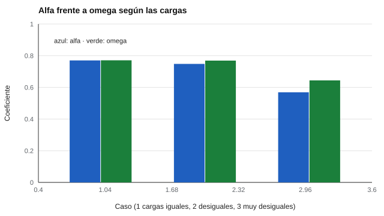

# 023 — Omega de McDonald y por qué alfa se queda corto


<!-- NAV -->
[← 022 — Consistencia interna: alfa de Cronbach y sus…](../022-consistencia-interna-alfa/README.md) · [📚 Parte 02](../README.md) · [🗺️ Índice 001–200](../../../PROGRAMA.md) · [024 — Test-retest: estabilidad frente a consistencia →](../024-test-retest-y-estabilidad/README.md)
<!-- /NAV -->

**Parte 02 — Fiabilidad** · Nivel intermedio · 4 h · Estado `escrita`
**Pensada para:** quien construye o evalúa escalas y quien lee sus informes de fiabilidad.
**Prerrequisitos:** clases 021 y 022 (se anticipa el modelo factorial de la parte 04).

## ¿Para qué te sirve esto?

Alfa supone que **todos los ítems miden el rasgo con la misma fuerza**. En la práctica casi nunca es así: algunos ítems son muy buenos indicadores y otros, flojos. Cuando eso ocurre, alfa **subestima** la fiabilidad. El coeficiente **omega** de McDonald corrige esto permitiendo que cada ítem tenga su propia fuerza. Esta clase te enseña a calcularlo, a anticipar cuánto difiere de alfa y a no tratarlo como «mejor» por decreto.

## Al terminar esta clase podrás

- Explicar la tau-equivalencia y cuándo falla.
- Calcular omega total desde las cargas factoriales.
- Anticipar cuánto difieren alfa y omega.
- Reconocer que omega depende de que el modelo factorial sea correcto.

## La idea en palabras simples

Imagina cuatro remeros: si todos tienen la misma fuerza, el promedio simple del equipo describe bien al bote. Si uno rema con muchísima fuerza y tres casi no empujan, el promedio simple se queda corto: no refleja que el bote avanza sobre todo por un remero. **Alfa** trata a todos los ítems como remeros iguales; **omega** pondera a cada uno por su **carga factorial** (cuánto de su variación refleja el rasgo).

## Cómo funciona, paso a paso

**1. Modelo.** Con ítems estandarizados y un factor, cada ítem tiene una carga λᵢ y una varianza única ψᵢ = 1 − λᵢ².

**2. Fórmula.**

```
ω = (Σ λᵢ)² / ( (Σ λᵢ)² + Σ ψᵢ )
```

**3. Ejemplo.** Cargas 0,8; 0,7; 0,6: (Σλ)² = 4,41; Σψ = 0,36 + 0,51 + 0,64 = 1,51; ω = 4,41 / 5,92 = **0,745**.

**4. Relación con alfa.** Si las cargas son iguales (tau-equivalencia), ω = α. Si no, α es menor (McDonald, 1999; Dunn et al., 2014).



*Figura 1.* A mayor desigualdad de cargas, mayor es la brecha entre alfa y omega.

**5. Límite importante.** En el laboratorio se usan las cargas **verdaderas** porque se generaron los datos. Con datos reales las cargas se estiman, y si el modelo ajusta mal (dos dimensiones, errores correlacionados), omega hereda el error. Con estructura multidimensional corresponde un omega jerárquico o por dimensión.

## Si construyes el instrumento

- Estima las cargas con análisis factorial y calcula omega, pero verifica que el modelo de un factor se sostenga.
- Informa alfa y omega con sus intervalos y describe el modelo usado.
- Si omega y alfa difieren mucho, mira qué ítems tienen cargas bajas.
- Si la escala tiene subdimensiones, usa omega jerárquico o por subescala.

## Si eres evaluado

- Dos informes pueden dar fiabilidades distintas para el mismo instrumento según el coeficiente usado: pregunta cuál se calculó.
- Una fiabilidad alta no significa que cada ítem pese lo mismo en tu puntaje.
- Omega y alfa son propiedades del grupo en que se calcularon, no de ti en particular.

## Qué muestra el laboratorio

`lab.py` calcula alfa y omega con 6 ítems cuyas cargas verdaderas se conocen.

| Caso | Alfa | Omega | Diferencia |
|---|---:|---:|---:|
| Cargas iguales (0,6 × 6) | 0,770 | 0,771 | 0,001 |
| Desiguales (0,9 … 0,3) | 0,748 | 0,769 | 0,021 |
| Muy desiguales (0,95 × 2; 0,2 × 4) | 0,569 | 0,644 | 0,075 |

**Análisis.** (1) Con cargas iguales, alfa y omega coinciden (diferencia 0,001). (2) Con cargas muy desiguales, alfa subestima en 0,075. (3) Omega no es «mejor» por decreto: es más adecuado cuando el modelo de un factor con cargas libres se sostiene. (4) Aquí se conocen las cargas verdaderas; con datos reales, omega puede equivocarse si el modelo está mal.

## Errores frecuentes

- Reportar omega calculado con un modelo que ajusta mal.
- Presentar la brecha alfa-omega como «defecto» de alfa en cualquier caso.
- Creer que un omega alto vuelve unidimensional una escala multidimensional.
- No reflejar una carga negativa antes de calcular alfa.

## Lo mínimo que debes llevarte

1. Alfa supone cargas iguales; omega las deja libres.
2. Si las cargas son desiguales, alfa subestima.
3. Omega depende de que el modelo factorial sea correcto.
4. Con varias dimensiones, usa omega jerárquico o por dimensión.

## Ejercicios

- **Inicial.** ¿Cuándo coinciden alfa y omega? *Solución: con cargas iguales.*
- **Intermedio.** Cuatro cargas de 0,5: (Σλ)² = 4, Σψ = 3, ω = 4/7 = 0,571.
- **Avanzado.** Añade a `lab.py` una carga negativa sin reflejar y explica el efecto en alfa.
- **Aplicación.** Toma un artículo con un alfa reportado y discute si omega sería más apropiado.

## Glosario

- **Carga factorial (λ):** fuerza con que un ítem refleja el rasgo.
- **Varianza única (ψ):** parte del ítem que no depende del rasgo.
- **Omega (ω):** coeficiente de fiabilidad basado en cargas factoriales.
- **Tau-equivalencia:** igualdad de cargas entre ítems.

## Laboratorio

```bash
python classes/part-02-fiabilidad/023-omega-y-alternativas-a-alfa/lab.py
python classes/part-02-fiabilidad/figuras.py
```

## Autoevaluación y criterios

1. ¿Qué supuesto sobre las cargas hace alfa? 2. ¿Por qué omega puede engañar con un modelo mal especificado? 3. ¿Qué usarías con dos subdimensiones?
Se logra la clase si puedes calcular omega, anticipar la brecha con alfa y declarar la dependencia del modelo.

## Bibliografía

- McDonald, R. P. (1999). *Test Theory: A Unified Treatment*. Lawrence Erlbaum. ✅ [DOI](https://doi.org/10.2307/2669496)
- Dunn, T. J., Baguley, T., & Brunsden, V. (2014). From alpha to omega: A practical solution to the pervasive problem of internal consistency estimation. *British Journal of Psychology*, 105(3), 399-412. ✅ [DOI](https://doi.org/10.1111/bjop.12046)
- Hayes, A. F., & Coutts, J. J. (2020). Use omega rather than Cronbach's alpha for estimating reliability. But… *Communication Methods and Measures*, 14(1), 1-24. ✅ [DOI](https://doi.org/10.1080/19312458.2020.1718629)

Leyenda: ✅ existe en Crossref con título y año coincidentes (enlace al DOI); ⚠️ hay una obra de título parecido con otro año (no se enlaza: comprobar la edición); 🔎 no verificada automáticamente (libros sin DOI, normas y sitios web). Crossref confirma la existencia de la fuente, no que respalde cada afirmación de la clase. Ver [`docs/VERIFICACION_BIBLIOGRAFIA.md`](../../../docs/VERIFICACION_BIBLIOGRAFIA.md).

---

<!-- NAV -->
[← 022 — Consistencia interna: alfa de Cronbach y sus…](../022-consistencia-interna-alfa/README.md)  
[📚 Parte 02](../README.md) · [🗺️ Índice 001–200](../../../PROGRAMA.md)  
[024 — Test-retest: estabilidad frente a consistencia →](../024-test-retest-y-estabilidad/README.md)
<!-- /NAV -->
