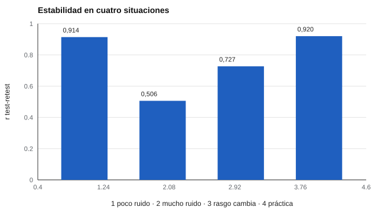

# 024 — Test-retest: estabilidad frente a consistencia


<!-- NAV -->
[← 023 — Omega de McDonald y por qué alfa se queda cor…](../023-omega-y-alternativas-a-alfa/README.md) · [📚 Parte 02](../README.md) · [🗺️ Índice 001–200](../../../PROGRAMA.md) · [025 — Error típico de medida e intervalos de confia… →](../025-error-tipico-de-medida/README.md)
<!-- /NAV -->

**Parte 02 — Fiabilidad** · Nivel intermedio · 3 h · Estado `escrita`
**Pensada para:** quien diseña estudios de fiabilidad, quien interpreta cambios en el tiempo y quien es evaluado más de una vez.
**Prerrequisitos:** clases 021 y 022.

## ¿Para qué te sirve esto?

Si te evalúan hoy y de nuevo en tres meses, ¿cuánto de la diferencia es cambio real y cuánto es «ruido del día»? El **test-retest** es la forma de estimar cuán estable es el puntaje en el tiempo. A diferencia del alfa (que mira el instrumento en una sola ocasión), este coeficiente mira a **las personas** en dos momentos. Entenderlo te ayuda a diseñar estudios y a no sacar conclusiones apresuradas de una segunda medición.

## Al terminar esta clase podrás

- Diseñar un estudio test-retest y justificar el intervalo entre aplicaciones.
- Interpretar la correlación sin confundirla con acuerdo absoluto.
- Distinguir ruido transitorio de cambio real.
- Elegir entre correlación y coeficiente de correlación intraclase (CCI).

## La idea en palabras simples

Pesas a las mismas personas dos mañanas distintas. Si la balanza es buena, quien pesa más el lunes también pesa más el martes: se conserva el **orden**. Pero si el martes todos llevan un kilo de ropa extra, **el orden se mantiene** y, sin embargo, todos pesan distinto. La correlación test-retest mide si se conserva el orden; no dice si los valores cambiaron.

El coeficiente de estabilidad baja por tres causas, y **no las separa**: ruido transitorio (ánimo, sueño), cambio real del rasgo y efectos de recuerdo o práctica.

## Cómo funciona, paso a paso

**1. Aplicar dos veces** el mismo instrumento a las mismas personas, con un intervalo.

**2. Correlacionar** ambos puntajes (r test-retest).

**3. Mirar también la diferencia de medias.** Si el grupo sube o baja, la correlación no lo detecta.



*Figura 1.* La última barra es la lección: todo el grupo mejora una desviación estándar y r sigue siendo 0,92.

**4. Elegir el intervalo.** Muy corto: la gente recuerda sus respuestas. Muy largo: el rasgo puede cambiar. No hay valor universal: se justifica por la estabilidad esperada del constructo (un estado de ánimo no es un rasgo) y se declara.

**5. Acuerdo absoluto.** Para acuerdo, se añade la diferencia de medias o un **coeficiente de correlación intraclase (CCI)** declarando su tipo (Shrout & Fleiss, 1979; Koo & Li, 2016).

**Ejemplo resuelto.** Una escala de ansiedad rasgo da r = 0,55 a 6 meses. No se concluye «mala fiabilidad»: se contrasta con r a 2 semanas y con alfa; si a 2 semanas es alta, la caída es cambio real, no ruido.

## Si construyes el instrumento

- Declara el intervalo y por qué lo elegiste.
- Reporta siempre correlación **y** diferencia de medias (o CCI con su tipo).
- No apliques test-retest a constructos que cambian por definición (estados).
- Controla el recuerdo con intervalos razonables o con formas paralelas.

## Si eres evaluado

- Si repites una prueba y tu puntaje cambia, parte puede ser ruido del día: no saques conclusiones de una sola diferencia.
- En pruebas de rendimiento, repetir la prueba suele mejorar el resultado por práctica; pregunta si hay un criterio para eso.
- Si te evalúan para ver «cuánto cambiaste», pregunta cuál es el cambio mínimo considerado confiable (clase 025).

## Qué muestra el laboratorio

`lab.py` simula 10.000 personas medidas dos veces en cuatro situaciones.

| Caso | r test-retest | Dif. de medias |
|---|---:|---:|
| Estable, poco ruido transitorio | 0,914 | −0,002 |
| Estable, mucho ruido transitorio | 0,506 | −0,016 |
| El rasgo cambia entre ocasiones | 0,727 | −0,003 |
| Estable, con práctica (+1 DE) | 0,920 | 0,996 |

**Análisis.** (1) Más ruido transitorio (0,506) o cambio real (0,727) bajan r, y la correlación no distingue cuál causó la caída. (2) El efecto de práctica deja r casi intacta (0,920) aunque todo el grupo suba 1 DE: **r mide orden relativo, no acuerdo**. (3) Para acuerdo hace falta comparar medias o usar un CCI. (4) La simulación usa errores independientes entre ocasiones; en la vida real el recuerdo los correlaciona e infla r.

## Errores frecuentes

- Reportar r sin diferencia de medias.
- Aplicar test-retest a estados que cambian por definición.
- Llamar «fiabilidad» a la estabilidad sin precisarlo.
- Usar un intervalo sin justificar.

## Lo mínimo que debes llevarte

1. El test-retest mide estabilidad en el tiempo, no consistencia interna.
2. r no distingue ruido, cambio real ni práctica.
3. r mide orden, no acuerdo absoluto.
4. El intervalo se justifica y se declara.

## Ejercicios

- **Inicial.** ¿Por qué r alta no implica puntajes iguales? *Solución: r solo mide si se conserva el orden.*
- **Intermedio.** Propón y justifica un intervalo para un inventario de personalidad y otro para una escala de ánimo.
- **Avanzado.** Agrega correlación entre los errores de ambas ocasiones en `lab.py` y observa r.
- **Aplicación.** Diseña un estudio test-retest para un cuestionario de tu contexto.

## Glosario

- **Test-retest:** aplicar el mismo instrumento dos veces a las mismas personas.
- **Estabilidad:** conservación del orden de las personas en el tiempo.
- **Ruido transitorio:** variación pasajera (ánimo, sueño) que afecta una medición.
- **Efecto de práctica:** mejora por haber hecho antes la prueba.
- **CCI:** coeficiente de correlación intraclase.

## Laboratorio

```bash
python classes/part-02-fiabilidad/024-test-retest-y-estabilidad/lab.py
python classes/part-02-fiabilidad/figuras.py
```

## Autoevaluación y criterios

1. ¿Qué tres causas bajan el test-retest y cuál no se separa? 2. ¿Cuándo prefieres un CCI? 3. ¿Qué intervalo evitarías en una prueba de rendimiento?
Se logra la clase si puedes reportar correlación, diferencia de medias y su limitación.

## Bibliografía

- Shrout, P. E., & Fleiss, J. L. (1979). Intraclass correlations: Uses in assessing rater reliability. *Psychological Bulletin*, 86(2), 420-428. ✅ [DOI](https://doi.org/10.1037/0033-2909.86.2.420)
- Weir, J. P. (2005). Quantifying test-retest reliability using the intraclass correlation coefficient and the SEM. *Journal of Strength and Conditioning Research*, 19(1), 231-240. ✅ [DOI](https://doi.org/10.1519/00124278-200502000-00038)
- Koo, T. K., & Li, M. Y. (2016). A guideline of selecting and reporting intraclass correlation coefficients for reliability research. *Journal of Chiropractic Medicine*, 15(2), 155-163. ✅ [DOI](https://doi.org/10.1016/j.jcm.2016.02.012)

Leyenda: ✅ existe en Crossref con título y año coincidentes (enlace al DOI); ⚠️ hay una obra de título parecido con otro año (no se enlaza: comprobar la edición); 🔎 no verificada automáticamente (libros sin DOI, normas y sitios web). Crossref confirma la existencia de la fuente, no que respalde cada afirmación de la clase. Ver [`docs/VERIFICACION_BIBLIOGRAFIA.md`](../../../docs/VERIFICACION_BIBLIOGRAFIA.md).

---

<!-- NAV -->
[← 023 — Omega de McDonald y por qué alfa se queda cor…](../023-omega-y-alternativas-a-alfa/README.md)  
[📚 Parte 02](../README.md) · [🗺️ Índice 001–200](../../../PROGRAMA.md)  
[025 — Error típico de medida e intervalos de confia… →](../025-error-tipico-de-medida/README.md)
<!-- /NAV -->
