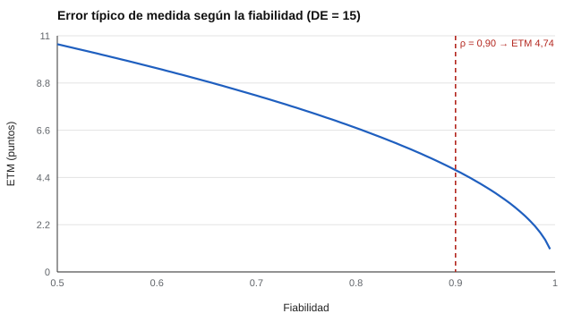

# 025 — Error típico de medida e intervalos de confianza del puntaje


<!-- NAV -->
[← 024 — Test-retest: estabilidad frente a consistencia](../024-test-retest-y-estabilidad/README.md) · [📚 Parte 02](../README.md) · [🗺️ Índice 001–200](../../../PROGRAMA.md) · [026 — Estadística descriptiva aplicada a puntajes →](../026-estadistica-descriptiva-aplicada-a-puntajes/README.md)
<!-- /NAV -->

**Parte 02 — Fiabilidad** · Nivel intermedio · 4 h · Estado `escrita`
**Pensada para:** quien interpreta puntajes individuales (docentes, orientadores, selectores) y quien recibe un resultado.
**Prerrequisitos:** clases 021 y 024.

## ¿Para qué te sirve esto?

«Antes tuviste 95 y ahora 105: mejoraste 10 puntos». ¿De verdad? Con fiabilidad 0,90, que es alta, un puntaje se mueve unos ±9 puntos solo por error. Esta clase convierte la fiabilidad en una cantidad usable, el **error típico de medida (ETM)**, y te enseña a decidir si una diferencia es **real** o cabe dentro del ruido. Es una de las herramientas más valiosas para quien interpreta resultados individuales.

## Al terminar esta clase podrás

- Calcular el ETM desde la desviación típica y la fiabilidad.
- Construir un intervalo para un puntaje individual y para una diferencia.
- Explicar por qué una diferencia moderada entre dos aplicaciones puede ser solo error.
- Rechazar conclusiones que caben dentro del error.

## La idea en palabras simples

Todo puntaje es una estimación con un «margen de error», como la medición de una cinta métrica con tolerancia de un centímetro. El ETM es el tamaño típico de ese margen, expresado **en los mismos puntos del test**. Si dos resultados difieren menos que ese margen (con el factor de seguridad), no hay evidencia de que la persona sea realmente distinta.

## Cómo funciona, paso a paso

**1. Fórmulas.**

```
ETM = DE · √(1 − fiabilidad)
Intervalo del 95 %:  X ± 1,96 · ETM
ETM de una diferencia = ETM · √2
```

**2. Ejemplo.** DE 10 y fiabilidad 0,84: ETM = 10 · √0,16 = 4. Un puntaje de 60 tiene intervalo 60 ± 7,84. Dos medidas que difieren 9 puntos: el umbral de cambio fiable es 1,96 · 4 · √2 = 11,1; 9 **no basta**.



*Figura 1.* Cuanto mayor la fiabilidad, menor el ETM; pero incluso con 0,90 el error es de casi 5 puntos.

**3. Una diferencia tiene más error que un puntaje** porque suma el error de las dos mediciones (por eso el factor √2).

**4. Cambio fiable.** Esta idea corresponde al **índice de cambio fiable** de Jacobson y Truax (1991): solo se habla de cambio si la diferencia supera lo que el error explica.

**5. Nota.** El intervalo centrado en el puntaje observado cubre el 95 % en promedio, pero pierde cobertura en los extremos por la regresión a la media; la clase 030 desarrolla la alternativa centrada en el verdadero estimado.

## Si construyes el instrumento

- Informa el ETM junto a la fiabilidad: es la cifra que más ayuda a quien interpreta.
- Calcula el ETM en la misma escala de puntaje que se reporta a las personas.
- Reconoce que el error no es igual para todos los niveles del rasgo; la teoría de respuesta al ítem (parte 05) lo modela.
- Evita informes que digan solo «mejoró 8 puntos».

## Si eres evaluado

- Pregunta cuál es el margen de error de tu puntaje y de la diferencia entre dos aplicaciones.
- Un puntaje un poco bajo un corte no es concluyente: el margen puede incluir el corte.
- Una «mejora» de pocos puntos entre dos pruebas puede ser solo error.

## Qué muestra el laboratorio

`lab.py` simula 50.000 personas con media 100, DE 15 y fiabilidad 0,90 → ETM = 4,74.

| Resultado | Valor |
|---|---:|
| Intervalo del 95 % de un puntaje observado | ± 9,3 puntos |
| Cobertura sobre el puntaje verdadero | 0,950 |
| Umbral de cambio fiable | 13,1 puntos |
| Personas sin cambio real marcadas como cambiadas | 0,050 |
| Diferencias de más de 10 puntos sin cambio real | 0,135 |

**Análisis.** (1) El intervalo cubre el 95 % esperado, de modo que el método funciona. (2) Con fiabilidad 0,90, un puntaje se mueve ±9 puntos solo por error. (3) El 13,5 % de las personas, cerca de una de cada siete, muestra una diferencia mayor a 10 puntos **sin cambio real**: una diferencia de 10 puntos no es evidencia de cambio. (4) La simulación supone un error igual para todos; en la práctica varía con el nivel del rasgo.

## Errores frecuentes

- Reportar un puntaje sin su intervalo.
- Usar un único ETM para todos los niveles sin advertirlo.
- Interpretar «no significativo» como «no cambió».
- Olvidar el factor √2 al evaluar una diferencia.

## Lo mínimo que debes llevarte

1. ETM = DE · √(1 − fiabilidad), en puntos del test.
2. Intervalo: X ± 1,96 · ETM.
3. Una diferencia tiene más error: se multiplica por √2.
4. Un cambio dentro del margen no es evidencia de cambio.

## Ejercicios

- **Inicial.** DE 15, fiabilidad 0,75: ¿ETM? *Solución: 7,5.*
- **Intermedio.** Con ese ETM, ¿qué diferencia entre dos aplicaciones es fiable al 95 %? *Solución: 1,96 · 7,5 · √2 = 20,8.*
- **Avanzado.** En `lab.py` baja la fiabilidad a 0,70 y observa cómo cambia la proporción de «cambios» espurios mayores de 10 puntos.
- **Aplicación.** Un colegio informa «mejoró 8 puntos». Escribe qué información faltaría para saber si es real.

## Glosario

- **ETM:** desviación típica del error de medida.
- **Intervalo de confianza:** rango en que, con cierta probabilidad, está el valor verdadero.
- **Cambio fiable:** diferencia mayor que lo que el error explica.
- **Cobertura:** proporción de veces que un intervalo contiene el valor verdadero.

## Laboratorio

```bash
python classes/part-02-fiabilidad/025-error-tipico-de-medida/lab.py
python classes/part-02-fiabilidad/figuras.py
```

## Autoevaluación y criterios

1. ¿Por qué el ETM de una diferencia es mayor que el de un puntaje? 2. ¿Qué decisión de aula o de selección sería indefendible con un cambio de 10 puntos? 3. ¿Qué información falta en un informe que solo dice «mejoró 8 puntos»?
Se logra la clase si puedes calcular ETM e intervalos y rechazar conclusiones que caben dentro del error.

## Bibliografía

- Harvill, L. M. (1991). Standard error of measurement. *Educational Measurement: Issues and Practice*, 10(2), 33-41. ✅ [DOI](https://doi.org/10.1111/j.1745-3992.1991.tb00195.x)
- Jacobson, N. S., & Truax, P. (1991). Clinical significance: A statistical approach to defining meaningful change in psychotherapy research. *Journal of Consulting and Clinical Psychology*, 59(1), 12-19. ✅ [DOI](https://doi.org/10.1037/0022-006x.59.1.12)
- AERA, APA, & NCME (2014). *Standards for Educational and Psychological Testing*. 🔎 sin verificar (libro, norma o sitio no hallado en Crossref: comprobar a mano)

Leyenda: ✅ existe en Crossref con título y año coincidentes (enlace al DOI); ⚠️ hay una obra de título parecido con otro año (no se enlaza: comprobar la edición); 🔎 no verificada automáticamente (libros sin DOI, normas y sitios web). Crossref confirma la existencia de la fuente, no que respalde cada afirmación de la clase. Ver [`docs/VERIFICACION_BIBLIOGRAFIA.md`](../../../docs/VERIFICACION_BIBLIOGRAFIA.md).

---

<!-- NAV -->
[← 024 — Test-retest: estabilidad frente a consistencia](../024-test-retest-y-estabilidad/README.md)  
[📚 Parte 02](../README.md) · [🗺️ Índice 001–200](../../../PROGRAMA.md)  
[026 — Estadística descriptiva aplicada a puntajes →](../026-estadistica-descriptiva-aplicada-a-puntajes/README.md)
<!-- /NAV -->
