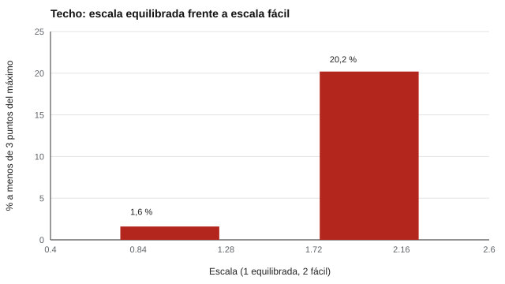

# 026 — Estadística descriptiva aplicada a puntajes


<!-- NAV -->
[← 025 — Error típico de medida e intervalos de confia…](../025-error-tipico-de-medida/README.md) · [📚 Parte 02](../README.md) · [🗺️ Índice 001–200](../../../PROGRAMA.md) · [027 — Correlación de Pearson, Spearman y sus supues… →](../027-correlacion-de-pearson-spearman-y-sus-supuestos/README.md)
<!-- /NAV -->

**Parte 02 — Fiabilidad** · Nivel intermedio · 4 h · Estado `escrita`
**Pensada para:** quien analiza datos de pruebas y cuestionarios, y quien lee sus informes.
**Prerrequisitos:** clases 004 y 021.

## ¿Para qué te sirve esto?

Antes de calcular fiabilidad o validez hay que **mirar la distribución** de los puntajes. Dos escalas pueden tener el mismo número de ítems y comportarse muy distinto: en una, los puntajes se reparten bien; en otra, muchas personas quedan «pegadas» al máximo y no se puede distinguir entre ellas. Esta clase amplía la estadística básica (clase 010) con los indicadores específicos de un puntaje total: asimetría, curtosis y efectos de suelo y techo.

## Al terminar esta clase podrás

- Describir un puntaje total con media, DE, asimetría, curtosis y efectos de suelo y techo.
- Reconocer cuándo la forma de la distribución limita la discriminación y la fiabilidad.
- Elegir resúmenes adecuados al nivel de medida (clase 003).
- Proponer una acción sobre los ítems cuando hay un techo marcado.

## La idea en palabras simples

Si una prueba es muy fácil, casi todos sacan puntajes altos y se amontonan cerca del máximo (efecto **techo**): no puedes distinguir al muy bueno del bueno. Si es muy difícil, se amontonan en el mínimo (efecto **suelo**). En ambos casos, el instrumento pierde capacidad de distinguir en esa zona, y su fiabilidad ahí cae.

- **Asimetría:** si la distribución tiene una cola hacia la izquierda (negativa) o la derecha (positiva).
- **Curtosis (exceso):** cuán pesadas son las colas; no mide «puntiagudez» (DeCarlo, 1997).
- **Suelo y techo:** porcentaje de personas en el puntaje mínimo y máximo.

## Cómo funciona, paso a paso

**1. Calcular los indicadores** de la distribución.

**2. Mirar suelo y techo.** Una referencia citada en la literatura de instrumentos de salud es 15 % en el mínimo o el máximo (Terwee et al., 2007); es una alerta, no una norma.

**3. Interpretar.** Un puntaje total de ítems Likert es una suma de variables ordinales: no es exactamente continuo ni normal.



*Figura 1.* En la escala fácil, uno de cada cinco evaluados queda a menos de 3 puntos del máximo.

**4. Ejemplo resuelto.** Datos 2, 3, 3, 4, 8: media 4; DE poblacional = √((4+1+1+0+16)/5) = 2,10; el 8 genera asimetría positiva. La mediana (3) describe mejor al caso típico.

## Si construyes el instrumento

- Calcula estos indicadores en el piloto de cada escala.
- Si hay techo marcado, agrega ítems más exigentes en lugar de transformar los datos.
- No supongas normalidad por ser una suma de ítems.
- Reporta mediana y rango intercuartil cuando haya asimetría.

## Si eres evaluado

- Si sacaste el máximo, pregunta si la prueba puede distinguir tu nivel: quizá la prueba es demasiado fácil para ti y tu resultado subestima lo que sabes.
- Un puntaje alto en una prueba con techo marcado es menos informativo que en una prueba que cubre el rango completo.
- Si te ubican «en el promedio» pero la prueba tiene mucho techo, el promedio también está comprimido.

## Qué muestra el laboratorio

`lab.py` simula 5.000 personas respondiendo 10 ítems Likert de 1 a 5 (puntaje de 10 a 50).

| Escala | Media | DE | Asimetría | Curtosis | Techo | Techo − 3 |
|---|---:|---:|---:|---:|---:|---:|
| Equilibrada | 30,1 | 8,0 | 0,00 | −0,53 | 0,2 % | 1,6 % |
| Fácil (+1,2) | 40,4 | 6,7 | −0,70 | 0,07 | 4,5 % | 20,2 % |

**Análisis.** (1) La escala fácil tiene media alta, asimetría negativa y mucha gente cerca del techo. (2) Uno de cada cinco evaluados está a menos de 3 puntos del máximo: no se distingue entre quienes están arriba y la fiabilidad en esa zona cae. (3) Una regla práctica citada es |asimetría| > 1 o más de un 15 % en suelo o techo como señal de problemas de cobertura; es una alerta, no una norma. (4) A veces el problema no es la forma sino que los ítems son demasiado fáciles.

## Errores frecuentes

- Reportar solo la media.
- Suponer normalidad por tratarse de una suma.
- Transformar los datos antes de preguntar si el instrumento cubre el rango del rasgo.
- Ignorar el suelo o el techo.

## Lo mínimo que debes llevarte

1. Grafica y describe antes de calcular fiabilidad.
2. Techo y suelo reducen la capacidad de distinguir.
3. La asimetría y la curtosis describen la forma, no «puntiagudez».
4. A veces la solución es agregar ítems, no transformar datos.

## Ejercicios

- **Inicial.** ¿Qué indica una asimetría negativa en un puntaje total? *Solución: cola hacia puntajes bajos; la mayoría está arriba.*
- **Intermedio.** Calcula media y DE de 2, 4, 4, 6. *Solución: media 4; DE = √2 = 1,41.*
- **Avanzado.** Modifica `sesgo` en `lab.py` a −1,2 y describe el suelo.
- **Aplicación.** Toma puntajes de una prueba real (anonimizados), calcula los indicadores y decide qué harías.

## Glosario

- **Asimetría:** inclinación de la distribución hacia un lado.
- **Curtosis:** peso de las colas de la distribución.
- **Efecto techo:** acumulación de personas en el puntaje máximo.
- **Efecto suelo:** acumulación en el puntaje mínimo.

## Laboratorio

```bash
python classes/part-02-fiabilidad/026-estadistica-descriptiva-aplicada-a-puntajes/lab.py
python classes/part-02-fiabilidad/figuras.py
```

## Autoevaluación y criterios

1. ¿Por qué el techo reduce la fiabilidad en la zona alta? 2. ¿Cuándo preferirías mediana y rango intercuartil? 3. ¿Qué haces si encuentras 30 % en el techo?
Se logra la clase si puedes describir una distribución real y proponer una acción sobre los ítems.

## Bibliografía

- DeCarlo, L. T. (1997). On the meaning and use of kurtosis. *Psychological Methods*, 2(3), 292-307.
- Terwee, C. B., et al. (2007). Quality criteria were proposed for measurement properties of health status questionnaires. *Journal of Clinical Epidemiology*, 60(1), 34-42.

---

<!-- NAV -->
[← 025 — Error típico de medida e intervalos de confia…](../025-error-tipico-de-medida/README.md)  
[📚 Parte 02](../README.md) · [🗺️ Índice 001–200](../../../PROGRAMA.md)  
[027 — Correlación de Pearson, Spearman y sus supues… →](../027-correlacion-de-pearson-spearman-y-sus-supuestos/README.md)
<!-- /NAV -->
