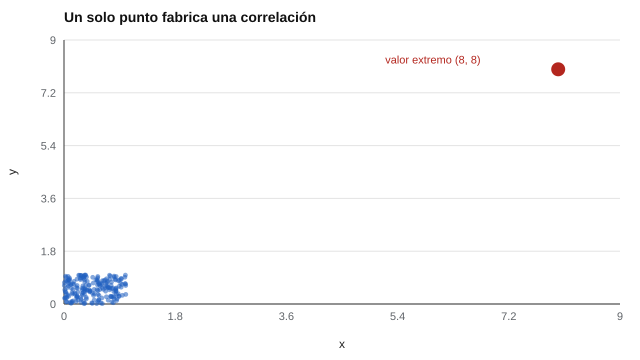

# 027 — Correlación de Pearson, Spearman y sus supuestos


<!-- NAV -->
[← 026 — Estadística descriptiva aplicada a puntajes](../026-estadistica-descriptiva-aplicada-a-puntajes/README.md) · [📚 Parte 02](../README.md) · [🗺️ Índice 001–200](../../../PROGRAMA.md) · [028 — Fiabilidad de pruebas dicotómicas: KR-20 →](../028-fiabilidad-de-pruebas-dicotomicas-kr-20/README.md)
<!-- /NAV -->

**Parte 02 — Fiabilidad** · Nivel intermedio · 4 h · Estado `escrita`
**Pensada para:** quien analiza relaciones entre puntajes y quien lee estudios de validez y fiabilidad.
**Prerrequisitos:** clases 003, 021 y 026.

## ¿Para qué te sirve esto?

La correlación es la herramienta más usada en psicometría: la fiabilidad test-retest, la validez de criterio y muchas otras evidencias se resumen en un coeficiente r. Pero un número puede esconder mucho: una relación curva, un valor extremo o un grupo seleccionado cambian por completo su significado. Esta clase te enseña a elegir el coeficiente adecuado y a pedir siempre el gráfico.

## Al terminar esta clase podrás

- Calcular e interpretar Pearson y Spearman.
- Reconocer el efecto de valores extremos, no linealidad y restricción de rango.
- Elegir el coeficiente según el nivel de medida y la forma de la relación.
- Justificar por qué no se reporta una correlación sin mirar el diagrama de dispersión.

## La idea en palabras simples

- **Pearson** mide cuán bien los puntos siguen una **línea recta**.
- **Spearman** convierte los valores en **rangos** (1.º, 2.º, 3.º…) y mide si al subir uno sube el otro, aunque sea curvo: una relación **monótona**.

Ambos resumen en un número lo que un gráfico muestra completo. El estadístico Anscombe (1973) lo demostró con cuatro conjuntos de datos distintos que dan el mismo r: **siempre hay que graficar**.

## Cómo funciona, paso a paso

**1. Pearson:** asociación lineal. Sensible a valores extremos.

**2. Spearman:** Pearson sobre rangos (con rangos promedio en los empates). Robusto a extremos y a curvas monótonas.

**3. Tres trampas.**



*Figura 1.* Sin relación real, un solo punto extremo (rojo) produce una correlación de Pearson de 0,33.

- **No linealidad:** una relación perfectamente monótona pero curva subestima Pearson.
- **Valor extremo:** un solo punto puede fabricar o ocultar una correlación.
- **Restricción de rango:** si se estudia solo a un subgrupo seleccionado (por ejemplo, solo a los contratados), la correlación observada baja.

**4. Ejemplo resuelto.** Datos x = (1, 2, 3, 4, 100), y = (2, 4, 5, 8, 10). Spearman: los rangos son idénticos → ρ = 1. Pearson es menor (0,75) y está dominado por el 100.

## Si construyes el instrumento

- Grafica siempre antes de reportar r.
- Para variables ordinales o con valores extremos, usa Spearman o revisa el efecto de los extremos.
- Al estudiar la validez de un instrumento de selección, recuerda que solo ves a los contratados: la correlación observada subestima la real (clase 034).
- No interpretes r como causalidad ni como «porcentaje de acuerdo».

## Si eres evaluado

- Si un informe dice «la prueba predice el desempeño con r = 0,30», pregunta con qué grupo se calculó: si fue solo con contratados, la relación real podría ser mayor.
- Un r moderado no significa que la prueba falle en cada persona: describe una tendencia del grupo.
- r² (la proporción de varianza compartida) suele ser más pequeño de lo que se imagina: r = 0,5 comparte solo el 25 %.

## Qué muestra el laboratorio

`lab.py` calcula ambos coeficientes en cinco situaciones (n = 200).

| Situación | Pearson | Spearman |
|---|---:|---:|
| 1. Lineal con ruido | 0,648 | 0,629 |
| 2. Monótona no lineal (exp) | 0,678 | 0,992 |
| 3a. Sin relación | 0,086 | 0,111 |
| 3b. Igual + un valor extremo (8, 8) | 0,332 | 0,124 |
| 4a. Rango completo | 0,667 | 0,643 |
| 4b. Rango restringido (x > 0,5, n = 57) | 0,464 | 0,410 |

**Análisis.** (1) En la situación 2, Pearson subestima una relación perfectamente monótona (0,678 frente a 0,992). (2) En 3b, un solo punto lleva Pearson de 0,09 a 0,33; Spearman casi no se mueve. (3) En 4b, seleccionar por X reduce r observada: es la restricción de rango. (4) Son datos simulados con relaciones conocidas; en la realidad conviene graficar y comparar ambos coeficientes.

## Errores frecuentes

- Interpretar r como causalidad.
- Correlacionar variables ordinales de pocas categorías con Pearson sin considerar la discretización (clase 050).
- No mirar el gráfico.
- Estimar la validez solo con un grupo seleccionado sin corregir.

## Lo mínimo que debes llevarte

1. Pearson: relación lineal; Spearman: relación monótona.
2. Un solo punto extremo puede cambiar r.
3. La restricción de rango subestima la correlación.
4. Siempre se grafica.

## Ejercicios

- **Inicial.** ¿Qué coeficiente usarías para dos rankings? *Solución: Spearman.*
- **Intermedio.** Si r = 0,5, ¿qué proporción de varianza comparten? *Solución: 25 %.*
- **Avanzado.** Añade a `lab.py` dos valores extremos opuestos que anulen la correlación y explica el resultado.
- **Aplicación.** Toma dos variables de tu contexto, grafícalas y compara Pearson y Spearman.

## Glosario

- **Correlación:** medida de asociación entre dos variables.
- **Monótona:** relación que siempre sube (o siempre baja), aunque no sea recta.
- **Rango:** posición que ocupa un valor al ordenar los datos.
- **Restricción de rango:** reducción de la variabilidad por seleccionar un subgrupo.

## Laboratorio

```bash
python classes/part-02-fiabilidad/027-correlacion-de-pearson-spearman-y-sus-supuestos/lab.py
python classes/part-02-fiabilidad/figuras.py
```

## Autoevaluación y criterios

1. ¿Por qué un punto puede cambiar r? 2. ¿Qué es la restricción de rango y a quién afecta? 3. ¿Cuándo Spearman no ayuda?
Se logra la clase si puedes elegir el coeficiente con razones y justificar el pedir el gráfico.

## Bibliografía

- Spearman, C. (1904). The proof and measurement of association between two things. *American Journal of Psychology*, 15(1), 72-101.
- Anscombe, F. J. (1973). Graphs in statistical analysis. *The American Statistician*, 27(1), 17-21.
- Bishara, A. J., & Hittner, J. B. (2012). Testing the significance of a correlation with nonnormal data: Comparison of Pearson, Spearman, transformation, and resampling approaches. *Psychological Methods*, 17(3), 399-417.

---

<!-- NAV -->
[← 026 — Estadística descriptiva aplicada a puntajes](../026-estadistica-descriptiva-aplicada-a-puntajes/README.md)  
[📚 Parte 02](../README.md) · [🗺️ Índice 001–200](../../../PROGRAMA.md)  
[028 — Fiabilidad de pruebas dicotómicas: KR-20 →](../028-fiabilidad-de-pruebas-dicotomicas-kr-20/README.md)
<!-- /NAV -->
