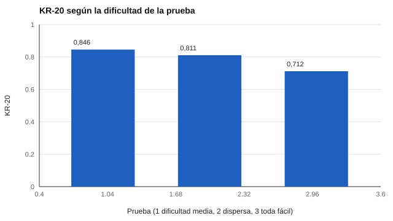

# 028 — Fiabilidad de pruebas dicotómicas: KR-20


<!-- NAV -->
[← 027 — Correlación de Pearson, Spearman y sus supues…](../027-correlacion-de-pearson-spearman-y-sus-supuestos/README.md) · [📚 Parte 02](../README.md) · [🗺️ Índice 001–200](../../../PROGRAMA.md) · [029 — Fiabilidad entre evaluadores: kappa y CCI →](../029-fiabilidad-entre-evaluadores-kappa-y-cci/README.md)
<!-- /NAV -->

**Parte 02 — Fiabilidad** · Nivel intermedio · 3 h · Estado `escrita`
**Pensada para:** quien construye pruebas de rendimiento (de acierto o error) y quien las rinde.
**Prerrequisitos:** clases 015 y 022.

## ¿Para qué te sirve esto?

Las pruebas de alternativas se puntúan con 1 (acierto) o 0 (error). Para ellas, la fiabilidad interna se calcula con una fórmula histórica, la **KR-20**, que es el alfa de Cronbach para ítems 0/1. Esta clase te enseña a calcularla, a entender por qué una prueba **demasiado fácil** rinde menos con el mismo número de ítems y a decidir si agregar o cambiar ítems.

## Al terminar esta clase podrás

- Calcular KR-20 desde las proporciones de acierto.
- Demostrar que equivale a alfa con ítems 0/1.
- Explicar el efecto de la dificultad sobre la fiabilidad.
- Reconocer las limitaciones de KR-20 y de KR-21.

## La idea en palabras simples

Kuder y Richardson (1937) resolvieron el problema antes que Cronbach (1951): para un ítem que se acierta o se falla, la varianza es **p × q**, donde p es la proporción que acierta y q = 1 − p. Un ítem que todos aciertan (p cerca de 1) casi no tiene variación: no ayuda a distinguir a nadie. Una prueba con muchos ítems así tiene poca varianza que «covariar», y por eso su fiabilidad es menor.

## Cómo funciona, paso a paso

**1. Fórmula.**

```
KR-20 = k/(k − 1) · ( 1 − Σ pᵢ·qᵢ / varianza(total) )          qᵢ = 1 − pᵢ
```

**2. Ejemplo resuelto.** Tres ítems con p = 0,5; 0,6; 0,7: Σpq = 0,25 + 0,24 + 0,21 = 0,70. Con varianza total 1,5: KR-20 = 3/2 · (1 − 0,70/1,5) = **0,80**.

**3. KR-21.** Supone igual dificultad en todos los ítems y subestima cuando no es así.



*Figura 1.* La prueba fácil rinde menos con el mismo número de ítems.

**4. Con adivinación.** En opción múltiple, adivinar agrega varianza de error y baja la fiabilidad.

## Si construyes el instrumento

- Incluye ítems de dificultad media (p cercano a 0,5) para maximizar la información.
- Si necesitas distinguir a los de alto rendimiento, incorpora ítems difíciles.
- Calcula KR-20 por prueba o subprueba; no uses KR-20 en ítems politómicos (usa alfa).
- Recuerda que KR-20 alto no prueba unidimensionalidad.

## Si eres evaluado

- Una prueba demasiado fácil no te permite mostrar lo que sabes: tu resultado queda «comprimido» arriba.
- Una prueba con alternativas tiene error por adivinación: algunos aciertos pueden ser suerte.
- Pregunta cuál es la fiabilidad de la prueba y su margen de error (clase 025).

## Qué muestra el laboratorio

`lab.py` simula 4.000 personas en pruebas de 20 ítems de dificultad variable.

| Prueba | p media | KR-20 | Alfa |
|---|---:|---:|---:|
| Dificultad media (b = 0) | 0,50 | 0,846 | 0,846 |
| Dispersa (b de −2 a 2) | 0,50 | 0,811 | 0,811 |
| Toda fácil (b = −2,5) | 0,92 | 0,712 | 0,712 |

**Análisis.** (1) KR-20 y alfa coinciden exactamente: es el mismo cálculo. (2) La prueba toda fácil rinde menos (0,712 frente a 0,846) con el mismo número de ítems. (3) Con p cercano a 1 los ítems casi no tienen varianza que covariar. (4) Son datos simulados con un modelo sencillo de acierto; con pruebas reales conviene mirar la dificultad ítem a ítem.

## Errores frecuentes

- Aplicar KR-20 a ítems politómicos.
- Interpretar un KR-20 alto como unidimensionalidad.
- Ignorar que la adivinación agrega error.
- Usar KR-21 cuando la dificultad es dispersa.

## Lo mínimo que debes llevarte

1. KR-20 es el alfa para ítems 0/1.
2. La varianza de un ítem 0/1 es p·q.
3. Ítems muy fáciles o muy difíciles aportan poco.
4. KR-21 subestima si la dificultad es desigual.

## Ejercicios

- **Inicial.** ¿Por qué un ítem con p = 1 no aporta a KR-20? *Solución: su varianza es 0.*
- **Intermedio.** k = 4, Σpq = 0,8, varianza = 2. *Solución: 4/3 · (1 − 0,4) = 0,80.*
- **Avanzado.** Aumenta a 40 ítems fáciles en `lab.py`: ¿cuánto sube KR-20?
- **Aplicación.** Calcula KR-20 de un examen de tu curso o trabajo (anonimizado).

## Glosario

- **Ítem dicotómico:** ítem con dos resultados (acierto/error).
- **Dificultad (p):** proporción de aciertos.
- **KR-20:** fiabilidad interna para ítems dicotómicos.
- **KR-21:** versión simplificada que supone igual dificultad.

## Laboratorio

```bash
python classes/part-02-fiabilidad/028-fiabilidad-de-pruebas-dicotomicas-kr-20/lab.py
python classes/part-02-fiabilidad/figuras.py
```

## Autoevaluación y criterios

1. ¿Cuándo difieren KR-20 y KR-21? 2. ¿Qué prefieres, ítems fáciles o de dificultad media, para fiabilidad? 3. ¿Qué cambia en una prueba de selección múltiple?
Se logra la clase si puedes calcular KR-20 y relacionar la dificultad con la precisión.

## Bibliografía

- Kuder, G. F., & Richardson, M. W. (1937). The theory of the estimation of test reliability. *Psychometrika*, 2(3), 151-160. ✅ [DOI](https://doi.org/10.1007/bf02288391)
- Cronbach, L. J. (1951). Coefficient alpha and the internal structure of tests. *Psychometrika*, 16, 297-334. ✅ [DOI](https://doi.org/10.1007/bf02310555)

Leyenda: ✅ existe en Crossref con título y año coincidentes (enlace al DOI); ⚠️ hay una obra de título parecido con otro año (no se enlaza: comprobar la edición); 🔎 no verificada automáticamente (libros sin DOI, normas y sitios web). Crossref confirma la existencia de la fuente, no que respalde cada afirmación de la clase. Ver [`docs/VERIFICACION_BIBLIOGRAFIA.md`](../../../docs/VERIFICACION_BIBLIOGRAFIA.md).

---

<!-- NAV -->
[← 027 — Correlación de Pearson, Spearman y sus supues…](../027-correlacion-de-pearson-spearman-y-sus-supuestos/README.md)  
[📚 Parte 02](../README.md) · [🗺️ Índice 001–200](../../../PROGRAMA.md)  
[029 — Fiabilidad entre evaluadores: kappa y CCI →](../029-fiabilidad-entre-evaluadores-kappa-y-cci/README.md)
<!-- /NAV -->
