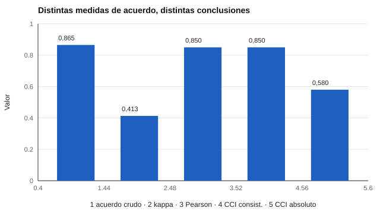

# 029 — Fiabilidad entre evaluadores: kappa y CCI


<!-- NAV -->
[← 028 — Fiabilidad de pruebas dicotómicas: KR-20](../028-fiabilidad-de-pruebas-dicotomicas-kr-20/README.md) · [📚 Parte 02](../README.md) · [🗺️ Índice 001–200](../../../PROGRAMA.md) · [030 — Intervalos de confianza para puntajes individ… →](../030-intervalos-de-confianza-para-puntajes-individuales/README.md)
<!-- /NAV -->

**Parte 02 — Fiabilidad** · Nivel intermedio · 4 h · Estado `escrita`
**Pensada para:** quien trabaja con observadores, jueces o correctores, y quien es calificado por ellos.
**Prerrequisitos:** clases 021, 024 y 027.

## ¿Para qué te sirve esto?

Cuando una persona juzga a otra (un examen oral, una entrevista, un diagnóstico por imagen), el resultado depende de **quién** juzga. ¿Cuánto coinciden dos evaluadores? Un 90 % de acuerdo parece excelente, pero puede ser engañoso. Esta clase te enseña dos herramientas: el **kappa de Cohen**, para categorías, y el **coeficiente de correlación intraclase (CCI)**, para puntajes, y a elegir según la decisión que se tomará.

## Al terminar esta clase podrás

- Calcular el kappa de Cohen y explicar por qué descuenta el azar.
- Distinguir acuerdo de consistencia con el CCI.
- Declarar qué tipo de acuerdo importa para la decisión.
- Reconocer cuándo el porcentaje de acuerdo engaña.

## La idea en palabras simples

Dos médicos revisan 100 radiografías en las que solo 8 tienen un hallazgo raro. Si ambos dicen «no hay nada» casi siempre, coincidirán en el 90 % de los casos **sin haber hecho nada útil**: casi todo se acierta diciendo «normal». El **kappa** descuenta ese acuerdo que se esperaría por pura casualidad.

Para puntajes (por ejemplo, notas de 0 a 7), no solo importa si los jueces ordenan igual a las personas (**consistencia**), sino si dan las **mismas notas** (**acuerdo absoluto**). Un juez que siempre pone 1,5 puntos menos mantiene el orden pero cambia el resultado de quien está cerca de un corte.

## Cómo funciona, paso a paso

**1. Kappa (Cohen, 1960):** κ = (pₒ − pₑ) / (1 − pₑ), donde pₒ es el acuerdo observado y pₑ el esperado por azar según las frecuencias de cada juez. Con una categoría muy prevalente, el acuerdo crudo es alto y κ baja (Feinstein & Cicchetti, 1990).

**2. Ejemplo resuelto.** Dos jueces clasifican 100 casos: ambos «sí» 20, ambos «no» 70, discrepan 10. pₒ = 0,90. Si cada uno dice «sí» en el 25 %, pₑ = 0,25² + 0,75² = 0,625; κ = (0,90 − 0,625) / 0,375 = **0,733**.

**3. CCI (Shrout & Fleiss, 1979):** cociente de varianzas obtenido con ANOVA. Hay variantes: *consistencia* (ignora diferencias de nivel entre jueces) y *acuerdo absoluto* (las penaliza). La elección se justifica por la decisión.



*Figura 1.* El porcentaje de acuerdo y la correlación pueden verse excelentes mientras kappa o el CCI de acuerdo revelan el problema.

## Si construyes el instrumento

- Informa kappa (o CCI) con su tipo y no solo el porcentaje de acuerdo.
- Entrena a los jueces con casos distintos a los de la evaluación: entrenar con los mismos casos infla el acuerdo.
- Declara qué importa: clasificar o puntuar.
- Si los jueces difieren en severidad, usa el CCI de acuerdo absoluto o corrige la severidad.

## Si eres evaluado

- Si tu resultado depende de un juez, tienes derecho a preguntar cómo se asegura la coherencia entre jueces.
- Cuando te califican con un corte (aprobado/reprobado), la severidad del juez puede cambiar tu resultado.
- Una segunda corrección es una buena práctica en decisiones importantes.

## Qué muestra el laboratorio

`lab.py` tiene dos partes.

**Parte 1 — hallazgo raro (prevalencia 8 %, cada evaluador con 93 % de aciertos):** acuerdo crudo = 0,865; **kappa = 0,413**.

**Parte 2 — dos jueces, el segundo 1,5 puntos más severo:**

| Indicador | Valor |
|---|---:|
| Correlación de Pearson | 0,850 |
| CCI de consistencia (3,1) | 0,850 |
| CCI de acuerdo absoluto (2,1) | 0,580 |

**Análisis.** (1) Con 86,5 % de acuerdo crudo, el kappa es 0,413: la mayor parte del acuerdo se debe a que casi todo es «normal». (2) La correlación y el CCI de consistencia no ven la severidad diferencial; el de acuerdo absoluto sí (0,850 → 0,580). (3) Para fijar «aprobado/reprobado» con un corte, esa diferencia importa. (4) Las etiquetas de interpretación de kappa (por ejemplo, de Landis & Koch, 1977) son convenciones arbitrarias.

## Errores frecuentes

- Reportar solo el porcentaje de acuerdo.
- Interpretar κ con tablas universales.
- Usar un CCI sin declarar su tipo y modelo.
- Entrenar a los jueces con los casos de evaluación.

## Lo mínimo que debes llevarte

1. Kappa descuenta el acuerdo por azar.
2. El porcentaje de acuerdo puede engañar con categorías raras.
3. CCI de consistencia ignora diferencias de severidad; el de acuerdo absoluto no.
4. Elige el índice según la decisión.

## Ejercicios

- **Inicial.** ¿Por qué κ puede ser bajo con 95 % de acuerdo? *Solución: porque casi todo el acuerdo sería esperable por azar.*
- **Intermedio.** Recalcula el ejemplo con pₑ = 0,5. *Solución: κ = 0,80.*
- **Avanzado.** En `lab.py` haz que el juez 2 sea 3 puntos más severo y reporta ambos CCI.
- **Aplicación.** Diseña cómo evaluarías el acuerdo entre dos entrevistadores de un proceso de selección.

## Glosario

- **Kappa de Cohen:** acuerdo entre dos jueces corregido por azar.
- **CCI:** coeficiente de correlación intraclase.
- **Consistencia:** los jueces ordenan igual a las personas.
- **Acuerdo absoluto:** los jueces asignan los mismos valores.
- **Prevalencia:** frecuencia de una categoría en la población.

## Laboratorio

```bash
python classes/part-02-fiabilidad/029-fiabilidad-entre-evaluadores-kappa-y-cci/lab.py
python classes/part-02-fiabilidad/figuras.py
```

## Autoevaluación y criterios

1. ¿Cuándo importa el acuerdo absoluto? 2. ¿Qué evalúas antes de usar rúbricas con varios jueces? 3. ¿Por qué entrenar jueces y reportar el kappa?
Se logra la clase si puedes elegir y reportar el índice de acuerdo según la decisión.

## Bibliografía

- Cohen, J. (1960). A coefficient of agreement for nominal scales. *Educational and Psychological Measurement*, 20(1), 37-46. ✅ [DOI](https://doi.org/10.1177/001316446002000104)
- Shrout, P. E., & Fleiss, J. L. (1979). Intraclass correlations: Uses in assessing rater reliability. *Psychological Bulletin*, 86(2), 420-428. ✅ [DOI](https://doi.org/10.1037/0033-2909.86.2.420)
- Feinstein, A. R., & Cicchetti, D. V. (1990). High agreement but low kappa: I. The problems of two paradoxes. *Journal of Clinical Epidemiology*, 43(6), 543-549. ✅ [DOI](https://doi.org/10.1016/0895-4356(90)90159-m)
- Landis, J. R., & Koch, G. G. (1977). The measurement of observer agreement for categorical data. *Biometrics*, 33(1), 159-174. ✅ [DOI](https://doi.org/10.2307/2529310)

Leyenda: ✅ existe en Crossref con título y año coincidentes (enlace al DOI); ⚠️ hay una obra de título parecido con otro año (no se enlaza: comprobar la edición); 🔎 no verificada automáticamente (libros sin DOI, normas y sitios web). Crossref confirma la existencia de la fuente, no que respalde cada afirmación de la clase. Ver [`docs/VERIFICACION_BIBLIOGRAFIA.md`](../../../docs/VERIFICACION_BIBLIOGRAFIA.md).

---

<!-- NAV -->
[← 028 — Fiabilidad de pruebas dicotómicas: KR-20](../028-fiabilidad-de-pruebas-dicotomicas-kr-20/README.md)  
[📚 Parte 02](../README.md) · [🗺️ Índice 001–200](../../../PROGRAMA.md)  
[030 — Intervalos de confianza para puntajes individ… →](../030-intervalos-de-confianza-para-puntajes-individuales/README.md)
<!-- /NAV -->
