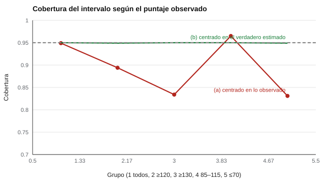

# 030 — Intervalos de confianza para puntajes individuales


<!-- NAV -->
[← 029 — Fiabilidad entre evaluadores: kappa y CCI](../029-fiabilidad-entre-evaluadores-kappa-y-cci/README.md) · [📚 Parte 02](../README.md) · [🗺️ Índice 001–200](../../../PROGRAMA.md) · [031 — La validez no es una propiedad del test, es u… →](../../part-03-validez/031-validez-como-argumento/README.md)
<!-- /NAV -->

**Parte 02 — Fiabilidad** · Nivel intermedio · 4 h · Estado `escrita`
**Pensada para:** quien informa puntajes individuales (orientadores, psicólogos, docentes) y quien los recibe.
**Prerrequisitos:** clases 021 y 025.

## ¿Para qué te sirve esto?

Alguien obtiene 130 en una prueba. ¿Su puntaje «verdadero» es 130? Probablemente es un poco menos, porque un puntaje muy alto suele incluir algo de buena suerte. Esta clase te enseña a construir dos tipos de intervalo para un puntaje individual, a entender por qué el más simple falla justo en los extremos (donde se toman las decisiones importantes) y a redactar una frase que comunique la incertidumbre sin sobreafirmar.

## Al terminar esta clase podrás

- Construir los dos intervalos habituales para un puntaje individual.
- Explicar por qué el intervalo centrado en lo observado pierde cobertura en los extremos.
- Estimar el puntaje verdadero con regresión hacia la media.
- Redactar una frase de informe que comunique la incertidumbre.

## La idea en palabras simples

Si de 1.000 estudiantes tomas a quienes sacaron 130 (muy alto), una parte tuvo habilidad alta **y** buena suerte. Si los vuelves a medir, en promedio sacarán algo menos: la suerte no se repite (regresión a la media, clase 006). Por eso la mejor estimación de su puntaje verdadero no es 130 sino algo **más cercano a la media**.

## Cómo funciona, paso a paso

Con puntaje observado X, media M, desviación s y fiabilidad ρ:

```
(a) Intervalo centrado en lo observado:   X ± 1,96 · ETM         con ETM = s · √(1 − ρ)
(b) Intervalo centrado en el verdadero estimado:
        T̂ = M + ρ · (X − M)      T̂ ± 1,96 · s · √(ρ · (1 − ρ))
```

- (a) cubre ~95 % **en el conjunto**, pero, dada una persona con X extremo, el verdadero tiende a estar más cerca de la media.
- (b) incorpora esa regresión (Charter & Feldt, 2001).

**Ejemplo resuelto.** X = 130, M = 100, s = 15, ρ = 0,80: T̂ = 100 + 0,8 · 30 = **124**; error = 15 · √0,16 = 6; el intervalo (b) es 124 ± 11,8 → **[112,2; 135,8]**. El intervalo (a) sería 130 ± 13,2.



*Figura 1.* El intervalo (a), en rojo, pierde cobertura justo en los puntajes altos y bajos.

## Si construyes el instrumento

- Elige el tipo de intervalo y decláralo en el manual.
- Para decisiones de cola (admisión, diagnóstico, cortes), usa el intervalo centrado en el verdadero estimado o advierte la limitación.
- Informa siempre la fiabilidad y el ETM usados.
- No digas «tu puntaje verdadero es X»: es un valor que no se observa.

## Si eres evaluado

- Pregunta cuál es el intervalo de tu puntaje, no solo el número.
- Si tu resultado es extremo (muy alto o muy bajo), una segunda medición probablemente será menos extremo.
- Un intervalo que incluye el corte significa que el resultado no es concluyente.

## Qué muestra el laboratorio

`lab.py` simula 200.000 personas con M = 100, DE = 15 y fiabilidad 0,80 (ETM = 6,71; error del verdadero estimado = 6,00).

| Puntaje observado | n | Cobertura (a) | Cobertura (b) |
|---|---:|---:|---:|
| Todos | 200.000 | 0,949 | 0,950 |
| 120 o más | 18.338 | 0,894 | 0,949 |
| 130 o más | 4.549 | 0,834 | 0,950 |
| 85 a 115 | 136.517 | 0,965 | 0,950 |
| 70 o menos | 4.539 | 0,831 | 0,949 |

**Análisis.** (1) En conjunto, ambos intervalos cubren el 95 %. (2) Para puntajes de 130 o más, el intervalo (a) cubre solo el 83,4 %: justo donde las decisiones pesan, cubre bastante menos de lo declarado. (3) El intervalo (b) mantiene 0,95 en todos los tramos. (4) Con fiabilidad alta, la diferencia entre ambos es pequeña; con fiabilidad baja, importa. El método supone normalidad y error igual para todos.

## Errores frecuentes

- Informar «tu puntaje verdadero es X».
- Usar el intervalo (a) para decisiones de cola sin advertirlo.
- Pasar por alto que con fiabilidad baja la diferencia es grande.
- Olvidar que el método supone error homogéneo.

## Lo mínimo que debes llevarte

1. El puntaje verdadero estimado se regresa hacia la media.
2. El intervalo (a) falla en los extremos; el (b) no.
3. La incertidumbre se informa, no se esconde.
4. Con ρ alta ambos se parecen.

## Ejercicios

- **Inicial.** Con ρ = 1, ¿cuánto vale el ETM? *Solución: 0.*
- **Intermedio.** Calcula (b) para X = 70 con los mismos parámetros. *Solución: T̂ = 76; 76 ± 11,8.*
- **Avanzado.** Cambia ρ a 0,95 en `lab.py` y compara las coberturas.
- **Aplicación.** Redacta una frase de informe para X = 130 sin sobreafirmar (por ejemplo: «su puntaje estimado está probablemente entre 112 y 136»).

## Glosario

- **Puntaje verdadero estimado (T̂):** mejor estimación del puntaje verdadero, regresada a la media.
- **Cobertura:** proporción de veces que un intervalo contiene el valor verdadero.
- **ETM:** error típico de medida.
- **Regresión a la media:** tendencia de los valores extremos a acercarse al promedio.

## Laboratorio

```bash
python classes/part-02-fiabilidad/030-intervalos-de-confianza-para-puntajes-individuales/lab.py
python classes/part-02-fiabilidad/figuras.py
```

## Autoevaluación y criterios

1. ¿Por qué T̂ está más cerca de la media que X? 2. ¿Cuándo el intervalo (a) basta? 3. Redacta una frase de informe para X = 130 sin sobreafirmar.
Se logra la clase si puedes construir ambos intervalos y comunicar la incertidumbre.

## Bibliografía

- Charter, R. A., & Feldt, L. S. (2001). Confidence intervals for true scores: Is there a correct approach? *Journal of Psychoeducational Assessment*, 19(4), 350-364. ✅ [DOI](https://doi.org/10.1177/073428290101900404)
- Harvill, L. M. (1991). Standard error of measurement. *Educational Measurement: Issues and Practice*, 10(2), 33-41. ✅ [DOI](https://doi.org/10.1111/j.1745-3992.1991.tb00195.x)

Leyenda: ✅ existe en Crossref con título y año coincidentes (enlace al DOI); ⚠️ hay una obra de título parecido con otro año (no se enlaza: comprobar la edición); 🔎 no verificada automáticamente (libros sin DOI, normas y sitios web). Crossref confirma la existencia de la fuente, no que respalde cada afirmación de la clase. Ver [`docs/VERIFICACION_BIBLIOGRAFIA.md`](../../../docs/VERIFICACION_BIBLIOGRAFIA.md).

---

<!-- NAV -->
[← 029 — Fiabilidad entre evaluadores: kappa y CCI](../029-fiabilidad-entre-evaluadores-kappa-y-cci/README.md)  
[📚 Parte 02](../README.md) · [🗺️ Índice 001–200](../../../PROGRAMA.md)  
[031 — La validez no es una propiedad del test, es u… →](../../part-03-validez/031-validez-como-argumento/README.md)
<!-- /NAV -->
