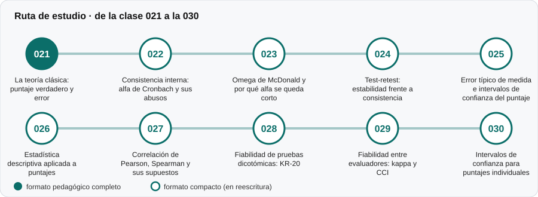

# 📶 Parte 02 — Fiabilidad

**Nivel:** intermedio · **Duración estimada:** 3-4 semanas · **Clases:** 10

## De qué trata

Cuánto del puntaje es señal y cuánto es ruido, y las formas de estimarlo según la fuente de error que preocupe (los ítems, el momento, los evaluadores).

## Por qué importa

Sin fiabilidad no hay forma de saber si una diferencia entre dos personas, o entre dos momentos, significa algo. Es el requisito mínimo para tomar cualquier decisión con un puntaje.

## Según tu papel

- **Si construyes o aplicas instrumentos:** Calcularás alfa, omega, KR-20, test-retest y acuerdo entre evaluadores, y sabrás cuál usar y cuándo desconfiar de cada uno.
- **Si eres evaluado o recibes resultados:** Podrás pedir el margen de error de tu puntaje y entender por qué un resultado cercano a un corte no es concluyente.

## Al terminar esta parte podrás

- Explicar la teoría clásica (observado = verdadero + error).
- Calcular e interpretar alfa, omega, KR-20 y kappa.
- Obtener el error típico de medida y un intervalo para un puntaje individual.

## Cómo estudiarla

Empieza por la clase 021, que es la base de toda la parte. Luego sigue el orden indicado; las clases 026 a 030 amplían lo anterior con correlación, KR-20, acuerdo entre evaluadores e intervalos.

## Ruta de estudio

## Clases en orden de estudio

Las clases están numeradas de forma consecutiva (001 a 200) en el orden de estudio: sigue el número.

| Orden | ID | Clase | Qué aprenderás | Formato | Horas |
|---:|---|---|---|---|---:|
| 1 | 021 | [La teoría clásica: puntaje verdadero y error](021-teoria-clasica-del-error/README.md) | Explicar con tus palabras que todo puntaje es una parte verdadera más una parte de error. | ✅ pedagógico | 4 |
| 2 | 022 | [Consistencia interna: alfa de Cronbach y sus abusos](022-consistencia-interna-alfa/README.md) | Calcular alfa desde las varianzas de los ítems y del total. | ✅ pedagógico | 5 |
| 3 | 023 | [Omega de McDonald y por qué alfa se queda corto](023-omega-y-alternativas-a-alfa/README.md) | Explicar la tau-equivalencia y cuándo falla. | ✅ pedagógico | 4 |
| 4 | 024 | [Test-retest: estabilidad frente a consistencia](024-test-retest-y-estabilidad/README.md) | Diseñar un estudio test-retest y justificar el intervalo entre aplicaciones. | ✅ pedagógico | 3 |
| 5 | 025 | [Error típico de medida e intervalos de confianza del puntaje](025-error-tipico-de-medida/README.md) | Calcular el ETM desde la desviación típica y la fiabilidad. | ✅ pedagógico | 4 |
| 6 | 026 | [Estadística descriptiva aplicada a puntajes](026-estadistica-descriptiva-aplicada-a-puntajes/README.md) | Describir un puntaje total con media, DE, asimetría, curtosis y efectos de suelo y techo. | ✅ pedagógico | 4 |
| 7 | 027 | [Correlación de Pearson, Spearman y sus supuestos](027-correlacion-de-pearson-spearman-y-sus-supuestos/README.md) | Calcular e interpretar Pearson y Spearman. | ✅ pedagógico | 4 |
| 8 | 028 | [Fiabilidad de pruebas dicotómicas: KR-20](028-fiabilidad-de-pruebas-dicotomicas-kr-20/README.md) | Calcular KR-20 desde las proporciones de acierto. | ✅ pedagógico | 4 |
| 9 | 029 | [Fiabilidad entre evaluadores: kappa y CCI](029-fiabilidad-entre-evaluadores-kappa-y-cci/README.md) | Calcular el kappa de Cohen y explicar por qué descuenta el azar. | ✅ pedagógico | 4 |
| 10 | 030 | [Intervalos de confianza para puntajes individuales](030-intervalos-de-confianza-para-puntajes-individuales/README.md) | Construir los dos intervalos habituales para un puntaje individual. | ✅ pedagógico | 4 |

[← Volver al índice del programa](../../README.md) · [Índice numérico de las 200 clases](../../PROGRAMA.md)
