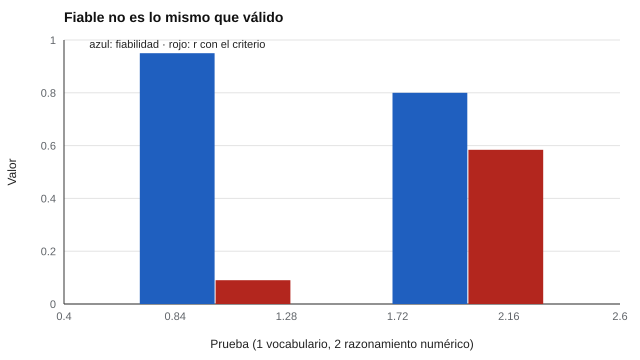

# 031 — La validez no es una propiedad del test, es un argumento


<!-- NAV -->
[← 030 — Intervalos de confianza para puntajes individ…](../../part-02-fiabilidad/030-intervalos-de-confianza-para-puntajes-individuales/README.md) · [📚 Parte 03](../README.md) · [🗺️ Índice 001–200](../../../PROGRAMA.md) · [032 — Validez de contenido y el juicio de expertos →](../032-validez-de-contenido/README.md)
<!-- /NAV -->

**Parte 03 — Validez** · Nivel intermedio · 4 h · Estado `escrita`
**Pensada para:** quien elige, construye o interpreta pruebas, y quien es evaluado con ellas.
**Prerrequisitos:** clases 021 y 025.

## ¿Para qué te sirve esto?

«Este test está validado.» Es una frase que se dice mucho y que, tal cual, **no significa nada**. ¿Validado para qué? ¿En quiénes? ¿Con qué evidencia? Esta clase te enseña la idea que organiza todo el campo: la validez no es una etiqueta que lleva el test, sino un **argumento** que respalda una interpretación y un uso concretos. Te servirá para preguntar mejor, para construir mejor y para detectar usos indebidos de una prueba.

## Al terminar esta clase podrás

- Explicar por qué se valida una interpretación y un uso, y no un test.
- Distinguir fiabilidad de validez con un ejemplo cuantificado.
- Enumerar las fuentes de evidencia de los Standards (2014).
- Formular el argumento de validez de un uso concreto.

## La idea en palabras simples

Un cuchillo no es «bueno» o «malo» en abstracto: es bueno para cortar pan y pésimo para atornillar. Igual, una prueba de razonamiento numérico puede ser muy válida para **predecir notas de matemática** y no servir para **elegir a un buen vendedor**. La validez es el grado en que la evidencia y la teoría respaldan **la interpretación de los puntajes para un uso propuesto** (AERA/APA/NCME, 2014). Messick (1995) la presentó como un concepto unitario y Kane (2013) la formula como un **argumento**: una cadena de inferencias, cada una con su evidencia, desde la respuesta en el test hasta la decisión que se toma.

**Fuentes de evidencia** que reconocen los Standards: contenido del test, procesos de respuesta, estructura interna, relaciones con otras variables y consecuencias del uso.

## Cómo funciona, paso a paso

**1. Definir el uso propuesto** (por ejemplo, «seleccionar estudiantes para un programa de ingeniería»).

**2. Escribir las inferencias** que hay que creer para que el uso sea razonable.

**3. Reunir evidencia** para cada inferencia y señalar las que no la tienen.

**Ejemplo.** Uso: seleccionar estudiantes de ingeniería con un test de razonamiento. Argumento: (1) el test cubre razonamiento cuantitativo (contenido); (2) el puntaje es estable (fiabilidad); (3) predice notas de primer año (criterio); (4) el uso no excluye de forma injustificada a grupos de la población (consecuencias).

**4. Fiabilidad es necesaria, no suficiente.** Con dos pruebas, una de vocabulario muy fiable y otra de razonamiento numérico algo menos, usadas para predecir rendimiento en matemática:



*Figura 1.* La prueba más fiable es casi inútil para este propósito.

El techo teórico de la correlación con un criterio es √(fiabilidad del test × fiabilidad del criterio): sin fiabilidad no hay validez, pero con fiabilidad no basta.

## Si construyes el instrumento

- Escribe desde el principio el uso previsto y quiénes serán evaluados.
- Haz una lista de inferencias y de la evidencia que tienes y la que falta.
- No comuniques «test validado» sin decir para qué, en quién y con qué evidencia.
- Revisa la validez cuando cambie el uso, la población o la versión.

## Si eres evaluado

- Pregunta: «¿para qué se usará este resultado y qué evidencia respalda ese uso?».
- Si una prueba se usa con un fin distinto de aquel para el que fue estudiada, tiene menos respaldo: puedes planteárselo a quien decide.
- Un manual que muestre solo coeficientes de fiabilidad no responde a esta pregunta.

## Qué muestra el laboratorio

`lab.py` compara una prueba de vocabulario (muy fiable) y una de razonamiento numérico para predecir rendimiento en matemática.

| Prueba | Fiabilidad | r con el criterio | Techo √(ρₓρᵧ) |
|---|---:|---:|---:|
| A. Vocabulario | 0,95 | 0,090 | 0,905 |
| B. Razonamiento numérico | 0,80 | 0,584 | 0,831 |

**Análisis.** (1) A es casi perfecta como medida (0,95) y casi inútil para este propósito (r = 0,09). (2) B es menos fiable pero muchísimo más útil. (3) «Válida» no es propiedad de A ni de B: depende de **para qué** se use. (4) Son pruebas simuladas con relaciones conocidas.

## Errores frecuentes

- Decir «el test X está validado» sin decir para qué, en quién y con qué evidencia.
- Reunir evidencia solo de lo que es fácil de medir.
- Tratar la validez como un sello que se otorga una vez.
- Confundir fiabilidad alta con validez.

## Lo mínimo que debes llevarte

1. Se valida un uso, no un test.
2. La validez es un argumento con inferencias y evidencia.
3. La fiabilidad es necesaria, no suficiente.
4. La validez se revisa cuando cambian el uso o la población.

## Ejercicios

- **Inicial.** Nombra dos usos distintos de un mismo test de lectura que requieran evidencia diferente. *Ej.: cribado de dificultades; ubicación por nivel.*
- **Intermedio.** Si ρₓ = 0,64 y ρᵧ = 0,81, ¿cuál es el techo de r? *Solución: √0,5184 = 0,72.*
- **Avanzado.** Escribe el argumento de validez de uno de los instrumentos del catálogo, marcando las inferencias sin evidencia.
- **Aplicación.** Toma una prueba que se use en tu entorno y escribe qué evidencia respaldaría cada uso.

## Glosario

- **Validez:** grado en que la evidencia respalda una interpretación y uso de los puntajes.
- **Argumento de validez:** cadena de inferencias con su evidencia.
- **Fuentes de evidencia:** contenido, procesos de respuesta, estructura interna, relaciones con otras variables, consecuencias.
- **Techo de validez:** máximo de r posible dada la fiabilidad de ambas medidas.

## Laboratorio

```bash
python classes/part-03-validez/031-validez-como-argumento/lab.py
python classes/part-03-validez/figuras.py
```

## Autoevaluación y criterios

1. ¿Por qué «test válido» es una frase incompleta? 2. ¿Qué evidencia falta típicamente? 3. ¿Cómo se relaciona la fiabilidad con el techo de la validez?
Se logra la clase si puedes redactar un argumento con inferencias y señalar la evidencia faltante.

## Bibliografía

- AERA, APA, & NCME (2014). *Standards for Educational and Psychological Testing*.
- Messick, S. (1995). Validity of psychological assessment: Validation of inferences from persons' responses and performances as scientific inquiry into score meaning. *American Psychologist*, 50(9), 741-749.
- Kane, M. T. (2013). Validating the interpretations and uses of test scores. *Journal of Educational Measurement*, 50(1), 1-73.

---

<!-- NAV -->
[← 030 — Intervalos de confianza para puntajes individ…](../../part-02-fiabilidad/030-intervalos-de-confianza-para-puntajes-individuales/README.md)  
[📚 Parte 03](../README.md) · [🗺️ Índice 001–200](../../../PROGRAMA.md)  
[032 — Validez de contenido y el juicio de expertos →](../032-validez-de-contenido/README.md)
<!-- /NAV -->
