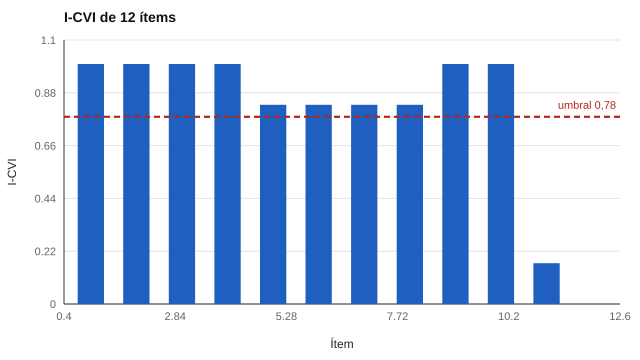

# 032 — Validez de contenido y el juicio de expertos


<!-- NAV -->
[← 031 — La validez no es una propiedad del test, es u…](../031-validez-como-argumento/README.md) · [📚 Parte 03](../README.md) · [🗺️ Índice 001–200](../../../PROGRAMA.md) · [033 — Validez de constructo: convergente y discrimi… →](../033-validez-de-constructo/README.md)
<!-- /NAV -->

**Parte 03 — Validez** · Nivel intermedio · 4 h · Estado `escrita`
**Pensada para:** quien construye o revisa pruebas, y quien rinde evaluaciones con contenido definido.
**Prerrequisitos:** clases 011 y 031.

## ¿Para qué te sirve esto?

Cuando rindes un examen de un curso, esperas que pregunte **de lo que se enseñó**. La validez de contenido es justamente eso: ¿los ítems representan el dominio que se quiere cubrir? Si construyes pruebas, es la primera evidencia que debes reunir; si las rindes, es lo que te permite reclamar cuando el examen evalúa algo que nunca se estudió.

## Al terminar esta clase podrás

- Explicar la representatividad del contenido frente a la tabla de especificaciones.
- Calcular el I-CVI, el S-CVI/Ave y la V de Aiken.
- Reconocer lo que estos índices **no** miden.

## La idea en palabras simples

La validez de contenido se apoya en dos pilares:

1. La **tabla de especificaciones** (clase 016): el plano que dice qué contenidos y con qué peso.
2. El **juicio de expertos**: especialistas califican cada ítem (por ejemplo, de 1 a 4) según su relevancia.

Los índices resumen ese acuerdo. Pero cuidado: miden **cuánto coinciden los jueces**, no si el conjunto de ítems **cubre** todo el dominio.

## Cómo funciona, paso a paso

```
I-CVI     = jueces que califican 3 o 4 / total de jueces          (escala 1-4)
S-CVI/Ave = promedio de los I-CVI
V de Aiken = Σ(rᵢ − mínimo) / ( n · (categorías − 1) )            (Aiken, 1985)
```

Un umbral habitual para el I-CVI es 0,78 con seis o más jueces (Lynn, 1986; Polit & Beck, 2006): es una convención, no una ley.

**Ejemplo resuelto.** Cinco jueces califican un ítem con 4, 4, 3, 2, 3. I-CVI = 4/5 = 0,80. V de Aiken = (3 + 3 + 2 + 1 + 2) / (5 · 3) = 0,73.



*Figura 1.* Diez ítems superan el umbral; dos quedan marcados para revisión.

## Si construyes el instrumento

- Elige jueces con experiencia en el dominio **y** en la población evaluada.
- Pídeles juzgar relevancia y, por separado, claridad.
- Compara los ítems con la tabla de especificaciones para detectar facetas omitidas.
- No uses estos índices si el constructo no tiene un dominio acotado.

## Si eres evaluado

- Pide la tabla de especificaciones del examen: te muestra qué se evalúa y con qué peso.
- Si un examen incluye contenidos que no estaban en el programa, es una falla de validez de contenido que puedes plantear.
- Un contenido bien cubierto también te ayuda a estudiar mejor.

## Qué muestra el laboratorio

`lab.py` simula 6 jueces y 12 ítems; los ítems 11 y 12 son poco relevantes por diseño.

| Ítems | I-CVI | V de Aiken | Juicio |
|---|---:|---:|---|
| 1–10 | 0,83–1,00 | 0,67–1,00 | ok |
| 11 | 0,17 | 0,33 | revisar |
| 12 | 0,00 | 0,28 | revisar |

S-CVI/Ave = **0,79**.

**Análisis.** (1) Los índices detectan los dos ítems defectuosos. (2) El S-CVI/Ave (0,79) cae cerca del umbral porque dos ítems pésimos arrastran el promedio. (3) Un banco puede tener todos sus ítems «relevantes» y omitir una faceta entera: eso se ve contra la tabla de especificaciones, no con el I-CVI. (4) Los jueces simulados son independientes; los reales pueden compartir sesgos.

## Errores frecuentes

- Confundir acuerdo entre jueces con cobertura del dominio.
- Elegir jueces sin experiencia en el dominio o la población.
- Aplicar el índice a constructos sin dominio acotado.
- Usar el umbral 0,78 como regla universal.

## Lo mínimo que debes llevarte

1. Validez de contenido = ¿los ítems representan el dominio?
2. Los índices miden acuerdo entre jueces, no cobertura.
3. La cobertura se revisa contra la tabla de especificaciones.
4. Los umbrales son convenciones.

## Ejercicios

- **Inicial.** ¿Qué diferencia hay entre relevancia y claridad como criterios de juicio? *Guía: relevancia = pertinencia al constructo; claridad = comprensión de la redacción.*
- **Intermedio.** Calcula el I-CVI de un ítem con calificaciones 4, 4, 4, 3, 2, 1. *Solución: 4/6 = 0,67.*
- **Avanzado.** Añade a `lab.py` un séptimo juez sesgado y observa el efecto sobre el I-CVI.
- **Aplicación.** Aplica el procedimiento a un examen de tu curso con tres colegas.

## Glosario

- **Validez de contenido:** grado en que los ítems representan el dominio.
- **I-CVI / S-CVI/Ave:** índices de validez de contenido por ítem y de la escala.
- **V de Aiken:** coeficiente de acuerdo de jueces con valores entre 0 y 1.
- **Dominio:** conjunto de contenidos que se quiere cubrir.

## Laboratorio

```bash
python classes/part-03-validez/032-validez-de-contenido/lab.py
python classes/part-03-validez/figuras.py
```

## Autoevaluación y criterios

1. ¿Por qué un S-CVI alto no garantiza cobertura? 2. ¿Cómo eliges expertos? 3. ¿Qué haces con un ítem de I-CVI 0,67?
Se logra la clase si puedes calcular los índices y proponer cómo revisar la cobertura.

## Bibliografía

- Aiken, L. R. (1985). Three coefficients for analyzing the reliability and validity of ratings. *Educational and Psychological Measurement*, 45(1), 131-142.
- Lynn, M. R. (1986). Determination and quantification of content validity. *Nursing Research*, 35(6), 382-385.
- Polit, D. F., & Beck, C. T. (2006). The content validity index: Are you sure you know what's being reported? Critique and recommendations. *Research in Nursing & Health*, 29(5), 489-497.

---

<!-- NAV -->
[← 031 — La validez no es una propiedad del test, es u…](../031-validez-como-argumento/README.md)  
[📚 Parte 03](../README.md) · [🗺️ Índice 001–200](../../../PROGRAMA.md)  
[033 — Validez de constructo: convergente y discrimi… →](../033-validez-de-constructo/README.md)
<!-- /NAV -->
