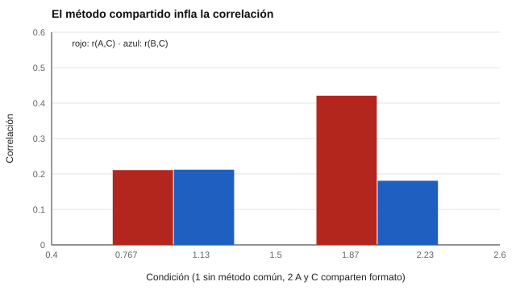

# 033 — Validez de constructo: convergente y discriminante


<!-- NAV -->
[← 032 — Validez de contenido y el juicio de expertos](../032-validez-de-contenido/README.md) · [📚 Parte 03](../README.md) · [🗺️ Índice 001–200](../../../PROGRAMA.md) · [034 — Validez de criterio y validez predictiva →](../034-validez-de-criterio/README.md)
<!-- /NAV -->

**Parte 03 — Validez** · Nivel intermedio · 4 h · Estado `escrita`
**Pensada para:** quien construye instrumentos, quien lee estudios de validez y quien es evaluado.
**Prerrequisitos:** clases 031 y 027.

## ¿Para qué te sirve esto?

¿Cómo se sabe que una escala de «perseverancia» mide perseverancia y no, por ejemplo, ganas de quedar bien? La respuesta es **un patrón de relaciones**: la escala debería parecerse a lo que teóricamente se le parece y diferenciarse de lo que no. Si evalúas estudios, esta clase te da un criterio para exigir evidencia seria; si construyes, te enseña a **formular predicciones antes de mirar los datos**.

## Al terminar esta clase podrás

- Formular predicciones teóricas de correlación antes de ver los datos.
- Distinguir evidencia convergente y discriminante.
- Reconocer cómo la varianza de método compartida distorsiona el patrón.
- Explicar por qué una sola correlación no basta como «validez de constructo».

## La idea en palabras simples

Cronbach y Meehl (1955) propusieron la **red nomológica**: un conjunto de predicciones sobre cómo debería relacionarse el constructo con otras variables. Por ejemplo, la «perseverancia» debería correlacionar con la «responsabilidad» (relación **convergente**: lo parecido se parece) y casi nada con la «inteligencia fluida» (relación **discriminante**: lo distinto se distingue). Si los datos siguen ese patrón, el constructo se hace más plausible; si lo contradicen, el problema está en el instrumento o en la teoría.

## Cómo funciona, paso a paso

**1. Escribir las predicciones antes de ver los datos** (si se escriben después, siempre «aciertan»).

**2. Reunir correlaciones** con medidas del mismo constructo (convergente) y de constructos distintos (discriminante).

**3. Contrastar** el patrón observado con el esperado.

**4. Cuidado con el método común.** Si dos medidas comparten formato (por ejemplo, ambas son autoinformes), correlacionan por el formato además de por el constructo.

**Ejemplo resuelto.** Se predice que perseverancia correlaciona 0,5 con responsabilidad y ~0 con inteligencia fluida. Se observa 0,48 y 0,05: el patrón **respalda** la hipótesis. Si se observara 0,05 y 0,48, el patrón la **refutaría**, aun con buenos coeficientes de fiabilidad.



*Figura 1.* Con método compartido, la relación entre A y C se infla: parte de lo que parece «relación entre constructos» es relación entre formatos.

## Si construyes el instrumento

- Escribe y fecha las predicciones antes del estudio.
- Incluye medidas de constructos cercanos y de constructos claramente distintos.
- Usa más de un método de medición cuando sea posible (clase 036).
- Informa tanto las correlaciones esperadas como las que no se cumplieron.

## Si eres evaluado

- Un manual que muestre solo una correlación alta con otra escala parecida no demuestra validez de constructo.
- Pregunta si la escala se distingue de otras: una escala de «liderazgo» que correlaciona 0,9 con «simpatía» probablemente mide lo segundo.
- Los resultados de un instrumento deben leerse con la cautela de que la evidencia de constructo es siempre parcial.

## Qué muestra el laboratorio

`lab.py` simula tres medidas: A y B miden el constructo X; C mide otro constructo (correlación verdadera 0,30 con X).

| Condición | r(A,B) convergente | r(A,C) | r(B,C) |
|---|---:|---:|---:|
| Sin varianza de método compartida | 0,744 | 0,211 | 0,212 |
| A y C comparten formato | 0,637 | 0,421 | 0,181 |

**Análisis.** (1) Sin método común, r(A,C) y r(B,C) son iguales (≈ 0,21), como corresponde a un mismo vínculo con C. (2) Con formato compartido, r(A,C) sube a 0,42 y r(B,C) baja a 0,18: la «relación» es en parte formato. (3) La convergente cae de 0,744 a 0,637. (4) La evidencia de constructo es un **patrón** de predicciones, no un único coeficiente.

## Errores frecuentes

- Reportar una sola correlación como «validez de constructo».
- Formular las predicciones después de ver los datos.
- No distinguir correlaciones por método compartido de relaciones sustantivas.
- Creer que un patrón compatible demuestra el constructo: solo lo hace más plausible.

## Lo mínimo que debes llevarte

1. La validez de constructo es un patrón de relaciones predichas.
2. Convergente: se parece a lo que debe parecerse; discriminante: se diferencia de lo que no.
3. Las predicciones se escriben antes.
4. El método común infla correlaciones.

## Ejercicios

- **Inicial.** Da un par de constructos para los cuales esperarías evidencia discriminante. *Ej.: ansiedad e inteligencia verbal.*
- **Intermedio.** Si r(A,B) = 0,45 y la fiabilidad de A y B es 0,8, ¿cuál es la r corregida? *Solución: 0,45 / 0,8 = 0,56.*
- **Avanzado.** Cambia el peso del método en `lab.py` y grafica r(A,C) en función de él.
- **Aplicación.** Para una escala de tu elección, escribe cinco predicciones convergentes y discriminantes.

## Glosario

- **Red nomológica:** conjunto de relaciones predichas entre un constructo y otras variables.
- **Validez convergente:** medidas del mismo constructo correlacionan alto.
- **Validez discriminante:** medidas de constructos distintos correlacionan bajo.
- **Varianza de método:** parte de la variación debida al formato de medición.

## Laboratorio

```bash
python classes/part-03-validez/033-validez-de-constructo/lab.py
python classes/part-03-validez/figuras.py
```

## Autoevaluación y criterios

1. ¿Por qué se escriben las predicciones antes? 2. ¿Qué es varianza de método? 3. ¿Qué evidencia refutaría la hipótesis?
Se logra la clase si puedes plantear predicciones y contrastarlas con un patrón.

## Bibliografía

- Cronbach, L. J., & Meehl, P. E. (1955). Construct validity in psychological tests. *Psychological Bulletin*, 52(4), 281-302. ✅ [DOI](https://doi.org/10.1037/h0040957)
- Campbell, D. T., & Fiske, D. W. (1959). Convergent and discriminant validation by the multitrait-multimethod matrix. *Psychological Bulletin*, 56(2), 81-105. ✅ [DOI](https://doi.org/10.1037/h0046016)

Leyenda: ✅ existe en Crossref con título y año coincidentes (enlace al DOI); ⚠️ hay una obra de título parecido con otro año (no se enlaza: comprobar la edición); 🔎 no verificada automáticamente (libros sin DOI, normas y sitios web). Crossref confirma la existencia de la fuente, no que respalde cada afirmación de la clase. Ver [`docs/VERIFICACION_BIBLIOGRAFIA.md`](../../../docs/VERIFICACION_BIBLIOGRAFIA.md).

---

<!-- NAV -->
[← 032 — Validez de contenido y el juicio de expertos](../032-validez-de-contenido/README.md)  
[📚 Parte 03](../README.md) · [🗺️ Índice 001–200](../../../PROGRAMA.md)  
[034 — Validez de criterio y validez predictiva →](../034-validez-de-criterio/README.md)
<!-- /NAV -->
