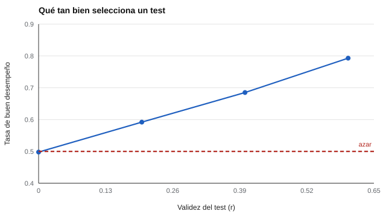

# 034 — Validez de criterio y validez predictiva


<!-- NAV -->
[← 033 — Validez de constructo: convergente y discrimi…](../033-validez-de-constructo/README.md) · [📚 Parte 03](../README.md) · [🗺️ Índice 001–200](../../../PROGRAMA.md) · [035 — La cara olvidada: consecuencias del uso del t… →](../035-consecuencias-del-uso/README.md)
<!-- /NAV -->

**Parte 03 — Validez** · Nivel intermedio · 5 h · Estado `escrita`
**Pensada para:** quien usa pruebas para seleccionar o predecir, y quien es evaluado con ellas.
**Prerrequisitos:** clases 031 y 027.

## ¿Para qué te sirve esto?

Si una prueba se usa para **predecir** algo (desempeño en un cargo, notas en el primer año), la pregunta es cuánto lo predice. Pero hay una trampa: el desempeño solo se observa en quienes **fueron seleccionados**, y eso hace que la relación parezca más débil de lo que es. Esta clase te enseña a calcular la validez de criterio, a corregir la restricción de rango y a traducir un coeficiente a algo que se entienda: cuántas decisiones acertadas se obtienen.

## Al terminar esta clase podrás

- Distinguir validez concurrente de predictiva.
- Explicar la restricción de rango y aplicar la corrección de Thorndike (Caso II).
- Traducir un coeficiente de validez a una tasa de acierto de selección.
- Leer críticamente un estudio de validez de un test de selección.

## La idea en palabras simples

La **validez de criterio** es la relación entre el puntaje y una variable externa (el «criterio»): desempeño, notas, etc.

- **Concurrente:** ambas se miden al mismo tiempo.
- **Predictiva:** el criterio se mide después (el test hoy, las notas en seis meses).

**La trampa:** si solo contratas al 30 % con mejor puntaje, solo ves el desempeño de esos. Entre ellos la variación del test es pequeña, y por eso la relación observada **se ve más débil** que la real.

## Cómo funciona, paso a paso

**1. Corrección de Thorndike (Caso II)** para restricción directa en el predictor (Sackett & Yang, 2000):

```
r_corregida = r·u / √(1 + r²·(u² − 1))        u = DE sin restringir / DE restringida
```

**2. Ejemplo.** r observada 0,25 y u = 1,5: r_corregida = 0,25 · 1,5 / √(1 + 0,0625 · 1,25) = 0,375 / 1,0384 = **0,361**.

**3. Traducir a decisiones.** Un coeficiente de 0,40 no se entiende solo: se convierte en tasa de buen desempeño entre los contratados.



*Figura 1.* Sin validez, seleccionar rinde lo que el azar (0,50); con 0,40 hay mejora real pero acotada.

**4. Supuestos de la corrección.** Exige que la selección haya sido solo por el predictor; con otras vías de selección el ajuste es otro.

## Si construyes el instrumento

- Estudia la validez con un criterio fiable y relevante; un criterio ruidoso reduce la validez observada.
- Informa la correlación observada y la corregida, y declara qué corrección usaste.
- Traduce los coeficientes a decisiones (tasa de acierto, ganancia en desempeño).
- No transfieras automáticamente valores de validez de la literatura (por ejemplo, de Schmidt & Hunter, 1998) a un puesto específico: son promedios metaanalíticos.

## Si eres evaluado

- Si un test se usa para seleccionarte, pregunta qué relación tiene con el desempeño en el puesto **concreto**.
- Un test con validez moderada mejora las decisiones en promedio, pero **se equivoca** en muchos casos individuales.
- Un puntaje bajo en un test de selección no demuestra que serías mal desempeñante.

## Qué muestra el laboratorio

`lab.py` simula una validez verdadera de 0,40 en postulantes y contrata al 30 % superior.

| Resultado | Valor |
|---|---:|
| Correlación observada solo en contratados | 0,216 |
| Corregida (u = 1,94) | 0,395 |

| Validez del test | Tasa de buen desempeño entre contratados |
|---:|---:|
| 0,0 | 0,498 |
| 0,2 | 0,592 |
| 0,4 | 0,685 |
| 0,6 | 0,793 |

**Análisis.** (1) La correlación observada (0,216) subestima la real (0,40); la corrección la recupera (0,395). (2) Sin validez, la selección rinde azar (≈ 0,50). (3) Incluso con r = 0,40 la mejora es real pero acotada: casi tres de cada diez contratados rendirán mal. (4) La fórmula corrige un supuesto: que la selección fue solo por el predictor.

## Errores frecuentes

- Usar la validez observada en contratados como si fuera la de los postulantes.
- Aplicar la corrección cuando la selección no fue por el predictor.
- Ignorar la fiabilidad del criterio.
- Transferir sin análisis la validez promedio de la literatura a un puesto específico.

## Lo mínimo que debes llevarte

1. Concurrente: criterio al mismo tiempo; predictiva: después.
2. La restricción de rango hace parecer débil la validez.
3. Se puede corregir con supuestos explícitos.
4. Traduce r a tasas de acierto para entender el efecto real.

## Ejercicios

- **Inicial.** ¿Qué tipo de validez de criterio es un estudio donde se aplica el test y 6 meses después se obtienen notas? *Solución: predictiva.*
- **Intermedio.** r = 0,20, u = 2: calcula r corregida. *Solución: 0,4 / √(1 + 0,04 · 3) = 0,378.*
- **Avanzado.** En `lab.py` contrata solo al 10 % superior y compara la r observada con la corregida.
- **Aplicación.** Lee un estudio de validez de un test de selección y señala si corrigió la restricción de rango.

## Glosario

- **Criterio:** variable externa que el test pretende predecir o reflejar.
- **Validez concurrente / predictiva:** criterio medido a la vez / después.
- **Restricción de rango:** reducción de variabilidad por seleccionar a un subgrupo.
- **Corrección de Thorndike:** ajuste que estima la correlación en la población sin restricción.

## Laboratorio

```bash
python classes/part-03-validez/034-validez-de-criterio/lab.py
python classes/part-03-validez/figuras.py
```

## Autoevaluación y criterios

1. ¿Por qué la validez observada subestima? 2. ¿Qué supuesto exige la corrección? 3. ¿Qué cambia si el criterio es poco fiable?
Se logra la clase si puedes aplicar la corrección y traducir la validez a decisiones.

## Bibliografía

- Sackett, P. R., & Yang, H. (2000). Correction for range restriction: An expanded typology. *Journal of Applied Psychology*, 85(1), 112-118. ✅ [DOI](https://doi.org/10.1037/0021-9010.85.1.112)
- Schmidt, F. L., & Hunter, J. E. (1998). The validity and utility of selection methods in personnel psychology: Practical and theoretical implications of 85 years of research findings. *Psychological Bulletin*, 124(2), 262-274. ✅ [DOI](https://doi.org/10.1037/0033-2909.124.2.262)
- Thorndike, R. L. (1949). *Personnel Selection: Test and Measurement Techniques*. Wiley. ⚠️ hay una obra de título parecido en Crossref con otro año (1951): comprobar la edición a mano

Leyenda: ✅ existe en Crossref con título y año coincidentes (enlace al DOI); ⚠️ hay una obra de título parecido con otro año (no se enlaza: comprobar la edición); 🔎 no verificada automáticamente (libros sin DOI, normas y sitios web). Crossref confirma la existencia de la fuente, no que respalde cada afirmación de la clase. Ver [`docs/VERIFICACION_BIBLIOGRAFIA.md`](../../../docs/VERIFICACION_BIBLIOGRAFIA.md).

---

<!-- NAV -->
[← 033 — Validez de constructo: convergente y discrimi…](../033-validez-de-constructo/README.md)  
[📚 Parte 03](../README.md) · [🗺️ Índice 001–200](../../../PROGRAMA.md)  
[035 — La cara olvidada: consecuencias del uso del t… →](../035-consecuencias-del-uso/README.md)
<!-- /NAV -->
