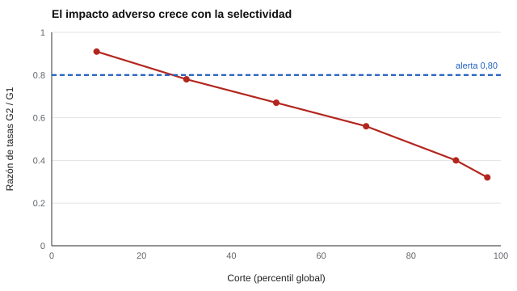

# 035 — La cara olvidada: consecuencias del uso del test


<!-- NAV -->
[← 034 — Validez de criterio y validez predictiva](../034-validez-de-criterio/README.md) · [📚 Parte 03](../README.md) · [🗺️ Índice 001–200](../../../PROGRAMA.md) · [036 — Validez convergente y discriminante: matriz m… →](../036-validez-convergente-y-discriminante-matriz-multirrasgo-multimetodo/README.md)
<!-- /NAV -->

**Parte 03 — Validez** · Nivel intermedio · 4 h · Estado `escrita`
**Pensada para:** quien decide usar pruebas (selección, admisión), quien las revisa y quien es afectado por ellas.
**Prerrequisitos:** clases 031 y 034.

## ¿Para qué te sirve esto?

Una prueba puede ser fiable y predecir bien, y aun así **tener efectos desiguales** entre grupos de personas. Esas consecuencias forman parte del argumento de validez (Messick, 1995) y deben evaluarse **antes** de adoptar un instrumento. Esta clase te da una herramienta sencilla para ver cómo un corte de selección amplifica pequeñas diferencias, y te enseña a distinguir una **alerta estadística** de una **conclusión sobre discriminación**.

## Al terminar esta clase podrás

- Explicar por qué las consecuencias forman parte del argumento de validez.
- Calcular tasas de selección y la razón de impacto adverso a partir de un punto de corte.
- Distinguir una alerta estadística de una conclusión sobre discriminación.
- Proponer acciones cuando aparece una alerta.

## La idea en palabras simples

Si dos grupos tienen una diferencia **moderada** en promedio en una prueba, y se usa un corte **muy exigente**, casi todos los seleccionados serán del grupo con mayor promedio. Es como una carrera con una meta muy alta: pequeñas diferencias de partida se vuelven enormes en la cima. Una diferencia entre grupos **no prueba por sí sola** que el test tenga sesgo: puede reflejar diferencias reales de oportunidad, sesgo del instrumento, o ambos. Pero sí exige mirar con atención.

## Cómo funciona, paso a paso

**1. Calcular la tasa de selección** de cada grupo (porcentaje que supera el corte).

**2. Razón de impacto adverso** = tasa del grupo 2 / tasa del grupo 1.

**3. Mirar la alerta.** La «regla de los cuatro quintos» (0,80) de las *Uniform Guidelines* de EE. UU. (1978) se usa aquí solo como alerta orientativa; **no es norma chilena** ni prueba de discriminación.

**4. Qué hacer si hay alerta.** Revisar la validez del criterio, la relevancia del contenido, alternativas con menor impacto adverso y el peso del test dentro de la decisión.

**Ejemplo.** Tasas 0,60 y 0,40: razón 0,67 < 0,80 → alerta.



*Figura 1.* Cuanto más selectivo el corte, menor la razón: la misma diferencia pequeña se amplifica en la cola.

## Si construyes el instrumento

- Estima el impacto adverso en el piloto y antes de fijar un corte.
- Evalúa alternativas (combinar con otras evidencias, bajar el peso del test, ajustar el corte) sin renunciar a la validez.
- Documenta quién participó en evaluar las consecuencias.
- Usa cortes distintos para propósitos distintos (cribado frente a selección final).

## Si eres evaluado

- Pregunta cómo se decidió el corte y qué se sabe de su efecto en distintos grupos.
- Un resultado bajo un corte exigente puede responder más a la elección del corte que a una diferencia real.
- Si crees que una prueba te perjudica por pertenecer a un grupo, puedes pedir información y revisión.

## Qué muestra el laboratorio

`lab.py` simula dos grupos con diferencia media d = 0,5 DE y calcula la razón de tasas según el corte.

| Corte (percentil global) | Tasa G1 | Tasa G2 | Razón | Alerta 4/5 |
|---:|---:|---:|---:|---|
| 10 | 0,942 | 0,858 | 0,91 | no |
| 30 | 0,787 | 0,613 | 0,78 | sí |
| 50 | 0,600 | 0,400 | 0,67 | sí |
| 70 | 0,385 | 0,215 | 0,56 | sí |
| 90 | 0,143 | 0,057 | 0,40 | sí |
| 97 | 0,046 | 0,014 | 0,32 | sí |

**Análisis.** (1) Con el corte más permisivo (10), la razón es 0,91; con el más exigente (97), 0,32. (2) La misma diferencia modesta entre grupos se amplifica en la cola. (3) La consecuencia depende del **uso** (corte, peso en la decisión), no solo del test. (4) Es una simulación con distribuciones normales y dos grupos; no establece causas de la diferencia.

## Errores frecuentes

- Adoptar un test sin estimar sus consecuencias en los grupos afectados.
- Declarar sesgo, o su ausencia, solo por una razón de tasas.
- Usar el mismo corte para propósitos distintos.
- Tomar la regla de los 4/5 como norma legal en Chile.

## Lo mínimo que debes llevarte

1. Las consecuencias del uso son parte de la validez.
2. Un corte más exigente amplifica diferencias entre grupos.
3. Una razón baja es una alerta, no una prueba de discriminación.
4. Hay alternativas para reducir el impacto sin perder validez.

## Ejercicios

- **Inicial.** ¿Qué información adicional necesitas antes de concluir sesgo a partir de una razón de 0,67? *Guía: validez para cada grupo, relevancia del contenido y del criterio.*
- **Intermedio.** Tasas 0,30 y 0,27: ¿razón y alerta? *Solución: 0,90; no.*
- **Avanzado.** En `lab.py` reduce d a 0,2 y describe el cambio de la razón en el corte 90.
- **Aplicación.** Redacta una evaluación de consecuencias para una prueba de admisión: quién participa, qué datos se revisan y qué se haría ante una alerta.

## Glosario

- **Validez consecuencial:** evidencia sobre los efectos sociales del uso de un test.
- **Impacto adverso:** diferencia en las tasas de selección entre grupos.
- **Razón de tasas:** tasa del grupo con menor selección dividida por la del mayor.
- **Punto de corte:** puntaje a partir del cual se selecciona.

## Laboratorio

```bash
python classes/part-03-validez/035-consecuencias-del-uso/lab.py
python classes/part-03-validez/figuras.py
```

## Autoevaluación y criterios

1. ¿Por qué un corte más estricto aumenta el impacto adverso? 2. ¿Qué alternativas reducen la diferencia sin bajar la validez? 3. ¿Quién debería participar en evaluar las consecuencias?
Se logra la clase si puedes calcular tasas y razones y redactar una evaluación de consecuencias sin sobreafirmar causas.

## Bibliografía

- Messick, S. (1995). Validity of psychological assessment: Validation of inferences from persons' responses and performances as scientific inquiry into score meaning. *American Psychologist*, 50(9), 741-749. ✅ [DOI](https://doi.org/10.1037/0003-066x.50.9.741)
- AERA, APA, & NCME (2014). *Standards for Educational and Psychological Testing*. 🔎 sin verificar (libro, norma o sitio no hallado en Crossref: comprobar a mano)
- Uniform Guidelines on Employee Selection Procedures (1978), 29 CFR Part 1607 (EE. UU.). 🔎 sin verificar (libro, norma o sitio no hallado en Crossref: comprobar a mano)

Leyenda: ✅ existe en Crossref con título y año coincidentes (enlace al DOI); ⚠️ hay una obra de título parecido con otro año (no se enlaza: comprobar la edición); 🔎 no verificada automáticamente (libros sin DOI, normas y sitios web). Crossref confirma la existencia de la fuente, no que respalde cada afirmación de la clase. Ver [`docs/VERIFICACION_BIBLIOGRAFIA.md`](../../../docs/VERIFICACION_BIBLIOGRAFIA.md).

---

<!-- NAV -->
[← 034 — Validez de criterio y validez predictiva](../034-validez-de-criterio/README.md)  
[📚 Parte 03](../README.md) · [🗺️ Índice 001–200](../../../PROGRAMA.md)  
[036 — Validez convergente y discriminante: matriz m… →](../036-validez-convergente-y-discriminante-matriz-multirrasgo-multimetodo/README.md)
<!-- /NAV -->
