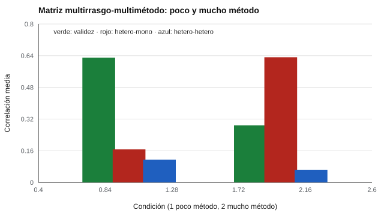

# 036 — Validez convergente y discriminante: la matriz multirrasgo-multimétodo


<!-- NAV -->
[← 035 — La cara olvidada: consecuencias del uso del t…](../035-consecuencias-del-uso/README.md) · [📚 Parte 03](../README.md) · [🗺️ Índice 001–200](../../../PROGRAMA.md) · [037 — Validez ecológica y generalización →](../037-validez-ecologica-y-generalizacion/README.md)
<!-- /NAV -->

**Parte 03 — Validez** · Nivel intermedio · 4 h · Estado `escrita`
**Pensada para:** quien diseña estudios de validez y quien lee sus resultados.
**Prerrequisitos:** clases 033 y 027.

## ¿Para qué te sirve esto?

Supón que mides «responsabilidad» y «sociabilidad» con dos métodos: un autoinforme y la opinión de un colega. Si las dos escalas de autoinforme correlacionan más entre sí que cada una con la opinión del colega sobre **lo mismo**, probablemente estás midiendo el **formato** de autoinforme y no los rasgos. La matriz multirrasgo-multimétodo (MRMM) permite ver eso de un vistazo. Si diseñas estudios de validez, te da un diseño poderoso; si los lees, te da criterios para no aceptar cualquier cifra.

## Al terminar esta clase podrás

- Leer una matriz multirrasgo-multimétodo.
- Aplicar los criterios de Campbell y Fiske.
- Diagnosticar la dominancia del método.
- Explicar por qué se necesitan al menos dos métodos para hablar de validez discriminante.

## La idea en palabras simples

Campbell y Fiske (1959) propusieron medir **varios rasgos con varios métodos** y mirar tres tipos de correlación:

- **De validez** (mismo rasgo, distinto método): deberían ser altas.
- **Heterorrasgo-heterométodo** (rasgo y método distintos): deberían ser bajas.
- **Heterorrasgo-monométodo** (rasgos distintos, mismo método): deberían ser bajas; si superan a las de validez, **domina el método**.

## Cómo funciona, paso a paso

**1. Diseñar** al menos dos rasgos y dos métodos.

**2. Calcular las tres familias de correlaciones.**

**3. Aplicar los criterios.** (i) las de validez deben ser significativamente distintas de cero y altas; (ii) deben superar a las hetero-hetero; (iii) deben superar a las hetero-mono.

**4. Diagnosticar.** Si falla el criterio 3, hay varianza de método.

**Ejemplo resuelto.** Autoinforme y juicio de un colega sobre responsabilidad y sociabilidad: r(resp-auto, resp-colega) = 0,40; r(resp-auto, soc-auto) = 0,55. El criterio 3 falla: se sospecha estilo de respuesta o deseabilidad en el autoinforme.



*Figura 1.* Con mucho método común, lo que se mide es el formato.

## Si construyes el instrumento

- Incluye más de un método (autoinforme y observación, por ejemplo).
- Elige métodos con sesgos distintos: dos autoinformes comparten el mismo sesgo.
- Hoy los criterios se complementan con modelos factoriales de rasgo-método.
- Informa la matriz completa, no solo las correlaciones favorables.

## Si eres evaluado

- Si te evalúan con dos métodos (por ejemplo, tú y tu jefatura) y no coinciden, no es una contradicción: cada método tiene sus sesgos.
- Un perfil derivado de un solo autoinforme debe leerse con cautela.
- Pregunta si el instrumento se estudió con métodos distintos al autoinforme.

## Qué muestra el laboratorio

`lab.py` simula 3 rasgos × 2 métodos (rasgos correlacionados 0,2).

| Condición | Validez | Hetero-mono | Hetero-hetero | Criterio 3 |
|---|---:|---:|---:|---|
| Poco método (0,2) | 0,630 | 0,167 | 0,115 | cumple |
| Mucho método (1,0) | 0,288 | 0,632 | 0,064 | **no cumple** |

**Análisis.** (1) Con poco método común, la validez (0,630) supera con holgura a las demás. (2) Con mucho método, rasgos **distintos** medidos con el mismo formato correlacionan 0,632, más que el **mismo** rasgo con métodos distintos (0,288): se mide el formato. (3) Eso solo se ve con un diseño multimétodo. (4) Los criterios son comparaciones descriptivas, no pruebas estadísticas formales.

## Errores frecuentes

- Usar un solo método y llamar al resultado «validez discriminante».
- Interpretar los criterios como pruebas formales.
- Elegir métodos que comparten sesgo (autoinforme y diario autoinformado).
- Informar solo las correlaciones favorables.

## Lo mínimo que debes llevarte

1. La MRMM cruza rasgos y métodos.
2. Validez: mismo rasgo, distinto método, alta.
3. Si hetero-mono supera a la validez, domina el método.
4. Se necesita más de un método.

## Ejercicios

- **Inicial.** ¿Qué tipo de correlación es la de dos cuestionarios distintos sobre ansiedad? *Solución: evidencia convergente débil, porque ambos comparten el método (autoinforme); lo ideal es contrastar con otro método.*
- **Intermedio.** Si validez = 0,45 y hetero-mono = 0,50, ¿qué sospechas? *Solución: dominancia del método.*
- **Avanzado.** Añade un tercer método a `lab.py` y verifica si el criterio 3 se recupera.
- **Aplicación.** Diseña una MRMM de dos rasgos y dos métodos para tu contexto.

## Glosario

- **MRMM:** matriz de correlaciones entre varios rasgos medidos con varios métodos.
- **Heterorrasgo-monométodo:** rasgos distintos, mismo método.
- **Dominancia del método:** el formato pesa más que el rasgo.
- **Validez convergente / discriminante:** ver clase 033.

## Laboratorio

```bash
python classes/part-03-validez/036-validez-convergente-y-discriminante-matriz-multirrasgo-multimetodo/lab.py
python classes/part-03-validez/figuras.py
```

## Autoevaluación y criterios

1. ¿Por qué se necesita más de un método? 2. ¿Qué indica el criterio 3? 3. ¿Cómo lo abordarías con modelos factoriales?
Se logra la clase si puedes leer una MRMM y diagnosticar la presencia de varianza de método.

## Bibliografía

- Campbell, D. T., & Fiske, D. W. (1959). Convergent and discriminant validation by the multitrait-multimethod matrix. *Psychological Bulletin*, 56(2), 81-105.
- Podsakoff, P. M., MacKenzie, S. B., Lee, J.-Y., & Podsakoff, N. P. (2003). Common method biases in behavioral research. *Journal of Applied Psychology*, 88(5), 879-903.

---

<!-- NAV -->
[← 035 — La cara olvidada: consecuencias del uso del t…](../035-consecuencias-del-uso/README.md)  
[📚 Parte 03](../README.md) · [🗺️ Índice 001–200](../../../PROGRAMA.md)  
[037 — Validez ecológica y generalización →](../037-validez-ecologica-y-generalizacion/README.md)
<!-- /NAV -->
