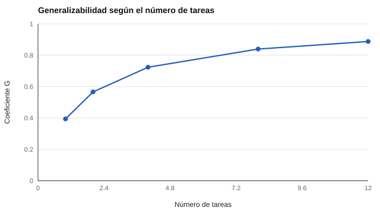

# 037 — Validez ecológica y generalización


<!-- NAV -->
[← 036 — Validez convergente y discriminante: matriz m…](../036-validez-convergente-y-discriminante-matriz-multirrasgo-multimetodo/README.md) · [📚 Parte 03](../README.md) · [🗺️ Índice 001–200](../../../PROGRAMA.md) · [038 — Evidencia basada en procesos de respuesta →](../038-evidencia-basada-en-procesos-de-respuesta/README.md)
<!-- /NAV -->

**Parte 03 — Validez** · Nivel intermedio · 4 h · Estado `escrita`
**Pensada para:** quien diseña evaluaciones basadas en tareas o desempeño, y quien es evaluado con ellas.
**Prerrequisitos:** clases 021 y 031.

## ¿Para qué te sirve esto?

Si un candidato resuelve bien una tarea de simulación en un centro de evaluación, ¿rendirá bien en el trabajo real? Un puntaje sirve si **generaliza** a las situaciones que importan. Pero una sola tarea es una muestra muy pequeña de «el trabajo». Esta clase te enseña a estimar **cuánto del puntaje es de la persona y cuánto depende de la tarea**, y a decidir cuántas tareas se necesitan.

## Al terminar esta clase podrás

- Explicar la generalización de un puntaje a otras tareas, ocasiones y contextos.
- Estimar componentes de varianza en un diseño personas × tareas.
- Calcular un coeficiente de generalizabilidad y decidir cuántas tareas se necesitan.
- Distinguir realismo aparente de validez ecológica demostrada.

## La idea en palabras simples

La teoría clásica ve todo lo que no es «verdadero» como un único error. La **teoría de la generalizabilidad** (Cronbach et al., 1972) separa **de dónde viene** la variación del puntaje: de las **personas** (lo que queremos), de las **tareas** (algunas son más difíciles) y de la **interacción persona × tarea** (a alguien le va mejor en una tarea que en otra) más el error. Con eso se calcula un coeficiente G que dice cuánto del puntaje es atribuible a las personas cuando se promedian *n* tareas.

## Cómo funciona, paso a paso

**1. Diseño:** cada persona hace varias tareas.

**2. Estimar varianzas** de persona y de persona × tarea (más error).

**3. Calcular G para n tareas:**

```
G(n) = var_persona / ( var_persona + var_(persona×tarea, error) / n )
```

**4. Decidir cuántas tareas.**

**Ejemplo resuelto.** var_persona = 1 y var_resto = 3. Con 1 tarea, G = 0,25; con 6 tareas, G = 1 / (1 + 0,5) = 0,667; para G = 0,80 se necesitan 12 tareas.



*Figura 1.* Con una sola tarea, menos de la mitad de la varianza es «persona».

## Si construyes el instrumento

- Planifica **varias** situaciones o tareas; más ítems de la misma tarea no resuelven la generalización.
- Estima los componentes de varianza en un estudio piloto.
- En evaluación de desempeño laboral, muestrea tareas, ocasiones y evaluadores.
- No confundas el aspecto realista de una tarea (validez aparente) con evidencia de que generaliza.

## Si eres evaluado

- Un desempeño malo en una sola tarea puede reflejar una mala suerte de la tarea: pide que haya más de una oportunidad.
- Una evaluación con muchas tareas distintas es más justa que una con una sola.
- Pregunta si el resultado se basa en una situación o en varias.

## Qué muestra el laboratorio

`lab.py` simula 400 personas × 12 tareas (varianza real de persona 1,00; persona × tarea + error 1,44).

| Resultado | Valor |
|---|---:|
| Varianza de persona estimada | 0,92 (real 1,00) |
| Varianza persona × tarea + error | 1,42 (real 1,44) |

| Tareas | G estimado |
|---:|---:|
| 1 | 0,394 |
| 2 | 0,566 |
| 4 | 0,723 |
| 8 | 0,839 |
| 12 | 0,887 |

**Análisis.** (1) Los componentes estimados son cercanos a los reales. (2) Con una sola tarea, menos de la mitad de la varianza (0,394) es «persona». (3) Se necesitan unas 8 tareas para superar 0,80. (4) El diseño ignora la varianza de ocasiones y de evaluadores; en la práctica se estudian varias facetas a la vez.

## Errores frecuentes

- Medir en una sola situación y generalizar a «el trabajo» o «el aula».
- Confundir realismo aparente con validez ecológica demostrada.
- Ignorar las demás facetas (ocasión, evaluador).
- Agregar más ítems de la misma tarea esperando generalizar.

## Lo mínimo que debes llevarte

1. Generalizar exige muestrear situaciones, no solo ítems.
2. La varianza se descompone en persona, tarea y su interacción.
3. G dice cuánto del puntaje es de la persona.
4. Se decide el número de tareas con G.

## Ejercicios

- **Inicial.** ¿Qué fuentes de varianza ve la teoría clásica como un único «error»? *Solución: tarea, interacción, ocasión, evaluador y error aleatorio.*
- **Intermedio.** var_persona = 2 y var_resto = 3: G(3). *Solución: 2 / (2 + 1) = 0,667.*
- **Avanzado.** Cambia `SD_PXT` a 0,6 en `lab.py` y observa cuántas tareas bastan para G = 0,80.
- **Aplicación.** Diseña una evaluación de desempeño con tareas y decide cuántas son necesarias.

## Glosario

- **Validez ecológica:** grado en que el puntaje generaliza a situaciones reales.
- **Teoría de la generalizabilidad:** marco que descompone la varianza por fuentes.
- **Interacción persona × tarea:** cuando a una persona le va mejor en unas tareas que en otras.
- **Coeficiente G:** proporción de varianza atribuible a las personas.

## Laboratorio

```bash
python classes/part-03-validez/037-validez-ecologica-y-generalizacion/lab.py
python classes/part-03-validez/figuras.py
```

## Autoevaluación y criterios

1. ¿Por qué más ítems de la misma tarea no resuelven la generalización? 2. ¿Qué facetas muestrear en una evaluación de desempeño laboral? 3. ¿Cómo informarías este límite?
Se logra la clase si puedes estimar G y decidir el número de tareas.

## Bibliografía

- Cronbach, L. J., Gleser, G. C., Nanda, H., & Rajaratnam, N. (1972). *The Dependability of Behavioral Measurements: Theory of Generalizability for Scores and Profiles*. Wiley. ⚠️ hay una obra de título parecido en Crossref con otro año (1974): comprobar la edición a mano
- Shavelson, R. J., & Webb, N. M. (1991). *Generalizability Theory: A Primer*. Sage. ⚠️ hay una obra de título parecido en Crossref con otro año (2004): comprobar la edición a mano
- Brennan, R. L. (2001). *Generalizability Theory*. Springer. ✅ [DOI](https://doi.org/10.1007/978-1-4757-3456-0)

Leyenda: ✅ existe en Crossref con título y año coincidentes (enlace al DOI); ⚠️ hay una obra de título parecido con otro año (no se enlaza: comprobar la edición); 🔎 no verificada automáticamente (libros sin DOI, normas y sitios web). Crossref confirma la existencia de la fuente, no que respalde cada afirmación de la clase. Ver [`docs/VERIFICACION_BIBLIOGRAFIA.md`](../../../docs/VERIFICACION_BIBLIOGRAFIA.md).

---

<!-- NAV -->
[← 036 — Validez convergente y discriminante: matriz m…](../036-validez-convergente-y-discriminante-matriz-multirrasgo-multimetodo/README.md)  
[📚 Parte 03](../README.md) · [🗺️ Índice 001–200](../../../PROGRAMA.md)  
[038 — Evidencia basada en procesos de respuesta →](../038-evidencia-basada-en-procesos-de-respuesta/README.md)
<!-- /NAV -->
