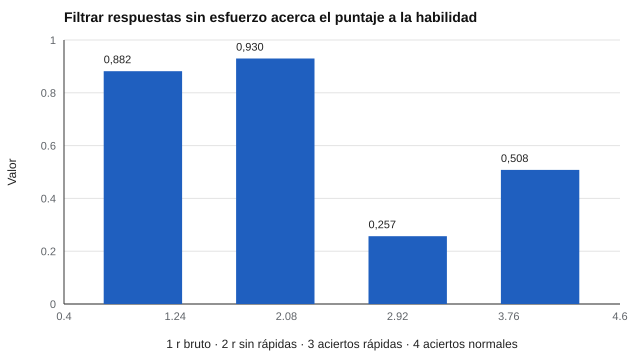

# 038 — Evidencia basada en procesos de respuesta


<!-- NAV -->
[← 037 — Validez ecológica y generalización](../037-validez-ecologica-y-generalizacion/README.md) · [📚 Parte 03](../README.md) · [🗺️ Índice 001–200](../../../PROGRAMA.md) · [039 — Metaanálisis de validez y corrección por aten… →](../039-metaanalisis-de-validez-y-correccion-por-atenuacion/README.md)
<!-- /NAV -->

**Parte 03 — Validez** · Nivel intermedio · 4 h · Estado `escrita`
**Pensada para:** quien diseña o analiza pruebas digitales, y quien las rinde.
**Prerrequisitos:** clases 031 y 012.

## ¿Para qué te sirve esto?

No basta con saber qué respondió una persona: importa **cómo** llegó a esa respuesta. ¿Razonó o adivinó? ¿Leyó el ítem? Los *Standards* (2014) incluyen entre las fuentes de validez los **procesos de respuesta**. Hoy las pruebas digitales registran tiempos y movimientos, y eso abre posibilidades (detectar adivinación rápida) y riesgos (juzgar mal a quien responde rápido por pericia). Esta clase te enseña a usar esa información con criterio.

## Al terminar esta clase podrás

- Explicar qué aportan los procesos de respuesta al argumento de validez.
- Usar tiempos de respuesta para detectar adivinación rápida.
- Reconocer los riesgos de interpretar mecánicamente un tiempo corto.
- Plantear las cautelas éticas de registrar tiempos.

## La idea en palabras simples

Si una persona contesta un ítem difícil de razonamiento en 1,2 segundos, es muy probable que no lo leyó: **adivinó**. Esas respuestas «sin esfuerzo» no reflejan la habilidad; reflejan que la persona no estaba motivada. Así, el puntaje de una prueba mezcla **habilidad** con **motivación de esfuerzo**. Si se identifican y filtran las respuestas sin esfuerzo, el puntaje se acerca a la habilidad (Wise & Kong, 2005).

Los procesos de respuesta se estudian con protocolos de pensamiento en voz alta, entrevistas cognitivas (clase 019), seguimiento ocular y tiempos de respuesta.

## Cómo funciona, paso a paso

**1. Registrar el tiempo** por ítem.

**2. Fijar un umbral** de «respuesta rápida» mirando la distribución de cada ítem (aquí, 3 s por decisión del laboratorio).

**3. Comparar** aciertos de respuestas rápidas con los del azar.

**4. Calcular el puntaje filtrado** y su relación con la habilidad.



*Figura 1.* Filtrar respuestas sin esfuerzo acerca el puntaje a la habilidad.

**Ejemplo resuelto.** Un ítem se responde en 1,2 s con acierto. Si la mediana del ítem es 14 s y el 90 % de las respuestas correctas toma más de 5 s, 1,2 s sugiere adivinación (quizás correcta por azar). Pero si el ítem es una recuperación inmediata de un dato muy practicado, un tiempo corto puede ser pericia.

## Si construyes el instrumento

- Fija umbrales por ítem, no uno general, y justifícalos con la distribución.
- Informa qué proporción de respuestas se descartó y por qué.
- Los tiempos son datos de conducta digital: requieren consentimiento y minimización (parte 07).
- Úsalos como alerta para revisar, no como sanción automática.

## Si eres evaluado

- Si una prueba registra tus tiempos, tienes derecho a saberlo y a saber para qué se usa.
- Responder rápido no te hace sospechoso por sí solo: la pericia también es rápida.
- Pregunta si hay revisión humana antes de descartar resultados por «esfuerzo bajo».

## Qué muestra el laboratorio

`lab.py` simula 30 ítems, con ≈ 30 % de personas que se apuran en la mitad de sus ítems (umbral 3 s).

| Resultado | Valor |
|---|---:|
| Respuestas rápidas (< 3 s) | 14,4 % del total |
| Aciertos en rápidas | 0,257 (azar con 4 opciones: 0,25) |
| Aciertos en normales | 0,508 |
| r (habilidad, puntaje bruto) | 0,882 |
| r (habilidad, puntaje sin rápidas) | **0,930** |

**Análisis.** (1) Las respuestas rápidas aciertan casi como el azar (0,257 frente a 0,25). (2) Filtrarlas sube la correlación con la habilidad de 0,882 a 0,930. (3) El puntaje mezcla habilidad con motivación de esfuerzo. (4) El umbral de 3 s es una decisión del laboratorio; con otro umbral, o con ítems de recuperación inmediata, el resultado cambia.

## Errores frecuentes

- Fijar el umbral sin mirar la distribución de cada ítem.
- Penalizar a quienes responden rápido por pericia o por un ritmo lector distinto.
- Descartar datos sin informar qué proporción se descartó.
- Registrar tiempos sin consentimiento ni minimización.

## Lo mínimo que debes llevarte

1. Los procesos de respuesta son evidencia de validez.
2. Un tiempo muy corto puede significar adivinación o pericia.
3. Filtrar respuestas sin esfuerzo mejora la relación con la habilidad.
4. Registrar tiempos exige cautelas éticas.

## Ejercicios

- **Inicial.** ¿Qué dos explicaciones tiene un tiempo muy corto? *Solución: adivinación (sin esfuerzo) o pericia.*
- **Intermedio.** Si 14,4 % de las respuestas son rápidas con 25 % de aciertos, ¿cuántos aciertos «regala» el azar en 30 ítems? *Solución: ≈ 30 · 0,144 · 0,25 ≈ 1,1.*
- **Avanzado.** Cambia el umbral a 6 s en `lab.py` y describe qué respuestas razonadas se pierden.
- **Aplicación.** Redacta un aviso de consentimiento para el uso de tiempos de respuesta.

## Glosario

- **Proceso de respuesta:** lo que la persona hace al responder un ítem.
- **Tiempo de respuesta:** tiempo que toma contestar.
- **Esfuerzo de respuesta:** grado de dedicación al responder.
- **Adivinación rápida:** respuesta muy rápida sin lectura del ítem.

## Laboratorio

```bash
python classes/part-03-validez/038-evidencia-basada-en-procesos-de-respuesta/lab.py
python classes/part-03-validez/figuras.py
```

## Autoevaluación y criterios

1. ¿Qué dice un proceso de respuesta que una correlación no dice? 2. ¿Cómo justificarías un umbral? 3. ¿Qué riesgos éticos tiene registrar tiempos?
Se logra la clase si puedes usar tiempos como evidencia sin sobreinterpretarlos.

## Bibliografía

- Wise, S. L., & Kong, X. (2005). Response time effort: A new measure of examinee motivation in computer-based tests. *Applied Measurement in Education*, 18(2), 163-183. ✅ [DOI](https://doi.org/10.1207/s15324818ame1802_2)
- AERA, APA, & NCME (2014). *Standards for Educational and Psychological Testing*. 🔎 sin verificar (libro, norma o sitio no hallado en Crossref: comprobar a mano)

Leyenda: ✅ existe en Crossref con título y año coincidentes (enlace al DOI); ⚠️ hay una obra de título parecido con otro año (no se enlaza: comprobar la edición); 🔎 no verificada automáticamente (libros sin DOI, normas y sitios web). Crossref confirma la existencia de la fuente, no que respalde cada afirmación de la clase. Ver [`docs/VERIFICACION_BIBLIOGRAFIA.md`](../../../docs/VERIFICACION_BIBLIOGRAFIA.md).

---

<!-- NAV -->
[← 037 — Validez ecológica y generalización](../037-validez-ecologica-y-generalizacion/README.md)  
[📚 Parte 03](../README.md) · [🗺️ Índice 001–200](../../../PROGRAMA.md)  
[039 — Metaanálisis de validez y corrección por aten… →](../039-metaanalisis-de-validez-y-correccion-por-atenuacion/README.md)
<!-- /NAV -->
