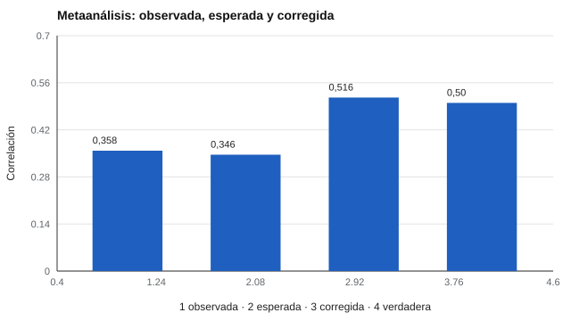

# 039 — Metaanálisis de validez y corrección por atenuación


<!-- NAV -->
[← 038 — Evidencia basada en procesos de respuesta](../038-evidencia-basada-en-procesos-de-respuesta/README.md) · [📚 Parte 03](../README.md) · [🗺️ Índice 001–200](../../../PROGRAMA.md) · [040 — Amenazas a la validez: falseamiento y deseabi… →](../040-amenazas-a-la-validez-falseamiento-y-deseabilidad/README.md)
<!-- /NAV -->

**Parte 03 — Validez** · Nivel avanzado · 4 h · Estado `escrita`
**Pensada para:** quien lee o produce síntesis de evidencia, y quien debe decidir con base en ellas.
**Prerrequisitos:** clases 021, 034 y 027.

## ¿Para qué te sirve esto?

Un solo estudio de validez es una muestra pequeña y con ruido. Para saber cuánto predice realmente un método de selección, se **combinan** muchos estudios en un metaanálisis. Pero hay que saber leerlo: ¿cuánta de la variación entre estudios es solo azar? ¿Qué significa un coeficiente «corregido por atenuación»? Esta clase te da las dos herramientas básicas y te advierte sobre lo que un metaanálisis **no** corrige.

## Al terminar esta clase podrás

- Calcular la correlación media ponderada y separar varianza de muestreo de varianza real.
- Aplicar la corrección por atenuación.
- Reconocer qué asume y qué no controla un metaanálisis.
- Distinguir la relación entre constructos de la validez operativa de un test real.

## La idea en palabras simples

Los estudios difieren por tres motivos: **azar de muestreo** (muestras pequeñas dan resultados dispares), **error de medida** (instrumentos poco fiables reducen las correlaciones) y **restricción de rango**. El metaanálisis «bare-bones» (Hunter & Schmidt, 2004) promedia las correlaciones **ponderando por el tamaño de la muestra** y compara cuánta dispersión se esperaría solo por azar con la observada.

La **corrección por atenuación** (Spearman, 1904) estima cuál sería la correlación si ambas variables se midieran sin error.

## Cómo funciona, paso a paso

```
r̄ = Σ nᵢ · rᵢ / Σ nᵢ                         (media ponderada)
varianza por muestreo ≈ (1 − r̄²)² / (n̄ − 1)
corrección:  ρ̂ = r̄ / √(r_xx · r_yy)         (r_xx y r_yy: fiabilidades)
```

**Ejemplo resuelto.** r̄ = 0,30 y fiabilidades 0,70 y 0,50: ρ̂ = 0,30 / √0,35 = **0,507**. Esto es la relación entre **constructos**, no la validez operativa del test real con sus errores.



*Figura 1.* La corrección por atenuación recupera la relación verdadera (0,516 frente a 0,50).

## Si construyes el instrumento

- No presentes ρ̂ como la validez que obtendrá un empleador: el test real tiene error.
- Documenta cómo estimaste las fiabilidades usadas en la corrección.
- Considera el sesgo de publicación: solo se meta-analiza lo publicado.
- Informa la validez operativa (sin corregir por error del predictor) y la corregida por separado.

## Si eres evaluado

- Cuando te dicen que un método de selección «predice con validez 0,5», pregunta si es el valor corregido o el que se obtendría en la práctica.
- Un metaanálisis describe promedios: tu caso puede ser distinto.
- Los resultados dependen de los estudios incluidos: pregunta cuáles y de qué contextos.

## Qué muestra el laboratorio

`lab.py` simula 40 estudios (n total = 5.250) con relación verdadera ρ = 0,50 y fiabilidades 0,80 y 0,60.

| Cantidad | Valor |
|---|---:|
| r observada media ponderada | 0,358 (esperada 0,346) |
| Varianza observada de r | 0,0070 |
| Varianza esperada por muestreo | 0,0058 |
| Varianza atribuible a otra cosa | 0,0011 |
| r corregida por atenuación | 0,516 (verdadera 0,50) |

**Análisis.** (1) Casi toda la dispersión entre estudios (0,0058 de 0,0070) es error de muestreo. (2) La atenuación explica por qué las validezes observadas parecen bajas (0,358 frente a 0,50). (3) La corrección recupera el valor verdadero (0,516). (4) La simulación no tiene sesgo de publicación ni heterogeneidad real: los metaanálisis reales dependen de que los estudios incluidos sean representativos.

## Errores frecuentes

- Presentar ρ̂ como la validez que obtendrá un empleador con el test.
- Ignorar el sesgo de publicación.
- Corregir con fiabilidades mal estimadas.
- Interpretar la varianza residual como heterogeneidad real sin más análisis.

## Lo mínimo que debes llevarte

1. Se pondera por n.
2. Gran parte de la dispersión entre estudios es azar.
3. La corrección por atenuación estima la relación entre constructos.
4. Un metaanálisis no corrige el sesgo de publicación.

## Ejercicios

- **Inicial.** ¿Por qué se pondera por n? *Solución: porque los estudios grandes son más informativos.*
- **Intermedio.** r̄ = 0,25; r_xx = 0,81; r_yy = 0,64. *Solución: ρ̂ = 0,25 / 0,72 = 0,347.*
- **Avanzado.** Añade en `lab.py` un efecto heterogéneo (ρ distinto por estudio) y observa la varianza residual.
- **Aplicación.** Lee un metaanálisis de validez y señala qué correcciones aplicó.

## Glosario

- **Metaanálisis:** combinación estadística de resultados de varios estudios.
- **Atenuación:** reducción de una correlación por el error de medida.
- **Varianza de muestreo:** dispersión esperable solo por azar.
- **Sesgo de publicación:** tendencia a publicar más los resultados favorables.

## Laboratorio

```bash
python classes/part-03-validez/039-metaanalisis-de-validez-y-correccion-por-atenuacion/lab.py
python classes/part-03-validez/figuras.py
```

## Autoevaluación y criterios

1. ¿Qué parte de la dispersión es solo azar? 2. ¿Qué corrección haría un empleador real? 3. ¿Qué sesgos no corrige el metaanálisis?
Se logra la clase si puedes calcular r̄, descomponer la varianza y comunicar las limitaciones.

## Bibliografía

- Hunter, J. E., & Schmidt, F. L. (2004). *Methods of Meta-Analysis: Correcting Error and Bias in Research Findings* (2.ª ed.). Sage. ⚠️ hay una obra de título parecido en Crossref con otro año (2015): comprobar la edición a mano
- Schmidt, F. L., & Hunter, J. E. (1998). The validity and utility of selection methods in personnel psychology. *Psychological Bulletin*, 124(2), 262-274. ✅ [DOI](https://doi.org/10.1037/0033-2909.124.2.262)
- Spearman, C. (1904). The proof and measurement of association between two things. *American Journal of Psychology*, 15(1), 72-101. ✅ [DOI](https://doi.org/10.2307/1412159)

Leyenda: ✅ existe en Crossref con título y año coincidentes (enlace al DOI); ⚠️ hay una obra de título parecido con otro año (no se enlaza: comprobar la edición); 🔎 no verificada automáticamente (libros sin DOI, normas y sitios web). Crossref confirma la existencia de la fuente, no que respalde cada afirmación de la clase. Ver [`docs/VERIFICACION_BIBLIOGRAFIA.md`](../../../docs/VERIFICACION_BIBLIOGRAFIA.md).

---

<!-- NAV -->
[← 038 — Evidencia basada en procesos de respuesta](../038-evidencia-basada-en-procesos-de-respuesta/README.md)  
[📚 Parte 03](../README.md) · [🗺️ Índice 001–200](../../../PROGRAMA.md)  
[040 — Amenazas a la validez: falseamiento y deseabi… →](../040-amenazas-a-la-validez-falseamiento-y-deseabilidad/README.md)
<!-- /NAV -->
