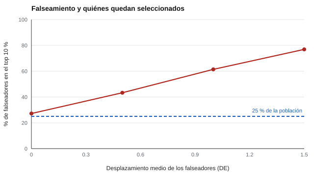

# 040 — Amenazas a la validez: falseamiento y deseabilidad social


<!-- NAV -->
[← 039 — Metaanálisis de validez y corrección por aten…](../039-metaanalisis-de-validez-y-correccion-por-atenuacion/README.md) · [📚 Parte 03](../README.md) · [🗺️ Índice 001–200](../../../PROGRAMA.md) · [041 — Correlación, matriz y lo que se puede leer en… →](../../part-04-estructura-y-analisis-factorial/041-correlacion-y-matriz/README.md)
<!-- /NAV -->

**Parte 03 — Validez** · Nivel intermedio · 4 h · Estado `escrita`
**Pensada para:** quien usa autoinformes en contextos de alto riesgo (selección, admisión) y quien es evaluado con ellos.
**Prerrequisitos:** clases 013, 034 y 035.

## ¿Para qué te sirve esto?

En una postulación laboral, ¿responderías «a veces me cuesta terminar lo que empiezo»? Cuando hay mucho en juego, algunas personas presentan una imagen favorable. Eso amenaza la validez de los autoinformes. Esta clase te enseña a distinguir los tipos de sesgo, a estimar su efecto sobre **quién queda seleccionado** y a reconocer los límites de las contramedidas. Importa si seleccionas, si te seleccionan o si interpretas informes de personalidad.

## Al terminar esta clase podrás

- Distinguir deseabilidad social, falseamiento intencional y estilos de respuesta.
- Estimar el efecto del falseamiento sobre una selección.
- Reconocer las limitaciones de las contramedidas.
- Decidir cuándo no usar un autoinforme para decidir.

## La idea en palabras simples

- **Deseabilidad social:** una tendencia general a responder de modo socialmente aceptable (Paulhus, 1991).
- **Falseamiento:** un intento deliberado de mejorar la impresión.
- **Estilos de respuesta:** formas sistemáticas de responder (asentir a todo, evitar los extremos).

Lo importante: aunque el falseamiento baje poco la correlación del test con el desempeño (la **validez**), puede cambiar mucho **quiénes quedan arriba** en una selección. Un metaanálisis de estudios sobre falseamiento (Viswesvaran & Ones, 1999) muestra que las personas pueden elevar sus puntajes cuando se les pide.

## Cómo funciona, paso a paso

**1. Modelo del laboratorio.** Una escala de responsabilidad con validez verdadera 0,30; el 25 % de las personas falsea sumando un desplazamiento aditivo; se selecciona el 10 % superior.

**2. Medir dos cosas:** cuántos falseadores hay entre los seleccionados y cuánto cae la validez.



*Figura 1.* Aunque son el 25 % de la población, los falseadores pueden ocupar tres de cada cuatro plazas del tramo superior.

**3. Contramedidas.** Escalas de validez, formatos de elección forzada (clase 013), advertencias y métodos de otro tipo ayudan, pero ninguna elimina el problema (Ziegler et al., 2012); hay que declararlo como límite.

**Ejemplo resuelto.** Si 1.000 personas postulan a 100 cupos y el 25 % falsea con +1 DE, esperaríamos ~61 falseadores entre los 100 elegidos frente a ~27 sin falseamiento. Cambia la composición de la selección aunque la correlación global apenas varíe.

## Si construyes el instrumento

- No uses un autoinforme como único criterio en decisiones de alto riesgo.
- Combina métodos (entrevistas estructuradas, muestras de trabajo) con sesgos distintos.
- Si usas escalas de deseabilidad, no elimines personas sin evidencia de que midan falseamiento y no rasgo real.
- Declara el límite en el informe.

## Si eres evaluado

- Responder con sinceridad sigue siendo lo correcto, y quien interpreta debería leer los resultados con cautela.
- Un puntaje muy alto en «virtud» puede reflejar una imagen más que un rasgo.
- Si sospechas que un instrumento no es adecuado para decidir, puedes plantearlo.

## Qué muestra el laboratorio

`lab.py` varía el desplazamiento medio de los falseadores (prevalencia 25 %).

| Desplazamiento medio | Falseadores en el top 10 % | r con desempeño |
|---:|---:|---:|
| 0,0 | 27,2 % | 0,268 |
| 0,5 | 43,3 % | 0,263 |
| 1,0 | 61,4 % | 0,249 |
| 1,5 | 76,9 % | 0,231 |

**Análisis.** (1) Con un desplazamiento de 1,0 DE, los falseadores ocupan más de seis de cada diez plazas del tramo superior. (2) La validez cae poco (0,268 → 0,249), pero el efecto sobre **quién queda seleccionado** es grande. (3) Ninguna contramedida lo elimina. (4) El modelo es un desplazamiento aditivo, que simplifica: en la realidad el falseamiento es heterogéneo.

## Errores frecuentes

- Interpretar un puntaje muy alto de «virtud» como rasgo y no como posible imagen.
- Eliminar a quienes puntúan alto en una escala de deseabilidad sin evidencia.
- Confiar en una sola contramedida.
- Evaluar solo la caída de la correlación y no el cambio en la composición.

## Lo mínimo que debes llevarte

1. Deseabilidad social es tendencia; falseamiento es intención.
2. El falseamiento puede cambiar poco la validez y mucho la selección.
3. Ninguna contramedida elimina el problema.
4. En decisiones de alto riesgo, combina métodos.

## Ejercicios

- **Inicial.** Diferencia deseabilidad social de falseamiento. *Guía: tendencia general frente a intento deliberado.*
- **Intermedio.** Con 10 % de falseadores y +1 DE, ¿esperas más o menos falseadores en el top 10 % que con 25 %? *Solución: menos.*
- **Avanzado.** Modifica `PREVALENCIA` en `lab.py` y reporta los falseadores en el top para 5 %, 10 % y 40 %.
- **Aplicación.** Propón un proceso de selección que combine tres métodos para reducir el efecto del falseamiento.

## Glosario

- **Deseabilidad social:** tendencia a responder de manera socialmente favorable.
- **Falseamiento:** distorsión intencional de las respuestas.
- **Escala de validez:** conjunto de ítems que busca detectar respuestas inválidas.
- **Contramedida:** estrategia para reducir el falseamiento.

## Laboratorio

```bash
python classes/part-03-validez/040-amenazas-a-la-validez-falseamiento-y-deseabilidad/lab.py
python classes/part-03-validez/figuras.py
```

## Autoevaluación y criterios

1. ¿Por qué un efecto pequeño sobre r puede ser grande para la selección? 2. ¿Qué contramedidas existen y qué costo tiene cada una? 3. ¿Cuándo no usarías un autoinforme para decidir?
Se logra la clase si puedes cuantificar el efecto y declarar el límite al informar.

## Bibliografía

- Paulhus, D. L. (1991). Measurement and control of response bias. En J. P. Robinson, P. R. Shaver, & L. S. Wrightsman (Eds.), *Measures of Personality and Social Psychological Attitudes*. Academic Press.
- Viswesvaran, C., & Ones, D. S. (1999). Meta-analyses of fakability estimates: Implications for personality measurement. *Educational and Psychological Measurement*, 59(2), 197-210.
- Ziegler, M., MacCann, C., & Roberts, R. D. (Eds.) (2012). *New Perspectives on Faking in Personality Assessment*. Oxford University Press.

---

<!-- NAV -->
[← 039 — Metaanálisis de validez y corrección por aten…](../039-metaanalisis-de-validez-y-correccion-por-atenuacion/README.md)  
[📚 Parte 03](../README.md) · [🗺️ Índice 001–200](../../../PROGRAMA.md)  
[041 — Correlación, matriz y lo que se puede leer en… →](../../part-04-estructura-y-analisis-factorial/041-correlacion-y-matriz/README.md)
<!-- /NAV -->
