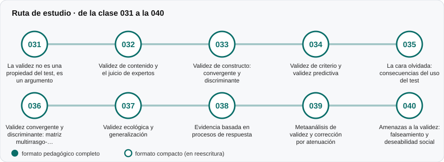

# ✅ Parte 03 — Validez

**Nivel:** intermedio · **Duración estimada:** 4-5 semanas · **Clases:** 10

## De qué trata

La pregunta que realmente importa: qué autoriza a interpretar un puntaje como aquello que se dice que mide. Validez de contenido, de constructo, de criterio, consecuencias del uso y amenazas.

## Por qué importa

Un test puede ser muy fiable y medir otra cosa. La validez no es una propiedad del test sino de la interpretación y el uso que se hace de sus puntajes.

## Según tu papel

- **Si construyes o aplicas instrumentos:** Aprenderás a reunir evidencia por distintas vías y a decir, para quién y para qué, un instrumento es válido.
- **Si eres evaluado o recibes resultados:** Entenderás por qué un test usado para un fin distinto del original pierde respaldo y cómo cuestionar un uso indebido.

## Al terminar esta parte podrás

- Distinguir tipos de evidencia de validez y sus límites.
- Leer una matriz multirrasgo-multimétodo.
- Reconocer amenazas como el falseamiento y la deseabilidad social.

## Cómo estudiarla

Después de la parte 02. Lee la clase 031 primero: reordena la forma de pensar el resto.

## Ruta de estudio

## Clases en orden de estudio

Las clases están numeradas de forma consecutiva (001 a 200) en el orden de estudio: sigue el número.

| Orden | ID | Clase | Qué aprenderás | Formato | Horas |
|---:|---|---|---|---|---:|
| 1 | 031 | [La validez no es una propiedad del test, es un argumento](031-validez-como-argumento/README.md) | Explicar por qué se valida una interpretación y un uso, no un test. | 🟡 compacto | 4 |
| 2 | 032 | [Validez de contenido y el juicio de expertos](032-validez-de-contenido/README.md) | Explicar la representatividad del contenido frente a la tabla de especificaciones. | 🟡 compacto | 3 |
| 3 | 033 | [Validez de constructo: convergente y discriminante](033-validez-de-constructo/README.md) | Formular predicciones teóricas de correlación antes de mirar los datos. | 🟡 compacto | 5 |
| 4 | 034 | [Validez de criterio y validez predictiva](034-validez-de-criterio/README.md) | Distinguir validez concurrente de predictiva. | 🟡 compacto | 5 |
| 5 | 035 | [La cara olvidada: consecuencias del uso del test](035-consecuencias-del-uso/README.md) | Explicar por qué las consecuencias forman parte del argumento de validez. | 🟡 compacto | 4 |
| 6 | 036 | [Validez convergente y discriminante: matriz multirrasgo-multimétodo](036-validez-convergente-y-discriminante-matriz-multirrasgo-multimetodo/README.md) | Leer una matriz multirrasgo-multimétodo (MRMM). | 🟡 compacto | 4 |
| 7 | 037 | [Validez ecológica y generalización](037-validez-ecologica-y-generalizacion/README.md) | Explicar la generalización de un puntaje a otras tareas, ocasiones y contextos. | 🟡 compacto | 4 |
| 8 | 038 | [Evidencia basada en procesos de respuesta](038-evidencia-basada-en-procesos-de-respuesta/README.md) | Explicar qué aportan los procesos de respuesta al argumento de validez. | 🟡 compacto | 4 |
| 9 | 039 | [Metaanálisis de validez y corrección por atenuación](039-metaanalisis-de-validez-y-correccion-por-atenuacion/README.md) | Calcular la correlación media ponderada y separar varianza de muestreo de varianza real. | 🟡 compacto | 4 |
| 10 | 040 | [Amenazas a la validez: falseamiento y deseabilidad social](040-amenazas-a-la-validez-falseamiento-y-deseabilidad/README.md) | Distinguir deseabilidad social, falseamiento intencional y estilos de respuesta. | 🟡 compacto | 4 |

[← Volver al índice del programa](../../README.md) · [Índice numérico de las 200 clases](../../PROGRAMA.md)
