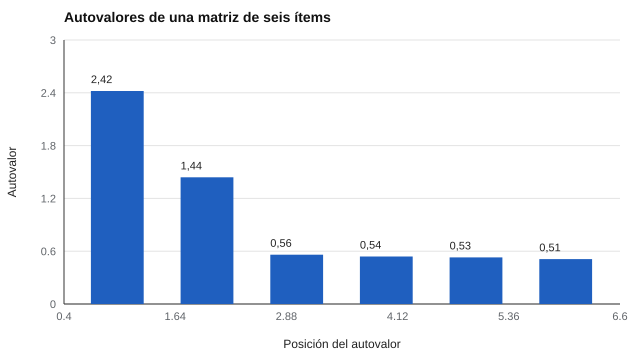

# 041 — Correlación, matriz y lo que se puede leer en ella


<!-- NAV -->
[← 040 — Amenazas a la validez: falseamiento y deseabi…](../../part-03-validez/040-amenazas-a-la-validez-falseamiento-y-deseabilidad/README.md) · [📚 Parte 04](../README.md) · [🗺️ Índice 001–200](../../../PROGRAMA.md) · [042 — Análisis factorial exploratorio →](../042-analisis-factorial-exploratorio/README.md)
<!-- /NAV -->

**Parte 04 — Estructura y análisis factorial** · Nivel avanzado · 4 h · Estado `escrita`
**Pensada para:** quien analiza la estructura de un cuestionario y quien lee informes con análisis factorial.
**Prerrequisitos:** clases 027 y 022.

## ¿Para qué te sirve esto?

Antes de cualquier análisis factorial hay una pregunta previa y barata: **¿hay algo que factorizar?** La respuesta está en la **matriz de correlaciones** entre los ítems. Aprender a leerla (bloques, magnitudes, signos) te permite ver a simple vista si el instrumento tiene la estructura que dice tener, y a detectar ítems que no pertenecen a la escala o ítems casi duplicados.

## Al terminar esta clase podrás

- Leer una matriz de correlaciones: bloques, magnitudes y signos.
- Calcular autovalores y relacionarlos con la estructura.
- Aplicar dos comprobaciones previas: determinante y KMO.
- Decidir si procede un análisis factorial.

## La idea en palabras simples

Piensa en un grupo de amigos: si en una fiesta los que hablan mucho de fútbol también hablan de deportes y los que hablan de libros también hablan de cine, el grupo se reparte en «bloques». La matriz de correlaciones es esa foto: cada celda dice cuánto se parecen dos ítems. Si los ítems 1 a 3 se parecen entre sí y los 4 a 6 se parecen entre sí, pero ambos bloques se parecen poco, hay **dos grupos**.

Los **autovalores** resumen la matriz: suman el número de ítems y un autovalor grande indica una «dirección» de variación compartida importante. El **determinante** cercano a 0 señala ítems casi duplicados, y el **KMO** (Kaiser, 1974) indica si las correlaciones parciales son pequeñas respecto de las totales, es decir, si hay estructura común.

## Cómo funciona, paso a paso

**1. Calcular la matriz R** de correlaciones entre ítems.

**2. Mirar los bloques:** correlaciones altas dentro de un grupo de ítems y bajas entre grupos.

**3. Calcular los autovalores.** Con una matriz de 2 × 2 [[1; 0,5]; [0,5; 1]], los autovalores son 1 + 0,5 = 1,5 y 1 − 0,5 = 0,5 (suman 2, el número de ítems). El primero explica el 75 % de la varianza total.

**4. Aplicar comprobaciones previas:** determinante (¿hay duplicados?) y KMO (¿hay estructura común?).



*Figura 1.* Dos autovalores por encima de 1 sugieren dos dimensiones.

## Si construyes el instrumento

- Mira siempre la matriz antes de factorizar: un ítem con correlaciones casi nulas con todos no pertenece a la escala.
- Revisa el determinante y el KMO como comprobaciones, no como pruebas de unidimensionalidad.
- Con ítems ordinales de pocas categorías, la matriz de Pearson subestima las relaciones (clase 050).
- Guarda la matriz en el informe técnico.

## Si eres evaluado

- Si un informe te entrega puntajes por dimensiones, pregunta si hay evidencia de que las dimensiones existen: la matriz de correlaciones es la primera prueba.
- Un perfil de «seis dimensiones» donde todas las escalas correlacionan 0,9 entre sí quizá solo tenga una.
- La estructura se estudia en grupos; en tu caso individual, los puntajes por dimensión tienen más error.

## Qué muestra el laboratorio

`lab.py` simula 6 ítems (1–3 miden el factor A; 4–6, el factor B; los factores se correlacionan 0,3; N = 2.000).

| Medida | Valor |
|---|---:|
| Correlación media dentro de bloque | 0,466 |
| Correlación media entre bloques | 0,163 |
| Autovalores | 2,42; 1,44; 0,56; 0,54; 0,53; 0,51 |
| Determinante | 0,282 |
| KMO global | 0,727 |

**Análisis.** (1) La estructura en dos bloques se ve a simple vista: 0,466 dentro y 0,163 entre ellos. (2) Hay dos autovalores sobre 1 y los demás rondan 0,5. (3) El determinante (0,282) está lejos de 0: no hay ítems duplicados; el KMO (0,727) es aceptable. (4) Los datos son simulados con una estructura sencilla; en datos reales las matrices son más ruidosas.

## Errores frecuentes

- Factorizar sin mirar la matriz.
- Interpretar el KMO como prueba de unidimensionalidad.
- Ignorar ítems con correlaciones casi nulas con todos.
- Usar Pearson con ítems ordinales de muy pocas categorías sin considerar la discretización.

## Lo mínimo que debes llevarte

1. El análisis factorial parte de la matriz de correlaciones.
2. Los autovalores suman el número de ítems.
3. Determinante y KMO son comprobaciones previas.
4. Los bloques se ven a simple vista.

## Ejercicios

- **Inicial.** ¿Qué suma dan los autovalores de una matriz de correlaciones 10 × 10? *Solución: 10.*
- **Intermedio.** Autovalores de [[1; 0,3]; [0,3; 1]]. *Solución: 1,3 y 0,7.*
- **Avanzado.** Aumenta a 0,7 la correlación entre factores en `lab.py` y describe los autovalores.
- **Aplicación.** Toma un cuestionario con datos (anonimizados), calcula la matriz y dibuja los bloques.

## Glosario

- **Matriz de correlaciones:** tabla de correlaciones entre todos los pares de ítems.
- **Autovalor:** cantidad de varianza asociada a una dirección de la matriz.
- **Determinante:** número que se acerca a 0 si hay ítems casi duplicados.
- **KMO:** índice de adecuación muestral para el análisis factorial.

## Laboratorio

```bash
python classes/part-04-estructura-y-analisis-factorial/041-correlacion-y-matriz/lab.py
python classes/part-04-estructura-y-analisis-factorial/figuras.py
```

## Autoevaluación y criterios

1. ¿Qué significa un determinante de 0,001? 2. ¿Por qué un KMO bajo desaconseja factorizar? 3. ¿Qué dos bloques ves y qué predice la teoría?
Se logra la clase si puedes leer la estructura de una matriz y decidir si procede factorizar.

## Bibliografía

- Kaiser, H. F. (1974). An index of factorial simplicity. *Psychometrika*, 39(1), 31-36.
- Fabrigar, L. R., & Wegener, D. T. (2012). *Exploratory Factor Analysis*. Oxford University Press.
- Brown, T. A. (2015). *Confirmatory Factor Analysis for Applied Research* (2.ª ed.). Guilford.

---

<!-- NAV -->
[← 040 — Amenazas a la validez: falseamiento y deseabi…](../../part-03-validez/040-amenazas-a-la-validez-falseamiento-y-deseabilidad/README.md)  
[📚 Parte 04](../README.md) · [🗺️ Índice 001–200](../../../PROGRAMA.md)  
[042 — Análisis factorial exploratorio →](../042-analisis-factorial-exploratorio/README.md)
<!-- /NAV -->
