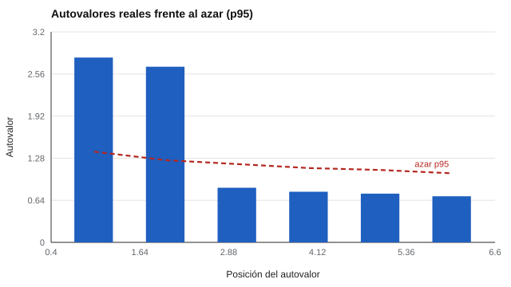

# 042 — Análisis factorial exploratorio


<!-- NAV -->
[← 041 — Correlación, matriz y lo que se puede leer en…](../041-correlacion-y-matriz/README.md) · [📚 Parte 04](../README.md) · [🗺️ Índice 001–200](../../../PROGRAMA.md) · [043 — Análisis factorial confirmatorio y ajuste →](../043-analisis-factorial-confirmatorio/README.md)
<!-- /NAV -->

**Parte 04 — Estructura y análisis factorial** · Nivel avanzado · 5 h · Estado `escrita`
**Pensada para:** quien construye escalas y quien lee estudios que reportan «factores».
**Prerrequisitos:** clase 041.

## ¿Para qué te sirve esto?

Cuando un informe dice «el cuestionario tiene tres factores», alguien hizo un **análisis factorial exploratorio** (AFE). La pregunta central es **cuántos factores hay** y qué ítems pertenecen a cada uno. Una mala decisión aquí (retener demasiados o muy pocos) cambia todas las escalas que se calcularán después. Esta clase te enseña el modelo, el criterio de decisión más defendible y por qué las cargas «sin rotar» son difíciles de leer.

## Al terminar esta clase podrás

- Explicar el modelo factorial común: cargas, comunalidades y unicidades.
- Decidir cuántos factores retener y por qué la regla de Kaiser es insuficiente.
- Interpretar cargas sin rotar y entender por qué se rota.
- Reconocer los límites de poner nombre a un factor.

## La idea en palabras simples

El modelo supone que cada ítem es una **suma ponderada de factores comunes** más un **factor único** (lo propio del ítem). La varianza de cada ítem se reparte entre **comunalidad** (la parte compartida con los factores) y **unicidad** (la parte propia). El AFE estima las cargas sin imponer de antemano qué ítems pertenecen a qué factor: de ahí «exploratorio».

**¿Cuántos factores?** La regla de Kaiser retiene los autovalores mayores que 1, pero suele **sobreestimar**. El **análisis paralelo** (Horn, 1965) compara los autovalores reales con los de datos aleatorios del mismo tamaño y retiene solo los que superan al azar.

## Cómo funciona, paso a paso

**1. Calcular los autovalores** de la matriz de correlaciones.

**2. Compararlos con el azar** (análisis paralelo): aquí, el percentil 95 de 40 réplicas aleatorias.

**3. Retener los factores** que superan el azar.

**4. Extraer las cargas** (y luego rotar, clase 046).

**Ejemplo.** Un ítem con cargas 0,6 y 0,3: comunalidad = 0,36 + 0,09 = 0,45; unicidad = 0,55.



*Figura 1.* Solo los dos primeros autovalores superan el umbral del azar.

## Si construyes el instrumento

- Usa al menos dos criterios para decidir el número de factores (análisis paralelo y la interpretabilidad).
- Usa muestras de tamaño suficiente: con pocas personas las cargas son inestables.
- No uses el nombre que le pones a un factor como evidencia del constructo.
- Diferencia componentes principales de análisis factorial y declara cuál usaste.

## Si eres evaluado

- Si el informe de un instrumento dice «cinco factores», pregunta con qué criterio se decidió.
- Los puntajes por factor tienen su propio margen de error.
- La estructura se estudia con grupos de personas; no describe a una persona en particular.

## Qué muestra el laboratorio

`lab.py` simula 12 ítems con dos factores verdaderos independientes (N = 400).

| # | Autovalor | Azar p95 | Kaiser | Paralelo |
|---:|---:|---:|---|---|
| 1 | 2,81 | 1,38 | sí | sí |
| 2 | 2,67 | 1,25 | sí | sí |
| 3 | 0,83 | 1,19 | no | no |
| 4 | 0,77 | 1,13 | no | no |

Kaiser retiene 2; el análisis paralelo retiene 2 (verdad: 2). Las cargas sin rotar de cada ítem están en torno a ±0,5 en **ambos** factores.

**Análisis.** (1) Ambos criterios reconocen los dos factores. (2) Con más ítems o cargas bajas, Kaiser tiende a sobreestimar; el paralelo es más conservador. (3) Las cargas sin rotar mezclan ambos factores: cada ítem carga ≈ 0,5 en los dos, lo que obliga a rotar para poder interpretarlos. (4) El laboratorio usa componentes principales como aproximación didáctica.

## Errores frecuentes

- Llamar «análisis factorial» a un análisis de componentes sin aclararlo.
- Retener factores solo por la regla de Kaiser.
- Usar muestras pequeñas.
- Interpretar el nombre de un factor como prueba del constructo.

## Lo mínimo que debes llevarte

1. Cada ítem = factores comunes + factor único.
2. Comunalidad + unicidad = 1 (con ítems estandarizados).
3. El análisis paralelo es más defendible que Kaiser.
4. Las cargas sin rotar suelen ser difíciles de interpretar.

## Ejercicios

- **Inicial.** Comunalidad de un ítem con cargas 0,5 y 0,5. *Solución: 0,50.*
- **Intermedio.** Si los autovalores son 3,1; 1,2; 1,05; 0,9 y el azar p95 = 1,3; 1,15; 1,1; 1,0, ¿cuántos retiene el análisis paralelo? *Solución: 1.*
- **Avanzado.** Cambia las cargas verdaderas a 0,4 en `lab.py` y compara Kaiser con paralelo.
- **Aplicación.** Aplica el análisis paralelo a datos de un cuestionario (anonimizados) y discute el resultado.

## Glosario

- **Factor común:** variable latente que explica la correlación entre varios ítems.
- **Carga:** relación entre un ítem y un factor.
- **Comunalidad:** parte de la varianza del ítem explicada por los factores comunes.
- **Unicidad:** parte propia del ítem.
- **Análisis paralelo:** criterio que compara con datos aleatorios.

## Laboratorio

```bash
python classes/part-04-estructura-y-analisis-factorial/042-analisis-factorial-exploratorio/lab.py
python classes/part-04-estructura-y-analisis-factorial/figuras.py
```

## Autoevaluación y criterios

1. ¿Qué es la comunalidad? 2. ¿Por qué el paralelo es más defendible? 3. ¿Qué criterios no estadísticos usarías?
Se logra la clase si puedes decidir el número de factores con más de un criterio.

## Bibliografía

- Horn, J. L. (1965). A rationale and test for the number of factors in factor analysis. *Psychometrika*, 30(2), 179-185.
- Fabrigar, L. R., Wegener, D. T., MacCallum, R. C., & Strahan, E. J. (1999). Evaluating the use of exploratory factor analysis in psychological research. *Psychological Methods*, 4(3), 272-299.

---

<!-- NAV -->
[← 041 — Correlación, matriz y lo que se puede leer en…](../041-correlacion-y-matriz/README.md)  
[📚 Parte 04](../README.md) · [🗺️ Índice 001–200](../../../PROGRAMA.md)  
[043 — Análisis factorial confirmatorio y ajuste →](../043-analisis-factorial-confirmatorio/README.md)
<!-- /NAV -->
