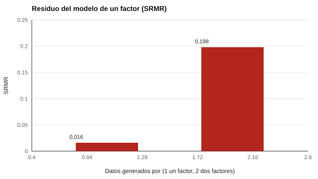

# 043 — Análisis factorial confirmatorio y ajuste


<!-- NAV -->
[← 042 — Análisis factorial exploratorio](../042-analisis-factorial-exploratorio/README.md) · [📚 Parte 04](../README.md) · [🗺️ Índice 001–200](../../../PROGRAMA.md) · [044 — Modelos circumplejos: el hexágono de Holland… →](../044-modelos-circumplejos/README.md)
<!-- /NAV -->

**Parte 04 — Estructura y análisis factorial** · Nivel avanzado · 5 h · Estado `escrita`
**Pensada para:** quien valida estructuras de instrumentos y quien lee índices de ajuste.
**Prerrequisitos:** clases 042 y 023.

## ¿Para qué te sirve esto?

Cuando un instrumento ya tiene una estructura propuesta (por ejemplo, cinco dimensiones), el análisis **confirmatorio** (AFC) comprueba si los datos la respaldan. En los artículos aparecen siglas como CFI, RMSEA o SRMR: son índices de ajuste. Esta clase te explica la lógica detrás (comparar lo observado con lo que el modelo implica), te muestra por qué los **residuos** informan más que un solo número y te advierte del mayor riesgo del AFC: reajustar el modelo hasta que ajuste.

## Al terminar esta clase podrás

- Distinguir AFC de AFE: el modelo se fija antes de ver los datos.
- Explicar el ajuste como comparación entre la matriz observada y la implicada por el modelo.
- Leer un SRMR y mirar los residuos.
- Reconocer el riesgo de reajustar el modelo hasta que ajuste.

## La idea en palabras simples

En el AFE «se deja que los datos hablen». En el AFC **tú declaras** qué ítems cargan en qué factor (el resto de cargas se fija en 0) y se evalúa cuánto se parece la matriz de correlaciones que **implica** tu modelo a la matriz **observada**. Los **residuos** (observada − implicada) muestran dónde el modelo falla: un residuo grande entre dos ítems dice que están más relacionados de lo que tu modelo supone.

**Aclaración honesta:** el laboratorio **no** es un AFC por máxima verosimilitud; ajusta un factor por ejes principales y mide el desajuste con el SRMR (raíz del residuo cuadrático medio estandarizado), para mostrar la lógica del residuo. El AFC real se hace con software especializado (lavaan, semopy, Mplus, etc.).

## Cómo funciona, paso a paso

**1. Especificar** el modelo antes de ver los datos.

**2. Estimar** y calcular la matriz implicada.

**3. Calcular los residuos** y el SRMR.

**Ejemplo.** Residuos 0,10; −0,10; 0,05: SRMR = √((0,01 + 0,01 + 0,0025) / 3) = 0,087. Un valor sobre 0,08 invita a mirar qué residuo domina.



*Figura 1.* El residuo delata una mala especificación.

**4. Evitar la trampa.** Modificar el modelo con «índices de modificación» hasta que ajuste convierte el AFC en exploratorio y **capitaliza el azar** (MacCallum et al., 1992).

## Si construyes el instrumento

- Fija y registra el modelo antes de analizar los datos.
- Reporta varios índices y los residuos, no solo uno.
- Si modificas el modelo, hazlo con justificación teórica y comprueba en una muestra nueva.
- No uses umbrales fijos para todo modelo y muestra: los de Hu y Bentler (1999) son orientaciones, no reglas.

## Si eres evaluado

- Un «buen ajuste» no prueba que el modelo sea verdadero: modelos distintos pueden ajustar igual de bien.
- Si un instrumento declara su estructura, pregunta si se confirmó en una muestra distinta de aquella en que se propuso.
- Los puntajes por dimensión valen en la medida en que la estructura se sostenga.

## Qué muestra el laboratorio

| Datos generados por | SRMR del modelo de 1 factor |
|---|---:|
| 1 factor (modelo correcto) | 0,016 |
| 2 factores (mal especificado) | 0,198 |

**Análisis.** (1) Con el modelo correcto, el residuo es mínimo (0,016). (2) Con dos factores verdaderos ajustados como uno solo, el SRMR sube a 0,198: el residuo delata la mala especificación. (3) Un AFC real usa máxima verosimilitud, chi-cuadrado e índices (clase 047) y, sobre todo, un modelo fijado antes de ver los datos. (4) El laboratorio es una ilustración de la lógica, no un AFC completo.

## Errores frecuentes

- Modificar el modelo con índices de modificación hasta que ajuste.
- Presentar un buen ajuste como prueba de que el modelo es verdadero.
- Usar umbrales fijos para todo modelo y muestra.
- Confundir el AFC con un AFE «más sofisticado».

## Lo mínimo que debes llevarte

1. En el AFC el modelo se fija antes de ver los datos.
2. El ajuste compara la matriz observada con la implicada.
3. Los residuos informan dónde falla el modelo.
4. Reajustar sin teoría capitaliza el azar.

## Ejercicios

- **Inicial.** ¿Qué diferencia hay entre AFE y AFC en la especificación? *Guía: en el AFC se fijan de antemano las cargas.*
- **Intermedio.** Calcula el SRMR con residuos 0,04; −0,04; 0,02; −0,02. *Solución: √((0,0016 + 0,0016 + 0,0004 + 0,0004) / 4) = 0,032.*
- **Avanzado.** En `lab.py` genera datos con cargas cruzadas pequeñas y observa el SRMR.
- **Aplicación.** Lee un artículo de AFC y señala si el modelo se fijó antes de los datos.

## Glosario

- **AFC:** análisis factorial confirmatorio.
- **Matriz implicada:** matriz de correlaciones que el modelo predice.
- **Residuo:** diferencia entre lo observado y lo implicado.
- **SRMR:** resumen de los residuos estandarizados.
- **Capitalizar el azar:** ajustar un modelo a las peculiaridades de una muestra.

## Laboratorio

```bash
python classes/part-04-estructura-y-analisis-factorial/043-analisis-factorial-confirmatorio/lab.py
python classes/part-04-estructura-y-analisis-factorial/figuras.py
```

## Autoevaluación y criterios

1. ¿Por qué los residuos informan más que un índice resumen? 2. ¿Qué es capitalizar el azar? 3. ¿Cuándo es legítimo modificar un modelo?
Se logra la clase si puedes fijar un modelo de antemano y evaluar su ajuste con residuos.

## Bibliografía

- Hu, L., & Bentler, P. M. (1999). Cutoff criteria for fit indexes in covariance structure analysis: Conventional criteria versus new alternatives. *Structural Equation Modeling*, 6(1), 1-55.
- MacCallum, R. C., Roznowski, M., & Necowitz, L. B. (1992). Model modifications in covariance structure analysis: The problem of capitalization on chance. *Psychological Bulletin*, 111(3), 490-504.
- Brown, T. A. (2015). *Confirmatory Factor Analysis for Applied Research* (2.ª ed.). Guilford.

---

<!-- NAV -->
[← 042 — Análisis factorial exploratorio](../042-analisis-factorial-exploratorio/README.md)  
[📚 Parte 04](../README.md) · [🗺️ Índice 001–200](../../../PROGRAMA.md)  
[044 — Modelos circumplejos: el hexágono de Holland… →](../044-modelos-circumplejos/README.md)
<!-- /NAV -->
