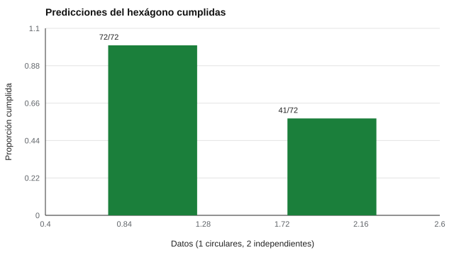

# 044 — Modelos circumplejos: el hexágono de Holland como predicción falsable


<!-- NAV -->
[← 043 — Análisis factorial confirmatorio y ajuste](../043-analisis-factorial-confirmatorio/README.md) · [📚 Parte 04](../README.md) · [🗺️ Índice 001–200](../../../PROGRAMA.md) · [045 — Invarianza de medida entre grupos →](../045-invarianza-de-medida/README.md)
<!-- /NAV -->

**Parte 04 — Estructura y análisis factorial** · Nivel avanzado · 4 h · Estado `escrita`
**Pensada para:** quien trabaja con intereses vocacionales y quien interpreta perfiles RIASEC.
**Prerrequisitos:** clases 041 y 033.

## ¿Para qué te sirve esto?

Los resultados de intereses vocacionales suelen entregarse como un código de tres letras (por ejemplo, «IAS»). Detrás hay una teoría muy visual: los seis tipos de personalidad vocacional de Holland se ordenan en un **hexágono**. Lo interesante, desde la metodología, es que esa teoría hace una **predicción que los datos pueden desmentir**. Esta clase te enseña a ponerla a prueba, y te ayuda a leer con criterio cualquier informe RIASEC (incluido el instrumento O*NET del catálogo).

## Al terminar esta clase podrás

- Explicar el modelo circumplejo y la predicción de orden de las correlaciones.
- Calcular un índice de satisfacción de predicciones.
- Relacionar el hexágono R-I-A-S-E-C con el instrumento RIASEC del catálogo.
- Explicar por qué un modelo falsable es mejor que uno infalsable.

## La idea en palabras simples

Holland (1997) ordena seis tipos (Realista, Investigador, Artístico, Social, Emprendedor, Convencional) en los vértices de un hexágono. **Predicción:** los tipos próximos en el círculo se parecen más que los alejados; es decir, las correlaciones **decrecen con la distancia** en el hexágono: adyacentes > alternos > opuestos. Es como un reloj: las 12 y la 1 están cerca; las 12 y las 6, lejos.

Si se cuenta cuántas comparaciones de orden se cumplen (72 en total), se obtiene un **índice de satisfacción de predicciones** (Hubert & Arabie, 1987). Con datos sin estructura, cabe esperar cerca de la mitad por puro azar.

## Cómo funciona, paso a paso

**1. Calcular la matriz** de correlaciones entre las seis escalas.

**2. Ordenar los pares por distancia** en el hexágono (1, 2 o 3).

**3. Contar las comparaciones cumplidas** (72 en total: 6·6 + 6·3 + 6·3).

**4. Comparar con el azar.**

**Ejemplo.** Distancias: R–I = 1, R–A = 2, R–S = 3. La predicción es r(R,I) > r(R,A) > r(R,S). Si el instrumento da 0,45; 0,30; 0,10, se cumplen las tres comparaciones.



*Figura 1.* Con estructura circular se cumplen todas las predicciones; con datos independientes, aproximadamente la mitad.

## Si construyes el instrumento

- Revisa si las escalas del instrumento cubren el círculo antes de aplicar el índice.
- Informa el índice con su intervalo y la muestra.
- Contempla modelos alternativos (por ejemplo, las dimensiones «personas-cosas» y «datos-ideas»).
- Declara que un índice calculado en una sola muestra no confirma el hexágono en toda la población.

## Si eres evaluado

- Tu código de tres letras resume seis puntajes y pierde información: pide ver el perfil completo.
- El hexágono es un modelo, no una ley: muchas muestras reales lo cumplen de manera imperfecta.
- Un perfil de intereses orienta, no decide.

## Qué muestra el laboratorio

`lab.py` evalúa el índice con datos circulares simulados y con seis variables independientes (N = 1.500).

| Datos | Predicciones cumplidas |
|---|---:|
| Estructura circular simulada | 72 / 72 = 1,00 |
| Seis variables independientes | 41 / 72 = 0,57 (azar ≈ 0,5) |

En los datos circulares se observan correlaciones ≈ 0,28 entre adyacentes y ≈ −0,58 entre opuestos.

**Análisis.** (1) El modelo hace una apuesta que los datos pueden desmentir. (2) Con datos sin estructura, el índice ronda lo esperable por azar (0,57). (3) Un instrumento que cumple todas las predicciones respalda la estructura hexagonal **en esa muestra**; no prueba que el hexágono sea «la» estructura de los intereses en toda la población. (4) Los datos son simulados.

## Errores frecuentes

- Declarar «hexágono confirmado» con un índice calculado en una sola muestra.
- Ignorar que las muestras reales muestran estructura circular imperfecta.
- Aplicar el índice a un instrumento sin saber si sus escalas cubren el círculo.
- Confundir un código de tres letras con el perfil completo.

## Lo mínimo que debes llevarte

1. El modelo predice que las correlaciones decrecen con la distancia.
2. Es falsable: los datos pueden contradecirlo.
3. El índice cuenta predicciones cumplidas frente al azar.
4. Un solo estudio no confirma el modelo.

## Ejercicios

- **Inicial.** ¿Cuántos pares de escalas hay en un hexágono? *Solución: 15 (6 a distancia 1, 6 a distancia 2 y 3 a distancia 3).*
- **Intermedio.** Cuenta cuántas comparaciones de orden hay. *Solución: 6·6 + 6·3 + 6·3 = 72.*
- **Avanzado.** Aplica el índice a datos sintéticos del instrumento `onet-riasec-sf`.
- **Aplicación.** Escribe cómo explicarías a un estudiante por qué su código de tres letras no lo define.

## Glosario

- **Circumplejo:** estructura en que las variables se ordenan en un círculo.
- **Hexágono de Holland:** orden circular R-I-A-S-E-C de los tipos vocacionales.
- **Predicción falsable:** hipótesis que los datos pueden refutar.
- **Índice de satisfacción de predicciones:** proporción de comparaciones de orden que se cumplen.

## Laboratorio

```bash
python classes/part-04-estructura-y-analisis-factorial/044-modelos-circumplejos/lab.py
python classes/part-04-estructura-y-analisis-factorial/figuras.py
```

## Autoevaluación y criterios

1. ¿Por qué es una predicción falsable? 2. ¿Qué evidencia contradiría el hexágono? 3. ¿Qué limita un índice calculado en una muestra?
Se logra la clase si puedes calcular el índice y discutir su alcance.

## Bibliografía

- Holland, J. L. (1997). *Making Vocational Choices: A Theory of Vocational Personalities and Work Environments* (3.ª ed.). Psychological Assessment Resources.
- Hubert, L., & Arabie, P. (1987). Evaluating order hypotheses within proximity matrices. *Psychological Bulletin*, 102(1), 172-178.
- Tracey, T. J., & Rounds, J. (1993). Evaluating Holland's and Gati's vocational-interest models: A structural meta-analysis. *Psychological Bulletin*, 113(2), 229-246.

---

<!-- NAV -->
[← 043 — Análisis factorial confirmatorio y ajuste](../043-analisis-factorial-confirmatorio/README.md)  
[📚 Parte 04](../README.md) · [🗺️ Índice 001–200](../../../PROGRAMA.md)  
[045 — Invarianza de medida entre grupos →](../045-invarianza-de-medida/README.md)
<!-- /NAV -->
