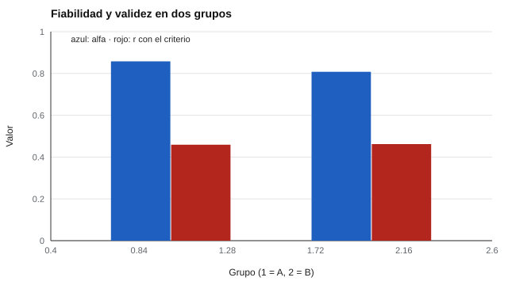

# 045 — Invarianza de medida entre grupos


<!-- NAV -->
[← 044 — Modelos circumplejos: el hexágono de Holland…](../044-modelos-circumplejos/README.md) · [📚 Parte 04](../README.md) · [🗺️ Índice 001–200](../../../PROGRAMA.md) · [046 — Rotaciones y criterios de retención de factor… →](../046-rotaciones-y-criterios-de-retencion-de-factores/README.md)
<!-- /NAV -->

**Parte 04 — Estructura y análisis factorial** · Nivel avanzado · 5 h · Estado `escrita`
**Pensada para:** quien compara grupos (sexos, edades, países, idiomas) con un mismo instrumento, y quien lee esas comparaciones.
**Prerrequisitos:** clases 042 y 043.

## ¿Para qué te sirve esto?

«Las mujeres puntúan más alto que los hombres en esta escala». «Los estudiantes de otro país obtienen menos». Estas comparaciones suponen que el instrumento **mide lo mismo en todos los grupos**. Si no es así, la diferencia puede ser del instrumento y no de las personas. La **invarianza de medida** es la forma de comprobarlo. Es una condición previa a cualquier comparación entre grupos, y una de las ideas que más protege contra conclusiones injustas.

## Al terminar esta clase podrás

- Distinguir invarianza configural, métrica, escalar y estricta.
- Explicar qué comparaciones habilita cada nivel.
- Reconocer que un problema de invarianza puede pasar inadvertido.
- Decidir qué hacer si falla un nivel.

## La idea en palabras simples

Piensa en una balanza que en un grupo funciona bien y en otro tiene un resorte flojo: comparar pesos entre grupos no tiene sentido. Con un instrumento psicológico, «el resorte flojo» es, por ejemplo, un ítem que en un grupo refleja el rasgo (carga alta) y en otro casi no lo refleja (carga baja), por diferencias de idioma o de cultura.

Meredith (1993) y Vandenberg & Lance (2000) describen niveles cada vez más exigentes:

| Nivel | Qué se iguala | Habilita |
|---|---|---|
| Configural | mismo patrón de ítems en factores | comparar la estructura |
| Métrica | cargas | comparar correlaciones y varianzas |
| Escalar | cargas + interceptos | comparar **medias** |
| Estricta | + varianzas únicas | comparar puntajes observados |

## Cómo funciona, paso a paso

**1. Ajustar el modelo** en cada grupo por separado (configural).

**2. Imponer cargas iguales** (métrica) y ver si el ajuste empeora.

**3. Imponer además los interceptos iguales** (escalar).

**4. Decidir.** Para comparar medias hace falta al menos invarianza escalar; si falla en pocos ítems, se puede intentar invarianza parcial con justificación sustantiva (clase 070).

**Ejemplo.** Un ítem con carga 0,8 aporta el 64 % de su varianza al factor; con carga 0,3, solo el 9 %. En el grupo B, el mismo ítem es casi ruido para el rasgo.



*Figura 1.* La fiabilidad baja en el grupo B; la correlación con el criterio casi no cambia.

## Si construyes el instrumento

- Prueba la invarianza antes de comparar grupos o de publicar normas distintas por grupo.
- Revisa los ítems que no funcionan igual y su redacción por idioma o cultura.
- No elimines ítems sin justificación sustantiva.
- Informa el nivel de invarianza alcanzado.

## Si eres evaluado

- Si te comparan con un grupo distinto del tuyo (idioma, cultura, edad), pregunta si el instrumento fue probado para ello.
- Una diferencia de promedios entre grupos puede deberse al instrumento y no a las personas.
- Si el instrumento está traducido, pregunta si se comprobó la equivalencia (clase 065).

## Qué muestra el laboratorio

`lab.py` simula dos grupos con el mismo rasgo medio; en un ítem de seis, la carga es 0,8 (grupo A) y 0,3 (grupo B).

| Grupo | Carga ítem 6 | Alfa | r (escala, criterio) |
|---|---:|---:|---:|
| A | 0,81 | 0,858 | 0,459 |
| B | 0,31 | 0,808 | 0,462 |

**Análisis.** (1) Con el mismo rasgo medio, la escala **no funciona igual** en ambos grupos: su fiabilidad baja en B. (2) La correlación con el criterio casi no se mueve (0,459 frente a 0,462), porque es un solo ítem de seis: **mirar solo la validez de criterio no delata el problema**. (3) Comparar fiabilidades o estructuras entre grupos sin invarianza métrica mezcla diferencias del rasgo con diferencias del instrumento. (4) El laboratorio conoce el rasgo; en datos reales se usan modelos multigrupo.

## Errores frecuentes

- Comparar medias de grupos sin probar invarianza escalar.
- Descartar la necesidad de invarianza porque «el ajuste es bueno» en cada grupo por separado.
- Eliminar ítems sin justificación sustantiva.
- Creer que la validez de criterio por sí sola garantiza que se mide lo mismo.

## Lo mínimo que debes llevarte

1. Comparar grupos supone que el instrumento mide lo mismo.
2. Configural, métrica, escalar y estricta son niveles crecientes.
3. Para comparar medias se necesita invarianza escalar.
4. Un problema de invarianza puede pasar inadvertido.

## Ejercicios

- **Inicial.** ¿Qué nivel de invarianza se necesita para comparar medias? *Solución: escalar.*
- **Intermedio.** ¿Qué diferencias de carga te preocuparían: 0,70 frente a 0,65 o 0,70 frente a 0,30? *Solución: la segunda.*
- **Avanzado.** Cambia en `lab.py` la carga de dos ítems y observa el alfa de B.
- **Aplicación.** Lee un estudio que compare grupos y señala si comprobó invarianza.

## Glosario

- **Invarianza de medida:** el instrumento mide lo mismo en distintos grupos.
- **Configural / métrica / escalar / estricta:** niveles de invarianza.
- **Intercepto:** nivel esperado del ítem cuando el rasgo es cero.
- **Invarianza parcial:** invarianza que se cumple salvo en algunos ítems.

## Laboratorio

```bash
python classes/part-04-estructura-y-analisis-factorial/045-invarianza-de-medida/lab.py
python classes/part-04-estructura-y-analisis-factorial/figuras.py
```

## Autoevaluación y criterios

1. ¿Por qué la invarianza es previa a comparar grupos? 2. ¿Qué evidencia delata una carga distinta? 3. ¿Qué haces si falla la invarianza escalar?
Se logra la clase si puedes ordenar los niveles y relacionar cada uno con una comparación legítima.

## Bibliografía

- Meredith, W. (1993). Measurement invariance, factor analysis and factorial invariance. *Psychometrika*, 58(4), 525-543. ✅ [DOI](https://doi.org/10.1007/bf02294825)
- Vandenberg, R. J., & Lance, C. E. (2000). A review and synthesis of the measurement invariance literature: Suggestions, practices, and recommendations for organizational research. *Organizational Research Methods*, 3(1), 4-70. ✅ [DOI](https://doi.org/10.1177/109442810031002)
- Putnick, D. L., & Bornstein, M. H. (2016). Measurement invariance conventions and reporting: The state of the art and future directions for psychological research. *Developmental Review*, 41, 71-90. ✅ [DOI](https://doi.org/10.1016/j.dr.2016.06.004)

Leyenda: ✅ existe en Crossref con título y año coincidentes (enlace al DOI); ⚠️ hay una obra de título parecido con otro año (no se enlaza: comprobar la edición); 🔎 no verificada automáticamente (libros sin DOI, normas y sitios web). Crossref confirma la existencia de la fuente, no que respalde cada afirmación de la clase. Ver [`docs/VERIFICACION_BIBLIOGRAFIA.md`](../../../docs/VERIFICACION_BIBLIOGRAFIA.md).

---

<!-- NAV -->
[← 044 — Modelos circumplejos: el hexágono de Holland…](../044-modelos-circumplejos/README.md)  
[📚 Parte 04](../README.md) · [🗺️ Índice 001–200](../../../PROGRAMA.md)  
[046 — Rotaciones y criterios de retención de factor… →](../046-rotaciones-y-criterios-de-retencion-de-factores/README.md)
<!-- /NAV -->
