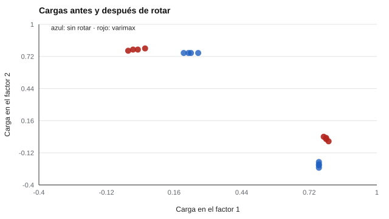

# 046 — Rotaciones y criterios de retención de factores


<!-- NAV -->
[← 045 — Invarianza de medida entre grupos](../045-invarianza-de-medida/README.md) · [📚 Parte 04](../README.md) · [🗺️ Índice 001–200](../../../PROGRAMA.md) · [047 — Ajuste en modelos de ecuaciones estructurales →](../047-ajuste-en-modelos-de-ecuaciones-estructurales/README.md)
<!-- /NAV -->

**Parte 04 — Estructura y análisis factorial** · Nivel avanzado · 4 h · Estado `escrita`
**Pensada para:** quien interpreta soluciones factoriales y quien lee tablas de cargas.
**Prerrequisitos:** clase 042.

## ¿Para qué te sirve esto?

Una tabla de cargas factoriales «sin rotar» suele ser ilegible: cada ítem carga un poco en todos los factores. Los informes casi siempre presentan cargas **rotadas**. ¿Es eso «maquillar» los resultados? No: la rotación es una operación legítima, pero tiene reglas. Esta clase te enseña qué hace una rotación, qué no puede hacer, y cuándo conviene una rotación que permita factores relacionados.

## Al terminar esta clase podrás

- Explicar por qué la solución factorial inicial no es única.
- Rotar con varimax y comprobar que no cambia la varianza explicada.
- Elegir entre rotación ortogonal y oblicua.
- Reconocer qué es la estructura simple.

## La idea en palabras simples

Imagina que dibujas el mapa de una ciudad. Puedes orientar el norte hacia arriba o hacia la izquierda: el mapa es el mismo, solo cambia la orientación. Con los factores pasa igual: las cargas sin rotar corresponden a **una** orientación de los ejes entre infinitas equivalentes (Browne, 2001). La **rotación** busca la orientación más fácil de interpretar, la **estructura simple** (Thurstone): cada ítem carga alto en un factor y casi cero en los demás.

- **Ortogonal (varimax):** los factores quedan sin correlación entre sí.
- **Oblicua (oblimin, promax):** se permite que los factores se correlacionen; es más realista cuando los constructos se relacionan.

## Cómo funciona, paso a paso

**1. Calcular las cargas iniciales.**

**2. Girar los ejes** en un ángulo que maximice la simplicidad (varimax, Kaiser, 1958).

**3. Comprobar** que la comunalidad de cada ítem y la varianza total explicada no cambian.

**Ejemplo.** Cargas (0,8; 0,2) rotadas 30°: a′ = 0,8·cos 30° + 0,2·sen 30° = 0,793; b′ = −0,8·sen 30° + 0,2·cos 30° = −0,227. Comunalidad: 0,68 antes; 0,793² + 0,227² = 0,68 después.



*Figura 1.* La rotación no crea estructura: ordena la que ya existe.

## Si construyes el instrumento

- Usa rotación oblicua si el marco teórico sugiere que los factores se relacionan.
- No elijas la rotación que «se ve mejor»: decide por criterio teórico y declara la elección.
- Informa las cargas con la matriz de estructura y la de patrón si usas oblicua.
- Interpreta las cargas bajas (< 0,30) considerando el tamaño muestral.

## Si eres evaluado

- La tabla de cargas que ves en un informe es una de las orientaciones posibles del mismo resultado.
- Si el instrumento define dimensiones, pregunta si se permitió que se relacionaran entre sí.
- Los factores son resúmenes de los ítems; no son «lugares» en las personas.

## Qué muestra el laboratorio

`lab.py` rota con varimax una solución de 8 ítems con estructura simple verdadera (1–4 / 5–8; N = 1.500).

| Ítem | Sin rotar | Varimax |
|---:|---|---|
| 1 | 0,23 / 0,75 | 0,01 / 0,78 |
| 5 | 0,76 / −0,23 | 0,79 / 0,00 |

Ángulo de rotación: −16,7°. Varianza explicada total: 4,962 antes y 4,962 después.

**Análisis.** (1) Antes de rotar, cada ítem carga en ambos factores; después, cada uno carga en un solo factor. (2) La varianza total explicada es idéntica: la rotación no crea ni destruye ajuste. (3) Existen rotaciones oblicuas que permiten factores correlacionados: si el constructo lo sugiere, forzar ortogonalidad con varimax es una decisión con costo. (4) Los datos tienen estructura simple verdadera; con datos reales, la rotación ayuda pero no resuelve la ambigüedad.

## Errores frecuentes

- Forzar ortogonalidad cuando los constructos se correlacionan.
- Elegir la rotación que «se ve mejor».
- Interpretar cargas bajas sin considerar el tamaño muestral.
- No reportar las decisiones del análisis (Costello & Osborne, 2005).

## Lo mínimo que debes llevarte

1. La solución inicial no es única.
2. Rotar cambia la orientación, no el ajuste.
3. La estructura simple facilita la interpretación.
4. Si los factores se relacionan, usa rotación oblicua.

## Ejercicios

- **Inicial.** ¿Cambia la comunalidad de un ítem al rotar? *Solución: no.*
- **Intermedio.** Rota (0,6; 0,6) en 45°. *Solución: a′ = 0,6·0,707 + 0,6·0,707 = 0,849; b′ = 0.*
- **Avanzado.** Introduce correlación 0,4 entre factores en `lab.py` y compara varimax con la estructura real.
- **Aplicación.** Revisa un artículo con una tabla de cargas rotadas y señala qué rotación usó y por qué.

## Glosario

- **Rotación:** giro de los ejes factoriales para facilitar la interpretación.
- **Varimax:** rotación ortogonal que simplifica las columnas de cargas.
- **Oblicua:** rotación que permite factores correlacionados.
- **Estructura simple:** cada ítem carga en un factor y casi nada en otros.

## Laboratorio

```bash
python classes/part-04-estructura-y-analisis-factorial/046-rotaciones-y-criterios-de-retencion-de-factores/lab.py
python classes/part-04-estructura-y-analisis-factorial/figuras.py
```

## Autoevaluación y criterios

1. ¿Por qué la rotación no «crea» estructura? 2. ¿Cuándo preferir oblicua? 3. ¿Qué es estructura simple?
Se logra la clase si puedes rotar, verificar que la comunalidad no cambia y justificar tu elección.

## Bibliografía

- Kaiser, H. F. (1958). The varimax criterion for analytic rotation in factor analysis. *Psychometrika*, 23(3), 187-200. ✅ [DOI](https://doi.org/10.1007/bf02289233)
- Browne, M. W. (2001). An overview of analytic rotation in exploratory factor analysis. *Multivariate Behavioral Research*, 36(1), 111-150. ✅ [DOI](https://doi.org/10.1207/s15327906mbr3601_05)
- Costello, A. B., & Osborne, J. W. (2005). Best practices in exploratory factor analysis: Four recommendations for getting the most from your analysis. *Practical Assessment, Research & Evaluation*, 10(7). 🔎 sin verificar (libro, norma o sitio no hallado en Crossref: comprobar a mano)

Leyenda: ✅ existe en Crossref con título y año coincidentes (enlace al DOI); ⚠️ hay una obra de título parecido con otro año (no se enlaza: comprobar la edición); 🔎 no verificada automáticamente (libros sin DOI, normas y sitios web). Crossref confirma la existencia de la fuente, no que respalde cada afirmación de la clase. Ver [`docs/VERIFICACION_BIBLIOGRAFIA.md`](../../../docs/VERIFICACION_BIBLIOGRAFIA.md).

---

<!-- NAV -->
[← 045 — Invarianza de medida entre grupos](../045-invarianza-de-medida/README.md)  
[📚 Parte 04](../README.md) · [🗺️ Índice 001–200](../../../PROGRAMA.md)  
[047 — Ajuste en modelos de ecuaciones estructurales →](../047-ajuste-en-modelos-de-ecuaciones-estructurales/README.md)
<!-- /NAV -->
